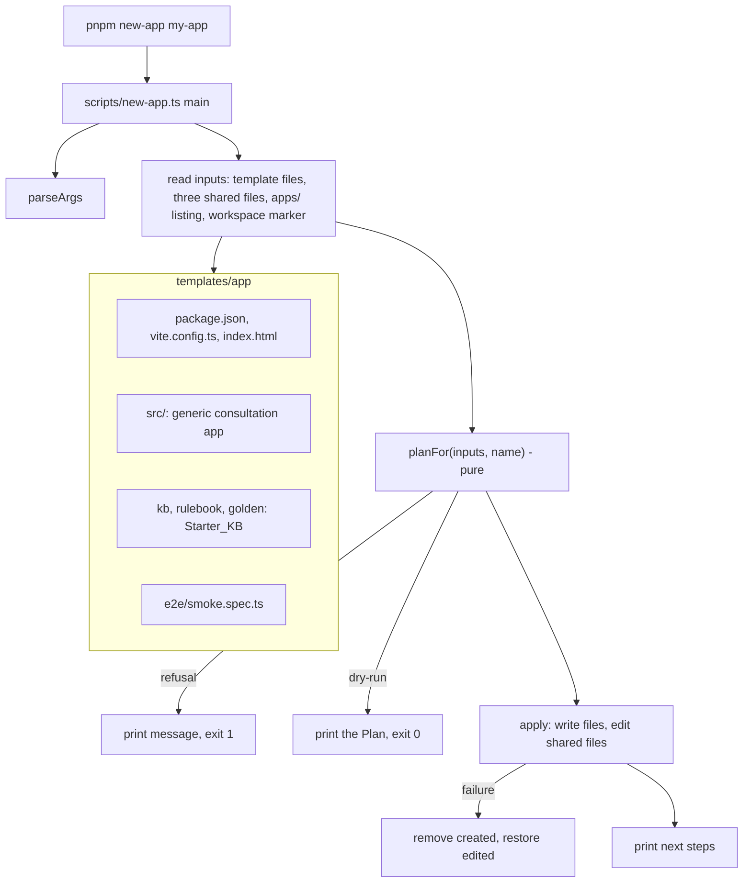

# Design Document: app-template

## Overview

`pnpm new-app <name>` copies `templates/app/` to `apps/<name>/`, substitutes four placeholders, and inserts five lines into two shared files so that Playwright and CI know about the new app, and one `PAGES` entry into a third (`packages/ui/src/site.ts`) so that the site's SEO check passes for it. Nothing else changes. After `pnpm install` the app builds, runs and passes its own smoke test.

The design has two halves with a hard seam.

- **The command** (`scripts/new-app.ts`) is a pure planner plus a thin applier. `planFor(root, name, files)` takes the text of every input and returns a Plan: files to create, lines to insert, a port. It reads and writes nothing. The applier checks the Plan against the disk, writes it, and undoes it if a write fails. Nearly all the logic, and all the property tests, sit in the planner.
- **The template** (`templates/app/`) is a generic consultation app, copied and cut down from `apps/claim-check`, with the facts, the money words and the rulebook page taken out. It is ordinary source that Biome lints. A drift test keeps it in step with Claim Check.

This spec is implemented by the Claude Code lane. The Starter_KB (three files of rules and clauses) is the one Kiro-lane deliverable (requirement 12.2).

### Findings from reading the repo

| Finding | Consequence |
| --- | --- |
| `scripts/` and `templates/` do not exist. `package.json` has no `new-app` script. | Task 1 creates both and the script entry. |
| `.kiro/steering/new-app.md` describes a layout that does not exist: it lists `src/main.tsx` only, says `deploy.yml` (the workflow is `ci.yml`), puts golden scenarios in `kb/golden.yaml` (they are in `apps/<app>/golden/scenarios.yaml`), and omits the Playwright wiring. | The steering is Kiro's. Requirement 12.3 has Kiro rewrite it after the gate. The command is the source of truth, and this spec is written from the apps, not from the steering. |
| Each Reference_App has: `package.json`, `vite.config.ts`, `index.html`, `src/` (with `main.tsx`, `config.ts`, `kb.ts`, `kbShape.ts`, `json.d.ts`, `styles.css`, `route.ts`, `useTitle.ts`, `lanes.test.ts`, `session/`, `screens/`, `verdict/`, `xray/`), `kb/`, `rulebook/`, `golden/`. Pre-Flight adds `tsconfig.json` and `collectors/`. | The Template is Claim Check's shape without `rulebook/` screens, `verdict/` money code and `xray/because.ts`'s Claim Check specifics. Pre-Flight's `tsconfig.json` is not needed: the root `tsconfig.json` includes `apps/*/src`. |
| The two apps' `package.json` files are identical apart from the name, and the scripts are `dev`, `build` (`node ../../packages/kb-tools/bin/dc.mjs build apps/<name> && vite build`, changed at the gate G5 review from `pnpm -w run dc build ...`: that form rebuilds kb-tools' `dist` in every package, and parallel rebuilds delete `dc.mjs` under each other) and `preview`. All versions are exact. | The Template's `package.json` is Claim Check's with placeholders. The drift test compares them (requirement 7). |
| `vite.config.ts` sets `base: "/dead-certain/<name>/"` and nothing else. `index.html` preloads three font files from `packages/ui/node_modules/@fontsource/...` (Sans 400, Sans 600, Serif 600). | The Template copies both, with the base and the title as the only differences. |
| `playwright.config.ts` exports `CLAIM_CHECK_URL` and `PRE_FLIGHT_URL` (ports 4174 and 4175), and has one `webServer` entry for each app, built with `pnpm --filter ... build` and previewed with `--strictPort`. | The command inserts one constant and one entry, with the next port. The Markers go where a person adding the third would add it. |
| `ci.yml` has `pnpm dc build apps/claim-check` and `apps/pre-flight` before `pnpm check`, because the apps import `kb/dist`, which is not committed. It copies each app's `dist` into `apps/site/dist/<app>` after `pnpm build`. | The command inserts one `dc build` line and one `cp -R` line. |
| `pnpm dc build apps/<name>` needs a `kb/*.yaml` file to compile. A scaffolded app with no knowledge base cannot build. | The Template ships the Starter_KB. Without it "runs from the README alone" is not true. |
| In CI, `pnpm install` implies `--frozen-lockfile`, and a new workspace package changes `pnpm-lock.yaml`. | The Scaffold_Job turns the frozen lockfile off for its installs with a runner-only `.npmrc` (requirement 9.1). The README tells a person to commit the lockfile (requirement 10.7). |
| Root `vitest.config.ts` includes `packages/**` and `apps/**` tests only, and `tsconfig.json` includes no `scripts`. | Requirement 11.2: add `scripts/**/*.test.ts` and `scripts` to them. Root configuration is Claude Code's. |
| The deployed site has `/kit/`, `/assets/` and the two apps at its root. | The reserved names (requirement 2.2). |
| `apps/claim-check/src/lanes.test.ts` names the two apps in a regular expression. It is a CI-only test that skips locally. | The Template's copy names `apps/__APP_NAME__/`. It does not guard the Template itself. |
| Claim Check's `package.json` and Pre-Flight's both depend on `@dead-certain/kb-tools` as a dev dependency, only so that `dc` is on the path. | The Template keeps it, for the same reason. |

## Architecture



### Modules

| Module | Responsibility | Pure? |
| --- | --- | --- |
| `scripts/new-app.ts` | Entry. Parse arguments, read the inputs, call the planner, apply or print. Declares the few Node names it uses. | no |
| `scripts/new-app/args.ts` | `parseArgs(argv)` returns `{ name, dryRun }` or a usage error | yes |
| `scripts/new-app/name.ts` | `validateName(name, taken)` and the reserved list; `titleOf`, `constOf` | yes |
| `scripts/new-app/plan.ts` | `planFor(inputs, name)` returns a `Plan` or a `Refusal` | yes |
| `scripts/new-app/substitute.ts` | `substitute(text, values)` | yes |
| `scripts/new-app/markers.ts` | `insertAtMarker(text, marker, line)` and `nextPort(playwrightText)` | yes |
| `scripts/new-app/apply.ts` | `apply(plan, fs)`: write with rollback, over an injected `Fs` | no (injected) |
| `scripts/new-app/print.ts` | `formatPlan(plan)`, `nextSteps(plan)` | yes |
| `scripts/readme-block.ts` | `extractBlock(readme)`: the commands under "Add a third app". Its command line refuses a name `validateName` refuses, because the output is piped to a shell. Used by the Scaffold_Job. | yes (the command line is not) |
| `templates/app/**` | See the table below | n/a |
| `.github/workflows/ci.yml` | New job `scaffold`, and two Markers | n/a |

### The Plan

```ts
interface Inputs {
  templateFiles: { path: string; text: string }[];      // paths relative to templates/app
  playwright: string;                                    // text of playwright.config.ts
  ci: string;                                            // text of ci.yml
  existingApps: string[];                                // names under apps/
  packageNames: string[];                                // workspace package names
}
interface Plan {
  name: string; title: string; slugConst: string; port: number; url: string;
  create: { path: string; text: string }[];              // repo-relative, never existing
  edits: { path: "playwright.config.ts" | ".github/workflows/ci.yml"; before: string; after: string; inserted: string[] }[];
}
type Refusal = { code: "BAD_NAME" | "RESERVED" | "EXISTS" | "MARKER" | "PATH"; message: string };
```

`planFor` checks the name (requirements 2.1 to 2.3), substitutes every Template file, maps the paths (requirement 3.2), refuses a path outside `apps/<name>/` or `e2e/` (requirement 8.1), finds each Marker exactly once (requirement 2.4), allocates the port, and builds the edits. It returns `before` and `after` text so the applier can restore a file without a second read.

### Template content

| Template path | Becomes | Notes |
| --- | --- | --- |
| `package.json` | `apps/<name>/package.json` | Claim Check's, with `@dead-certain/__APP_NAME__`, the same scripts (the `build` script runs `dc.mjs` directly, as the Reference_Apps' do) and the same pins |
| `vite.config.ts` | `apps/<name>/vite.config.ts` | `base: "/dead-certain/__APP_NAME__/"` |
| `index.html` | `apps/<name>/index.html` | Title `__APP_TITLE__`. The three font preloads as in Claim Check (the drift test requires it). |
| `src/main.tsx` | same | Mount, hash route, `AppShell`, the screens |
| `src/config.ts` | same | The only file that names facts and goals (see below) |
| `src/kb.ts`, `src/kbShape.ts`, `src/json.d.ts` | same | `kb.ts` imports `../kb/dist/starter.json` |
| `src/styles.css` | same | The kit's stylesheet and `@source "./"`, as Claim Check |
| `src/route.ts`, `src/useTitle.ts` | same | Fragment routes `#/` and anything else as not found |
| `src/session/{path,replay,store}.ts` | same | Copied from Claim Check, with skipped-notes and what-if left out |
| `src/screens/{Start,Consult,Verdict,Xray,LoadFailure,NotFound,Stale}.tsx` | same | Generic, see below |
| `src/screens/CopyLink.tsx` | same | The "Copy link to this verdict" control, used by `Verdict`. Added in the build. |
| `src/session/progress.ts` | same | `progress(kb, answers, currentFact)`: the position and the upper bound of questions left, for `Consult`'s progress line. Added in the build. |
| `src/lanes.test.ts` | same | The lane guard, with this app's folder |
| `src/session/*.test.ts` | same | Session, replay and path tests, carried over |
| `kb/starter.yaml`, `rulebook/starter.md`, `golden/scenarios.yaml` | same | The Starter_KB (Kiro lane) |
| `kb/open-questions.md` | same | One line: "None." The agent fills it in when it works. |
| `e2e/smoke.spec.ts` | `e2e/__APP_NAME__-smoke.spec.ts` | The smoke test (requirement 6.6) |

A `README.md` inside the app is not part of the Template: the root README holds the instruction.

### The generated app

It is Claim Check with the domain taken out. The seams:

- `src/config.ts` is the one place with names:

```ts
// The only module that names a fact or a goal (requirement 5.3).
import compiled from "../kb/dist/starter.json";
export const config = {
  /** The goal whose value is the verdict word, such as `paid` or `ready`. Change it when the rules change. */
  verdictGoal: "outcome",
} as const;
export const compiledKb: unknown = compiled;
```

The literal `"outcome"` is the Starter_KB's goal name. The Kiro-lane pull request sets it to the real one, since it is a literal and not a Placeholder. `kbShape.ts` checks that `verdictGoal` is one of the knowledge base's goals, and shows the load-failure notice if not.

- `session/store.ts` is Claim Check's reducer without `skipped`, `changed` and `rejected` handling beyond a message under the field. The engine's `start`, `answer`, `next`, `encode` and `decode` do the work. `session/path.ts` (replay the answers through `next` to get the question order, so Back works) is copied unchanged.
- `Consult.tsx` shows `QuestionCard` with `AnswerControl` for the fact's type, the `why` and the clause through `ClauseRef`, Back, Continue, and the progress line "Question 3. Up to 6 more." as in section 8.
- `Verdict.tsx` shows: when the verdict goal's value is a word `verdictStateFrom` knows, `VerdictHeadline` with it; otherwise an `<h1>` "Result" and the goal values. Then each other goal as a labelled value, and the line items as rows with the rule id, the clause and "See why". It has "See why" on the verdict itself, "Copy link to this verdict", and "Start over". No ledger, no proportion bar, no what-if.
- `Xray.tsx` is Claim Check's film body with the tree, the clause quote and "Change this answer", and no `because`-printing special case beyond what the engine returns.
- The start screen names the app (`__APP_TITLE__`), says what it decides from `kb.id` and the first goal's label, has "Start", and holds the one-line pointer of requirement 5.12.

The template carries no money formatting beyond what the kit's `formatValue` does with the knowledge base's currency.

### The Starter_KB

Written by the Kiro lane. Proposed domain: a library fine. Three or four askable facts (days late, member type, whether the item was a reference book, whether a waiver card is held), one derived fact (the fine before the cap), a cap, two line items with `role: deduction`, one goal `outcome` with the values `paid` or `waived` (so that `VerdictHeadline` has no state for it and the plain path is the one exercised) or, if the human chooses, `ready` and `not_ready` for the headline path. This choice follows open questions 2 and 4 in the requirements and is settled in the Kiro-lane pull request. The golden scenarios cover each rule. `rulebook/starter.md` is under one page.

### Marker edits

`insertAtMarker(text, marker, line)` finds the single line that contains `new-app:<marker>`, and inserts `line` on its own line before it, with the marker line's leading whitespace. It refuses if there are zero or two such lines. Every other byte is untouched, so the result minus the inserted line equals the input (Property 4).

| Marker | File | Line inserted |
| --- | --- | --- |
| `new-app:urls` | `playwright.config.ts` | `export const <SLUG>_URL = "http://localhost:<port>/dead-certain/<name>/";` with a comment line above it |
| `new-app:servers` | `playwright.config.ts` | One object: `command`, `url`, `reuseExistingServer`, as a multi-line entry. It is inserted as a unit (several lines, one marker) |
| `new-app:dc-build` | `ci.yml` | `- run: pnpm dc build apps/<name>` |
| `new-app:copy` | `ci.yml` | `- run: cp -R apps/<name>/dist apps/site/dist/<name>` |
| `new-app:pages` | `packages/ui/src/site.ts` | One `PAGES` entry (key from `keyOf(name)`, noindex, fixed description), inserted as a unit with the marker's indentation. The planner refuses (`EXISTS`) when `PAGES` already has the key or the path |

A marker is a comment (`// new-app:urls` and `# new-app:dc-build`), so the Markers cost nothing at run time. `nextPort` reads every `localhost:<digits>` in `playwright.config.ts`, and returns the maximum plus one (4176 today). If there are none, it returns 4174.

### Apply and undo

`apply(plan, fs)` where `Fs` is `{ readFile, writeFile, mkdir, rm, exists }`: create the directories (recording each one it made), write the new files (recording each), then write the edited shared files (keeping `before`). On any failure it removes what it recorded, in reverse order, rewrites each shared file from `before`, and rethrows. A test with a failing `Fs` that fails on the n-th write, for every n, ends with the file system equal to its start (Property 6).

### The Scaffold_Job

```yaml
scaffold:
  runs-on: ubuntu-latest
  steps:
    - uses: actions/checkout@v4
      with: { fetch-depth: 0 }
    - id: changes            # path filter: on a pull request, run only when the inputs change
      env: { BASE: "${{ github.base_ref }}" }
      run: |
        if [ -z "$BASE" ] || git diff --name-only "origin/$BASE...HEAD" | grep -qE '^(scripts/|templates/|README\.md$|playwright\.config\.ts$|\.github/workflows/ci\.yml$)'; then
          echo "run=true" >> "$GITHUB_OUTPUT"
        fi
    # Each later step has: if: steps.changes.outputs.run == 'true'
    - uses: pnpm/action-setup@v4
    - uses: actions/setup-node@v4
      with: { node-version-file: .nvmrc, cache: pnpm }
    # A new workspace package changes pnpm-lock.yaml, which pnpm refuses under CI=true.
    # pnpm 10 ignores the environment variable there, so write a project .npmrc on the runner only.
    - run: echo "frozen-lockfile=false" >> .npmrc
    - shell: bash          # adds -o pipefail, so a missing README block fails the step
      run: node --experimental-strip-types scripts/readme-block.ts ci-probe | sh -e
    - run: pnpm dc validate && pnpm dc golden && pnpm dc build
    - run: pnpm check && pnpm build
    - run: pnpm exec playwright install --with-deps chromium
    - run: pnpm exec playwright test --project=1280 e2e/ci-probe-smoke.spec.ts
```

`scripts/readme-block.ts <name>` prints the commands of the README_Block with `my-app` replaced by `<name>`, and exits 1 if the block is missing. The job pipes it to a shell with `-e`. `pnpm check` on the scaffolded repo covers the new app's unit tests, Biome and `tsc`, because the app now sits in the workspace. The path filter (decided, question 7) is the `changes` step above, in the same file, since `paths:` on the trigger would apply to the whole workflow. On main there is no base, so the job always runs. When no input changed, the job ends green with its later steps skipped.

### The README section

````md
## Add a third app

```sh
pnpm install
pnpm new-app my-app
pnpm install
```

### Run it

```sh
pnpm --filter @dead-certain/my-app dev
```
````

The sentences around it follow requirement 10. The Scaffold_Job runs the first block with `ci-probe`, so the README cannot drift from the command. It cannot run the dev server, which never ends. The Playwright smoke spec runs the same built app through `vite preview`, and the dev server's one difference, hot reload, is not part of the claim.

## Data Models

### Name rules

| Rule | Value |
| --- | --- |
| Pattern | `^[a-z][a-z0-9]*(-[a-z0-9]+)*$` |
| Length | 2 to 30 |
| Reserved | `site`, `kit`, `assets`, `templates`, `index`, `404` |
| Title | Each hyphen-separated word capitalised, joined by spaces: `loan-check` gives `Loan Check` |
| Constant | Upper case, hyphens to underscores: `LOAN_CHECK` |

### Refusal messages

Each message names the cause and the next step, in sentence case, with no apology. Examples: `"loan_check" is not a valid app name. Use lower-case words joined by hyphens, such as "loan-check".` and `apps/loan-check already exists. Choose another name or remove the folder.`

## Error Handling

| Condition | Result |
| --- | --- |
| Bad arguments | Usage on standard error, exit 2, nothing written |
| Name invalid, reserved or taken | Message, exit 1, nothing written |
| Marker missing or doubled | Message naming the file and the Marker, exit 1, nothing written |
| A Template file has a `__APP_` token the command does not know | `PATH`-class refusal naming the file, exit 1 (a typo in a Template file never reaches an app) |
| A write fails | Rollback, message with the cause, exit 1 |
| No workspace root | Message, exit 1 |

## Correctness Properties

*A property holds for every valid input. These are checked with fast-check on the pure modules, against the real Template files and the real shared files, and once end to end in the Scaffold_Job.*

### Property 1: Names are decided totally and consistently

*For any* string, `validateName` returns a result and never throws. *For any* string it accepts, the Title and Constant are non-empty, the Constant matches `^[A-Z][A-Z0-9_]*$`, the name is not reserved, and the folder `apps/<name>`, the URL path `/dead-certain/<name>/` and the package `@dead-certain/<name>` are free of `/`, `\`, `.`, `%`, whitespace and control characters.

**Validates: Requirements 2.1, 2.2, 2.8, 3.7**

### Property 2: Substitution is complete and local

*For any* valid name, `substitute` over every Template file leaves no `__APP_`, changes no byte outside a Placeholder, and `planFor` creates only paths that start with `apps/<name>/` or are `e2e/<name>-smoke.spec.ts`.

**Validates: Requirements 3.2, 3.3, 3.6, 8.1, 8.2**

### Property 3: The Plan is deterministic and refuses a collision

*For any* valid name, `planFor` called twice on the same inputs returns equal Plans. WHEN the name is in `existingApps`, or a created path exists, or a shared file already holds the URL constant, it returns a refusal and no Plan.

**Validates: Requirements 2.3, 2.5, 2.7**

### Property 4: A marker edit changes one thing

*For any* text that holds a Marker exactly once, and any inserted line, `insertAtMarker` returns text equal to the input with the inserted lines added immediately before the Marker line, each with the Marker's indentation. *For any* text with no Marker or two, it refuses.

**Validates: Requirements 2.4, 6.4**

### Property 5: Ports are unique and increasing

*For any* `playwright.config.ts` text with ports, `nextPort` returns a number greater than every port in it, and after the edit the file holds the new port exactly once.

**Validates: Requirements 6.1, 6.2**

### Property 6: A failed apply leaves nothing behind

*For any* Plan and any failing write position, `apply` ends with the file system, including all three shared files, equal to its state before the call.

**Validates: Requirements 2.6**

### Property 7: Dry run changes nothing

*For any* valid name, running with `--dry-run` writes no file, and its printed Plan lists exactly the paths and inserted lines that a real run creates.

**Validates: Requirements 1.4, 1.7**

### Property 8: The Generated_App's session round-trips

*For any* answers valid for the Starter_KB, the app's fragment (`#/?r=<token>`) decodes to the same answers and the same verdict, and the question order from `path.ts` never asks a known fact.

**Validates: Requirements 5.4, 5.7**

### Property 9: The Template follows Claim Check

*For any* package name that both `package.json` files hold, the versions are equal, the Template pins exactly, and the two sets of names are equal.

**Validates: Requirements 7.1, 7.2, 7.3**

## Testing Strategy

| Layer | Tool | What |
| --- | --- | --- |
| Planner, markers, names, substitution | Vitest and fast-check 4.10.2, `scripts/**/*.test.ts`, `*.props.test.ts`, at least 100 runs, tagged `// Feature: app-template, Property N: <title>` | Properties 1 to 7, with the real Template and shared files as inputs |
| Apply | Vitest with an in-memory `Fs` that fails at the n-th write | Property 6, and the success path |
| Drift | Vitest | Property 9 and requirement 7.4, with an allowed-differences table in the test |
| Generated app, pure | Vitest | `session/`, `kbShape.ts`, `route.ts`, from the Template, run once through the Scaffold_Job's `pnpm check` |
| Generated app, screens | Playwright smoke spec (requirement 6.6) at 390, 768, 1280 and reduced motion | The flow and axe |
| Whole thing | The Scaffold_Job | The README, as written, end to end |
| Reference apps | The existing suites | Unchanged (requirement 11.5) |

The Template's own unit tests are Template files: they are copied into every app, so each app carries the tests of its session code. The root `pnpm check` does not run them in `templates/` (the root Vitest config does not include it), and the Scaffold_Job runs them in the scaffolded copy.

### The Template is tested in place before it is copied

Task 1 adds a test, `scripts/template.test.ts`, that runs `planFor` for a fixed name over the real `templates/app/` files, writes the result to a temporary directory, and runs Biome over it. A Template file that does not lint fails here, on every `pnpm check`, not in the Scaffold_Job.

## Design decisions

| Decision | Alternatives | Why this one |
| --- | --- | --- |
| Marker comments in two shared files | Make Playwright and CI discover `apps/*`; let the command rewrite whole files; patch with a diff | The edit is five lines and shows in the diff. Discovery means changing wiring that works (open question 3). |
| The command writes no `pnpm-lock.yaml` and runs no install | Run `pnpm install` inside the command | A child process is a new failure mode and a network call. The README runs the install, and the job shows it works. |
| Planner returns the whole result before any write | Write as it goes | Refusals leave nothing behind, and rollback is only for disk failures. |
| The Starter_KB ships in the Template | Generate an empty app, tell the person to run the agent first | The app must run at once. A person sees a verdict before they write a rule. |
| A generic verdict screen | Claim Check's ledger and bar | Those depend on money facts and role semantics the template cannot assume. The kit's headline is used when the goal word allows it. |
| `config.ts` names the goal | Take the first goal | An app with several goals needs to say which one is the verdict. One file, one line. |
| A drift test against Claim Check | Generate the Template from Claim Check at build time | A generated Template cannot be read or linted as itself. A test is cheaper and catches the same drift. |
| Reserved names in the planner | Rely on the folder check | `kit` and `assets` do not exist under `apps/` but collide on the deployed site. |
| `readme-block.ts` feeds the Scaffold_Job | Repeat the commands in the workflow | One copy of the instruction means the README is what is tested. |
| A runner-only `.npmrc` turns the frozen lockfile off | `PNPM_CONFIG_FROZEN_LOCKFILE`, `npm_config_*`, user config | pnpm 10 ignores all of those under `CI=true`. The first CI run showed it. A project `.npmrc` is read, and the job never commits it. |
| `fast-check` as a root dev dependency | Import the app's copy from `scripts/` | `scripts/` is outside every workspace package and cannot resolve the app's copy. Same pin, a section 7 package. |
| Node's `--experimental-strip-types` for the script | `tsx`, or compile the script | The repo already runs `record.ts` this way and adds no dependency. That file imports only `node:fs`. A script of several modules must import them with explicit `.ts` extensions, which `tsc` accepts only with `allowImportingTsExtensions` (safe here, since `noEmit` is on). Task 1 adds that option to the root `tsconfig.json`. |
