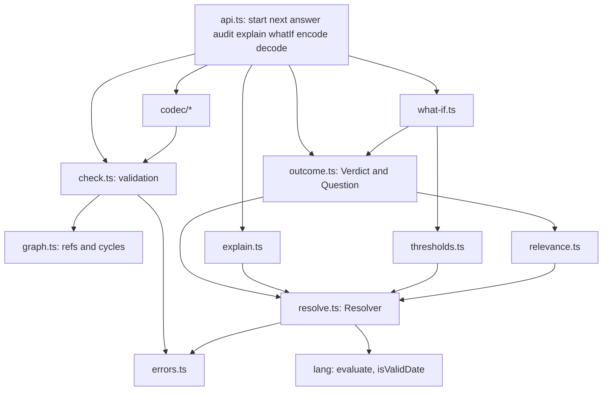
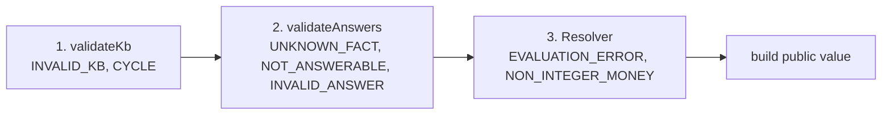
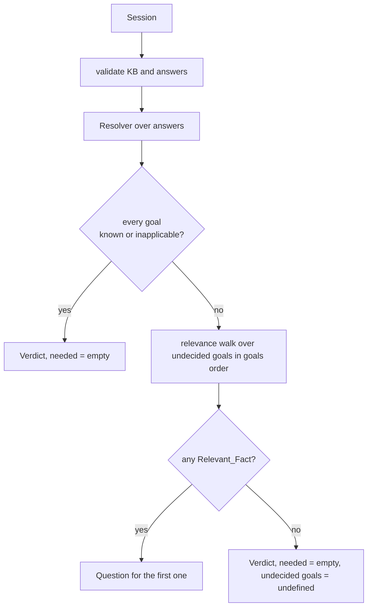

# Design Document: inference-engine

## Overview

The inference engine is the deterministic decision core of Dead Certain. It implements the `EngineApi` contract in `packages/engine/src/types.ts` and exports eight functions from `packages/engine/src/index.ts`: `start`, `next`, `answer`, `audit`, `explain`, `whatIf`, `encode` and `decode`. It builds on the finished rule language in `packages/engine/src/lang` (`parse`, `print`, `evaluate`, `isValidDate`, `compareDates`).

What I read before designing, and what it implies:

| Source | Finding | Consequence for the design |
| --- | --- | --- |
| `types.ts` | `FactDef` has no `label`; `Session`, `Question`, `LineItem`, `Verdict`, `ProofNode`, `Alternative` are fixed. | The single change this spec makes is `readonly label?: string` on `FactDef` (Requirement 23, criteria 8 and 12). The `Expr` union, `BinaryOp`, `BuiltinFn`, `Unknown` and `UNKNOWN` came from the `rule-language` spec with Claude Code's consent ([PR #4, comment 6865345893](https://github.com/chitrakumarsai/dead-certain/pull/4#issuecomment-6865345893)). Everything else is untouched. |
| `lang/evaluate.ts` | `evaluate(expr, env)` is total and never throws. A name missing from `env` reads as `UNKNOWN`. `and`/`or` short-circuit with Kleene logic. `if` evaluates only the selected branch. Comparisons accept two valid dates. Errors come back as `{ ok: false }` with `DIVISION_BY_ZERO`, `TYPE_MISMATCH`, `NUMERIC_OVERFLOW` or `UNKNOWN_ERROR`. | The engine never re-implements expression semantics. It builds an environment and calls `evaluate`. An env built from lazy getters keeps `if` and short-circuit laziness for derived facts. |
| `lang/dates.ts` | `isValidDate` accepts years 1 to 9999 and real calendar days. `compareDates` is plain string comparison. | Threshold probing reuses `isValidDate` for validity and sorts dates as strings. |
| `index.ts` | Exports the lang functions, the types and `UNKNOWN`. | The new exports are added next to them. Nothing is removed or renamed (Requirement 1, criterion 3). |
| `package.json` | No `dependencies`. `fast-check` is a dev dependency with a caret range (`^4.10.2`). | Zero runtime dependencies is already true and must stay true. The caret range should be pinned to an exact version in the tooling task, because the tech rules pin versions. |

Design goals, in priority order:

1. **Correctness by construction.** All truth comes from `evaluate`. The engine only decides which expression to evaluate next and which unanswered fact matters.
2. **One resolution pass.** Every public function runs on the same internal `Resolver`. This is what makes `next`, `audit`, `explain` and `whatIf` agree with each other by construction.
3. **Pure and portable.** No clock, no randomness, no I/O, no module-level state, no Node-only global. The codec includes its own SHA-256 and base64url so it runs in a browser.
4. **Plain JSON at the boundary.** `UNKNOWN` never leaves the engine.

### Design decisions and where they depart from the requirements text

These are decisions I made while designing. Items 1 to 5 and item 8 change or sharpen what a requirement literally says, so the parent agent and the human should review them. They are written up here, not edited into `requirements.md`.

1. **Token payload is index-coded and type-tagged (Requirement 11, criterion 12).** Fact names up to 64 characters and string values up to 64 characters, for 64 answers, cannot fit in 2,048 characters without compression. But every valid string answer is either a date or one of the fact's `options`, and the decoder holds the Knowledge_Base. So the payload stores the index of each fact in the sorted list of the Knowledge_Base's fact names, and stores enum values as option indexes. The worst case is about 12 bytes per answer, so 64 answers fit in about 1,050 characters. Consequence: a decoded token never contains a fact name. An index outside the Knowledge_Base throws `UNKNOWN_FACT` with a message that names the index, not a name (Requirement 3, criterion 4 asks for a name; no name exists to give). A repeated or out-of-order index throws `MALFORMED_TOKEN` and names the fact when the index is in range.
2. **Check order inside `decode` (Requirement 11, criterion 10).** The order is: characters and framing, then version, then payload shape, then fingerprint, then answer errors. Payload shape is checked before the fingerprint because each answer carries a type tag, so the payload is parseable without the Knowledge_Base. A token with an unsupported version reports `UNSUPPORTED_VERSION` even if its payload would have been malformed, because the payload layout of an unknown version cannot be read.
3. **The fingerprint is order-sensitive for `facts`.** It is the first 128 bits of SHA-256 over `JSON.stringify(kb)`, with `undefined` properties dropped as JSON does. Key order is kept, not sorted, because the order of `facts` decides the order of line items and of what-if results. Two Knowledge_Bases that differ only in the key order of `facts` therefore get different fingerprints, so the same link can never silently give a re-ordered verdict. "Different fingerprint for any difference" holds with cryptographic probability, not as a mathematical guarantee. SHA-256 is implemented in pure TypeScript because `crypto` is a Node-only module and `crypto.subtle` is asynchronous.
4. **Relevance is syntactic, so Requirement 17, criterion 2 needs a constrained generator.** The engine decides what to ask by three-valued evaluation. That is exact for formulas in which each fact is read once and sound for all formulas (Requirement 17, criterion 3 holds for every Knowledge_Base). It is not minimal when a value is masked across rules or derived facts. For example, `f = if(a, 1, 2)` with goal `f > 0` makes `a` look relevant even though the goal is always true. The "no self-cancelling expressions" limit in Requirement 17, criterion 6 does not exclude this. The property test for criterion 2 therefore uses a read-once generator (each fact referenced from at most one expression position, distinct literal outputs per fact). See Testing Strategy.
5. **Error priority across answers (Requirement 13, criterion 7 versus Requirement 3, criterion 10).** One says "first offending answer in sorted order"; the other says error classes have a fixed priority. The design validates in class passes (`UNKNOWN_FACT`, then `NOT_ANSWERABLE`, then `INVALID_ANSWER`), each pass walking names in code-unit order. When all offending answers share one class, both requirements give the same result.
6. **Inapplicable derived facts feed `UNKNOWN` into dependants.** `evaluate` has no `undefined`. A derived fact whose guards are all false has public value `undefined` (Requirement 4, criterion 7) and reads as `UNKNOWN` inside expressions, so a dependant stays Unknown. If no askable fact can change that, `next` returns a Verdict with `needed` empty and the undecided goals `undefined` (Requirement 5, criterion 6).
7. **`evaluate` is called at most once per expression node per engine call.** Requirement 4, criterion 12 says once per guard and once per `to`. The resolver memoises by expression-node identity. The relevance walk calls `evaluate` only on strict sub-expressions of a guard or `to` that came back Unknown, each at most once, and never on a guard or `to` a second time.
8. **`explain` never fails where `next` succeeds (Requirement 9, criteria 14 to 17; Requirement 13, criterion 9).** The environment given to `evaluate` uses getters, so a derived fact in a branch that `evaluate` never visits is never resolved, and cannot raise an error during `next`. The Resolver records which facts the deciding evaluations read. `explain` lists every referenced fact as a child (Requirement 9, criterion 9). For a child referenced only in a Skipped_Branch, `explain` tries to resolve it and catches an `EngineError`: on an error the child is a bare node (`fact` and `source` kept, `value` `undefined`, `children` `[]`, no `rule`, `clause` or `because`); otherwise it is a full node. The parent's `value` never depends on that child. So `explain` throws only for inputs where `next` throws the same code. Example: for `if(a > 0, b / a, 0)` with `a` answered 0, the verdict succeeds and the proof shows `b` as a bare child. This replaces an earlier draft in which `explain` could throw here.
9. **`-0` is stored as `0`.** `JSON.stringify(-0)` is `"0"`, which would break the JSON round trip of Requirement 12, criterion 4. `answer` normalises negative zero to zero. The value is still equal under `===`.
10. **Own-property lookups only.** Fact names such as `constructor` or `__proto__` must behave as ordinary names. Every lookup uses `Object.hasOwn`, and every record the engine builds uses `Object.fromEntries`, which defines properties instead of assigning them.

---

## Architecture

### Module layout

All files live under `packages/engine/src`. Nothing outside `src` is imported (Requirement 23, criterion 10), and no file imports a Node module (Requirement 1, criterion 7).

```text
src/
├── index.ts              public exports (existing exports kept, new ones added)
├── types.ts              contract; this spec's only change: FactDef.label? (rule-language additions are the baseline)
├── api.ts                the eight functions; `satisfies EngineApi` type check
├── errors.ts             EngineError, ErrorCode
├── check.ts              validateKb, validateAnswers, checkValue, normalise
├── graph.ts              factRefs(expr), dependency graph, cycle search
├── resolve.ts            Resolver: lazy, memoised rule resolution
├── relevance.ts          walk that finds the Relevant_Facts, in order
├── outcome.ts            evaluateSession -> Outcome; builds Question and Verdict
├── explain.ts            proof trees
├── what-if.ts            candidate generation and verdict comparison
├── thresholds.ts         probe collection and Threshold_Candidates
├── calendar.ts           pure day-number arithmetic for dates
├── util.ts               deepEqual, deriveLabel, clip
├── codec/
│   ├── encode.ts         encode, decode
│   ├── sha256.ts         pure SHA-256
│   ├── base64url.ts      pure base64url without padding
│   └── bytes.ts          canonical varints, float64, writer and reader
├── lang/                 existing rule language (unchanged)
└── testkit/              test-only: generators, reference interpreter, walker
```

`testkit/` holds fast-check generators, a small reference interpreter and the public-value walker. It is imported by test files only and is not re-exported from `index.ts`. The Node-import and Node-global check of Requirement 1, criterion 7 must treat `testkit/` as test code.

### Dependency picture



### One pipeline for every function

Every function that reads a session follows the same three steps, in this order. The order is the error-priority order of Requirement 13, criterion 7.



`next` and `audit` share `evaluateSession`. `audit(kb, facts)` is `evaluateSession(kb, facts)` followed by a Verdict. `next(s)` is `evaluateSession(s.kb, s.answers)` followed by either a Question or a Verdict. Mode agreement (Requirement 19) therefore reduces to "both call the same function on the same inputs", and the property tests prove that nothing in the wrappers breaks it.

### How `next` decides



`audit` takes the same branches, except that in the "yes" case it returns a Verdict whose `needed` holds one Question per Relevant_Fact.

### Research notes

No external research was needed for the engine logic. It is fixed by the requirements and the existing evaluator. Three implementation choices were checked against the standards instead of memory:

- Base64url without padding is the alphabet of RFC 4648 section 5 (`A-Z a-z 0-9 - _`), which matches Requirement 11, criterion 1.
- SHA-256 follows FIPS 180-4; the unit test uses the published vectors for the empty string and for `abc`.
- Date arithmetic uses the proleptic Gregorian day-number algorithm, so it never touches `Date`, which maps years 0 to 99 to 1900 to 1999 in `Date.UTC`.

---

## Components and Interfaces

### `errors.ts`

```ts
export type ErrorCode =
  | "INVALID_KB" | "CYCLE" | "UNKNOWN_FACT" | "NOT_ANSWERABLE"
  | "INVALID_ANSWER" | "EVALUATION_ERROR" | "NON_INTEGER_MONEY"
  | "MALFORMED_TOKEN" | "UNSUPPORTED_VERSION" | "KB_MISMATCH";

export class EngineError extends Error {
  readonly code: ErrorCode;
  constructor(code: ErrorCode, message: string);      // message clipped to 500 characters
  toJSON(): { name: "EngineError"; code: ErrorCode; message: string };
}
```

`message` and `stack` of an `Error` are not enumerable, so `JSON.stringify(new Error())` loses the message. `toJSON` restores `code` and `message` (Requirement 13, criterion 6). `index.ts` exports `EngineError` and `ErrorCode` (Requirement 1, criterion 4).

### `check.ts`: validation

```ts
validateKb(kb: KnowledgeBase): void;
validateAnswers(kb: KnowledgeBase, answers: Readonly<Record<string, unknown>>): void;
checkValue(kb: KnowledgeBase, fact: string, value: unknown): void;  // one answer
normaliseValue(value: FactValue): FactValue;                         // -0 -> 0
```

`validateKb` checks in this order and throws on the first failure:

1. each name in `goals` is an own key of `facts`, else `INVALID_KB` naming the goal;
2. each rule's `set` is an own key of `facts`, else `INVALID_KB` naming the rule id;
3. no cycle (`graph.ts`), else `CYCLE` naming every fact on it.

`validateAnswers` runs three passes over the answer names, sorted by code-unit order: unknown names, then derived names, then bad values. `checkValue` accepts exactly the combinations of Requirement 3, criterion 7. It treats `undefined`, `null`, symbols and the `UNKNOWN` symbol as `INVALID_ANSWER` for every type (Requirement 3, criterion 8). A `date` is checked with `isValidDate`. An `enum` is checked with `options.includes`, which is exact and case-sensitive.

A fact that is an own key of `facts` but has no `ask` is still a legal answer target if it is not derived. Only derived facts are refused.

### `graph.ts`: references and cycles

```ts
factRefs(expr: Expr): string[];      // distinct fact names, in first-reference order, left to right
findCycle(kb: KnowledgeBase): string[] | undefined;
```

`factRefs` walks the expression left to right: `binary` left then right, `call` arguments in order, `unary` operand. Its order is what makes proof-tree children and relevance order deterministic.

`findCycle` builds edges `rule.set -> every fact in factRefs(rule.when) and factRefs(rule.to)`, in rule order. It runs a depth-first search from each fact in `Object.keys(kb.facts)` order, with white, grey and black marks, iteratively so a deep chain cannot overflow the call stack. A grey hit returns the path from the first repeated fact. Self-edges are cycles. Names referenced in expressions but not declared in `facts` are leaves with no outgoing edges; declaring them is the kb-tools validator's job.

### `resolve.ts`: the Resolver

The Resolver is created once per engine call. It is the only place that calls `evaluate` for rules.

```ts
type Slot = FactValue | Unknown;

interface Resolution {
  readonly status: "known" | "unknown" | "inapplicable";
  readonly value: Slot;                 // UNKNOWN unless status is "known"
  readonly deciding: Rule | undefined;  // set for known, and for unknown with a deciding rule
  readonly tried: readonly Rule[];      // rules whose guard was evaluated, in order
}

class Resolver {
  constructor(kb: KnowledgeBase, answers: Readonly<Record<string, FactValue>>);
  wasRead(name: string): boolean;                       // true when an evaluation read this fact (backed by a private `reads` set)
  fact(name: string): Resolution;                       // memoised by name
  expr(e: Expr, ruleId: string): Slot;                  // memoised by node identity
  guard(rule: Rule): boolean | Unknown;                 // true when the rule has no `when`
}
```

`fact(name)`:

- Not derived: `known` with the answered value when `name` is an own key of `answers`, else `unknown`.
- Derived: iterate the rules whose `set` equals `name`, in `kb.rules` order:
  - `g = guard(rule)`; push the rule onto `tried`.
  - `g === false`: continue.
  - `g === UNKNOWN`: return `unknown`, no deciding rule (Requirement 4, criterion 6).
  - `g === true`: `v = expr(rule.to)`. If the fact's type is `money` and `v` is a finite non-integer number, throw `NON_INTEGER_MONEY` naming the rule id and the fact (criteria 14 to 16). If `v` is `UNKNOWN`, return `unknown` with `deciding = rule` (criterion 8). Otherwise return `known` with `deciding = rule`.
  - After the loop, return `inapplicable` (criterion 7).
- A name that is not an own key of `facts` (an undeclared reference inside an expression) resolves as `unknown` with no rules. It cannot be asked, so it never becomes relevant.

`expr(e, ruleId)` builds an environment and calls `evaluate`:

```ts
const env = Object.create(null) as Record<string, Slot>;
for (const name of factRefs(e)) {
  Object.defineProperty(env, name, {
    enumerable: true,
    get: () => { this.reads.add(name); return toSlot(this.fact(name)); },   // resolves only if evaluate reads it
  });
}
const r = evaluate(e, env);
if (!r.ok) throw new EngineError("EVALUATION_ERROR", `Rule ${ruleId}: ${r.error.code}`);
```

Getters make evaluation lazy exactly where `evaluate` is lazy: the unselected branch of `if` and the right side of a short-circuited `and`/`or` are never read, so facts only they mention are never resolved. `toSlot` maps `known` to its value and `unknown` or `inapplicable` to `UNKNOWN`. Because `evaluate` returns `NUMERIC_OVERFLOW` for non-finite results, a `NaN` or infinity can never reach a public value (Requirement 12, criterion 3).

The null-prototype environment is internal. It is never returned.

### `relevance.ts`: which questions matter

```ts
interface Relevant { readonly fact: string; readonly clause: string | undefined; }
function findRelevant(r: Resolver, kb: KnowledgeBase, goals: readonly string[]): Relevant[];
```

The walk is the one in Requirement 5, criterion 3. It keeps a `visited` set so each fact is reported once, in first-reached order.

```text
visitFact(name, viaRule):
  def = kb.facts[name]
  if def is not derived:
      if unanswered and def.ask is defined: report(name, viaRule?.cite)   // once
      return
  if visited(name) or r.fact(name).status != "unknown": return
  mark visited
  for rule of rules for name, in kb.rules order:
      if r.guard(rule) === false: continue          // skipped rule: its `to` is irrelevant
      visitExpr(rule.when, rule)                    // guard operands, left to right
      visitExpr(rule.to, rule)                      // then `to` operands, left to right
      break                                         // later rules are not tried

visitExpr(e, rule):
  v = r.expr(e, rule.id)
  if v is not UNKNOWN: return                       // settled: nothing under it matters
  switch e.kind:
    fact:   visitFact(e.name, rule)
    unary:  visitExpr(e.operand, rule)
    binary: visitExpr(e.left, rule); visitExpr(e.right, rule)
    call "if": c = r.expr(args[0]);
               if c is UNKNOWN: visitExpr(args[0]) else visitExpr(c ? args[1] : args[2])
    call other: visit each argument in order
```

Why this satisfies the requirements:

- **Short-circuit (Requirement 5, criterion 4).** `visitExpr` returns at once for any settled sub-expression. In `false and x` the whole expression is settled, so `x` is never visited. In `a and b` with `a` Unknown and `b` false, `b` is settled and `a` is not visited, which matches `evaluate` returning `false`.
- **Guard first, then `to` (Requirement 5, criterion 3).** A rule with an Unknown guard also visits its `to`: the `to` operands matter once the guard turns true. A rule whose guard is `true` has a settled guard, so only `to` operands are found.
- **Clause (Requirement 6, criterion 4).** `report` stores the `cite` of the rule through which the fact was first reached. A goal that is itself askable has no rule, so its `clause` is omitted (criterion 6).
- **Unselected branch of `if`.** Only the selected branch is visited, mirroring `evaluate`'s laziness.

`evaluate` is called here only on strict sub-expressions of a guard or `to` that was already evaluated and came back Unknown. Each is memoised by node identity.

### `outcome.ts`: Verdict and Question builders

```ts
interface Outcome {
  readonly resolver: Resolver;
  readonly undecidedGoals: readonly string[];
  readonly relevant: readonly Relevant[];     // empty when every goal is decided
}
function evaluateSession(kb: KnowledgeBase, answers: Readonly<Record<string, FactValue>>): Outcome;
function buildQuestion(kb: KnowledgeBase, rel: Relevant): Question;
function buildVerdict(kb: KnowledgeBase, o: Outcome): Verdict;
```

A goal is decided when its resolution is `known` or `inapplicable`.

`buildQuestion` creates a fresh object with keys in this order: `kind`, `fact`, `text`, then `why` and `clause` only when present (Requirement 6, criteria 5, 6 and 8). `text` is the fact's `ask`. A relevant fact always has `ask`, because `visitFact` reports only facts with `ask`.

`buildVerdict` creates:

- `goals`: one key per goal in `goals` order, each `undefined` unless the goal is `known`. Keys with `undefined` values are kept (Requirement 12, criterion 5).
- `lineItems`: one item per fact in `facts` order whose `role` is `deduction` or `check`, with:
  - `label = def.label ?? deriveLabel(name)` (Requirement 7, criteria 5 and 6);
  - `value` from the resolution, `undefined` unless known;
  - `rule` and `clause` from the deciding rule; otherwise, when the resolution is `unknown`, from the last element of `tried`, which is by construction the first rule whose guard is not false (criterion 9); otherwise `""` and `""` (criteria 10 and 11).
- `needed`: empty when every goal is decided. Otherwise `o.relevant.map(buildQuestion)`. For `next`, only the first element is used, as a Question.

`deriveLabel(name)` replaces each `_` with one space, then upper-cases the first code point with `toUpperCase()` (locale-independent) and leaves the rest unchanged.

### `explain.ts`: proof trees

```ts
function explain(s: Session, fact: string): ProofNode;
```

After validation, `node(name)` is memoised per call and builds:

- Non-derived fact: `{ fact, value, source: "answered", children: [] }`. `value` is the answer or `undefined`. The engine never returns `"collected"` (Requirement 9, criterion 3).
- Derived fact: `{ fact, value, source: "derived", [rule, clause, because], children }`.
  - With a deciding rule: `rule` and `clause` come from it, and `because` is the rule's sentence with placeholders filled. Without one, those three keys are omitted (criterion 8).
  - `children` has one entry per name in the ordered union of `factRefs(rule.when)` for every rule in `tried`, then `factRefs(deciding.to)`. Duplicates keep their first position (criterion 9). No tried rule gives `[]` (criterion 10). An entry is `node(name)` when `resolver.wasRead(name)` is true. Otherwise the name was referenced only in a Skipped_Branch, and the entry is `node(name)` inside a `try`: when it throws an `EngineError`, the entry is the bare node `{ fact, value: undefined, source, children: [] }` with `source` `"derived"` or `"answered"` from the fact's definition (criterion 14). Any other exception propagates. A memoised result is never stored for a failed fact.
  - A fact that a skipped position and an evaluated position both reference counts as read, and gets a full node.

`because` fill uses one regular-expression pass over `{name}` with `[^{}]*` as the name. A name that is an own key of `facts` is replaced with `String(value)` of its resolved value, or with `unknown` when the value is Unknown or inapplicable. Any other `{...}` text is left as it is (criteria 6 and 7). One pass means substituted text is never expanded again.

`explain` runs the same validation and the same deciding evaluations as `next` for the session, so it throws exactly the codes `next` throws for the same inputs and no others (criterion 15; Requirement 13, criterion 9). The only resolution `explain` adds beyond `next` is the guarded one for skipped children, and its errors are caught.

The returned tree has finite depth because the Knowledge_Base is acyclic. Shared facts produce structurally equal subtrees because they come from the same memoised node.

### `thresholds.ts` and `calendar.ts`: what-if candidates

```ts
function thresholdCandidates(
  kb: KnowledgeBase, r: Resolver, answers: Readonly<Record<string, FactValue>>, fact: string,
): FactValue[];
```

The steps follow Requirement 10, criteria 10 to 17:

1. **Collect probes.** Walk every `when` and `to` of every rule. For each `binary` node whose `op` is one of `<`, `<=`, `>`, `>=`, `==`, `!=`, check each orientation. If one operand is exactly `{ kind: "fact", name: fact }`, the other operand `O` is the probe's other side.
2. **Skip self-dependent probes.** If `fact` is in the transitive reference closure of `O` (following derived facts' rules), skip the probe, because `O` changes with the answer (criterion 14). The closure is computed from `factRefs` with a visited set.
3. **Value of `O`.** `r.expr(O, ruleId)`. If it is `UNKNOWN`, add nothing (criterion 13). If evaluating it throws an `EngineError`, add nothing: a probe that the current session cannot evaluate gives no threshold, and the current verdict has already been checked by `whatIf`.
4. **Add candidates.** For a Known_Value `v`: `v`, `v - 1`, `v + 1` for `number` and `money`; `v`, the previous day and the next day for `date` (`calendar.ts`, using day numbers, no `Date`).
5. **Filter.** Remove the current answer, wrong-typed values, and invalid values: non-finite numbers; money that is negative, non-integer or not a safe integer; dates failing `isValidDate` (which also enforces years 0001 to 9999). Remove duplicates.
6. **Sort and cap.** Sort ascending (numeric, or string order for dates, which is chronological), then keep the first 6, before any Verdict is computed.

Because steps 5 and 6 work on the de-duplicated set, the result does not depend on rule order or answer order (criterion 17).

`calendar.ts` exports `dayNumber(iso)`, `fromDayNumber(n)` and `addDays(iso, delta)`. They use the integer civil-calendar algorithm. `addDays` returns `undefined` when the result fails `isValidDate`.

### `what-if.ts`

```ts
function whatIf(s: Session): Alternative[];
```

1. Validate, then if `answers` has no entries return `[]` (criterion 9).
2. `base = buildVerdict(evaluateSession(kb, answers))`. A throw here propagates (criterion 19).
3. For each fact in `facts` order that is non-derived, has `ask`, and has an answer:
   - Candidates: `[false, true]` for boolean; `options` for enum; `thresholdCandidates` for number, money and date. Remove the current answer.
   - For each candidate in order, build `{ ...answers, [fact]: candidate }` with `Object.fromEntries`, compute its Verdict, and keep `{ fact, value, verdict }` when the Verdict is not `deepEqual` to `base`.
   - An `EngineError` while computing a candidate drops that candidate silently (criterion 7). Any other exception is a bug and propagates.

The comparison covers the whole Verdict: goals, line items and `needed`.

### `codec/`: replay tokens

Token layout (bytes, then base64url without padding):

```text
byte 0        format version (1)
bytes 1..16   fingerprint: first 16 bytes of SHA-256(JSON.stringify(kb))
varint        answer count n
n times:
  varint      index of the fact in the sorted list of fact names (strictly increasing)
  byte        type tag
  payload     by tag
```

| Tag | Meaning | Payload |
| --- | --- | --- |
| 0 | boolean `false` | none |
| 1 | boolean `true` | none |
| 2 | number | 8 bytes, big-endian IEEE 754 |
| 3 | money | 1 sign byte (0 or 1), then varint of the magnitude |
| 4 | date | varint of the day number from 0001-01-01 |
| 5 | enum | varint of the index into the fact's `options` |

Varints are unsigned LEB128 and must be minimal. Money stores sign and magnitude, not zig-zag, because the largest zig-zag value (2^54) is not exactly representable as a double. `bytes.ts` builds varints with `%` and `Math.floor` division on numbers up to 2^53 - 1, so no `BigInt` is needed.

`encode(s)`:

1. Validate the Knowledge_Base and answers (Requirement 11, criterion 14).
2. Sort fact names by code-unit order; write each answer with its tag.
3. Return base64url of the bytes.

`decode(kb, token)` follows this order and stops at the first failure:

1. **Framing.** Reject an empty string, any character outside the alphabet, a length of 1 modulo 4, non-zero spare bits in the last character, or fewer than 18 bytes. All give `MALFORMED_TOKEN` naming the check.
2. **Version.** A version other than 1 gives `UNSUPPORTED_VERSION` naming the version found.
3. **Payload shape.** Parse the count and each entry. Reject truncated data, non-minimal varints, unknown tags, a boolean tag with a payload, trailing bytes, a non-increasing index (an equal index is a repeat), and a count that cannot fit in the remaining bytes. All give `MALFORMED_TOKEN`; a repeat names the fact when the index is in range of the Knowledge_Base's sorted names (Requirement 11, criterion 9).
4. **Fingerprint.** Compare with the fingerprint of the given Knowledge_Base; a difference gives `KB_MISMATCH` with a message that says the rules have changed (Requirement 11, criterion 7).
5. **Answers.** In index order, map each index to a name (out of range gives `UNKNOWN_FACT`), build the value from the tag and the fact's type (a tag that does not suit the type gives `INVALID_ANSWER`), then run `validateKb` first and `checkValue` for each. A derived fact gives `NOT_ANSWERABLE`.
6. Return `{ kb, answers }`.

Because every accepted token is parsed strictly and minimally and its answers are in increasing index order, there is exactly one valid token for a session. So `encode(decode(kb, t)) === t` holds for every token `decode` accepts, which is stronger than Requirement 20, criterion 7.

Size: header 17 bytes plus at most about 12 bytes per answer, so 64 answers need about 785 bytes, which is about 1,050 characters (Requirement 11, criterion 12).

### `api.ts` and `index.ts`

```ts
export const start = ...; export const next = ...; /* and the rest */
const _contract = { start, next, answer, audit, explain, whatIf, encode, decode } satisfies EngineApi;
```

`satisfies EngineApi` is the type-level check of Requirement 1, criterion 2. `index.ts` re-exports the eight functions, `EngineError` and `ErrorCode`, and keeps every existing export.

`start(kb)` calls `validateKb` and returns `{ kb, answers: {} }` with a fresh `answers` object each call (Requirement 2, criteria 7 and 8). `answer(s, fact, value)` runs `validateKb`, then `checkValue` (which throws `UNKNOWN_FACT`, `NOT_ANSWERABLE` or `INVALID_ANSWER` in that order), then returns a new Session whose `answers` is `Object.fromEntries` of the old entries plus the normalised new pair, sorted by name.

---

## Data Models

### Public values (unchanged contract)

`Session`, `Question`, `Verdict`, `LineItem`, `ProofNode` and `Alternative` are exactly as declared in `types.ts`. The only addition is the optional label:

```ts
export interface FactDef {
  // ...existing properties...
  /** Display name for ledger lines. Falls back to a name derived from the fact. */
  readonly label?: string;
}
```

### Shape rules for returned values

| Value | Key order and omission rules |
| --- | --- |
| `Question` | `kind`, `fact`, `text`, then `why`, `clause` only when present |
| `Verdict` | `kind`, `goals` (one key per goal, `undefined` kept), `lineItems`, `needed` |
| `LineItem` | `fact`, `role`, `label`, `value`, `rule`, `clause` (`value` key always present) |
| `ProofNode` | `fact`, `value`, `source`, then `rule`, `clause`, `because` only for derived facts with a deciding rule, then `children` |
| `Alternative` | `fact`, `value`, `verdict` |
| `Session` | `kb` (the same reference passed in), `answers` (a new plain object) |

Every returned object and array is created by the engine and shares nothing mutable with its inputs, except `Session.kb`, which Requirement 2, criterion 7 requires to be the same value. Fixed key order is what makes `JSON.stringify` text identical across runs (Requirement 14, criterion 2).

### Internal types

```ts
type Slot = FactValue | Unknown;
interface Resolution { status: "known" | "unknown" | "inapplicable"; value: Slot; deciding?: Rule; tried: readonly Rule[]; }
interface Relevant   { fact: string; clause: string | undefined; }
interface Outcome    { resolver: Resolver; undecidedGoals: readonly string[]; relevant: readonly Relevant[]; }
```

None of these cross the public boundary. `Slot` is the only place `UNKNOWN` lives, and `outcome.ts`, `explain.ts` and `what-if.ts` convert `UNKNOWN` to `undefined` when they build public values (Requirement 12, criterion 1).

### Error messages

| Code | Message contains | Source |
| --- | --- | --- |
| `INVALID_KB` | goal name, or rule id | `validateKb` |
| `CYCLE` | every fact on the cycle | `findCycle` |
| `UNKNOWN_FACT` | the fact name (or the index, for a token) | `checkValue`, `decode` |
| `NOT_ANSWERABLE` | the fact name | `checkValue` |
| `INVALID_ANSWER` | the fact name | `checkValue`, `decode` |
| `EVALUATION_ERROR` | rule id and the language error code | `Resolver.expr` |
| `NON_INTEGER_MONEY` | rule id and fact name | `Resolver.fact` |
| `MALFORMED_TOKEN` | the failed check, or the repeated fact | `decode` |
| `UNSUPPORTED_VERSION` | the version found | `decode` |
| `KB_MISMATCH` | that the rules have changed | `decode` |

All messages are clipped to 500 characters by the `EngineError` constructor. A cycle with very long fact names could lose names to the clip; the generators and real knowledge bases stay far below the limit.

### Notes carried to other specs

These add no engine behaviour; they record the human's decisions for the lanes that own them.

- **kb-tools:** accept the optional `label` string on a fact; warn when a fact with role `deduction` has no unguarded fallback rule (the engine reports `undefined` for it); make its tests fail on any `money` rule that lacks an explicit `round(...)`, so `NON_INTEGER_MONEY` is found at build time; validate that every `cite` names a clause, which the engine assumes.
- **docs/kb-format.md:** add `label` to the fact properties table.
- **Pre-Flight interface:** relabel facts supplied by its collector as `"collected"`; the engine returns `"answered"` for every non-derived leaf.

---

## Correctness Properties

*A property is a characteristic or behavior that should hold true across all valid executions of a system-essentially, a formal statement about what the system should do. Properties serve as the bridge between human-readable specifications and machine-verifiable correctness guarantees.*

The engine is a set of pure functions over structured data, with large input spaces (Knowledge_Bases, answer sets, tokens) and clear invariants, so property-based testing applies. The first eight properties are the ones the requirements name: the seven of Requirements 14 to 20 plus the public-values property of Requirement 21. Properties 9 to 14 are additional; they cover requirements that the eight do not reach. After the prework reflection, redundant properties were merged: for example, the per-function "same error code" criteria all sit in Property 10, and the immutability criteria of Requirements 1, 3 and 8 sit in Property 9.

The determinism property also covers Requirement 14, criterion 7 (the same Skipped_Branch child nodes on every call).

Properties 1 to 8 are tested in the files the requirements name. Properties 9 to 14 are tested in `engine-contract.props.test.ts`, `reference-agreement.props.test.ts` and `what-if.props.test.ts`.

### Property 1: Determinism

*For any* Knowledge_Base, answer set and fact name, calling `next`, `audit`, `explain`, `whatIf` or `encode` twice with Deep_Equal inputs returns Deep_Equal results with identical `JSON.stringify` text, including when the answer record or facts record is rebuilt with its entries inserted in a different order, and a call is unaffected by any earlier call with other inputs. Invalid inputs throw an `EngineError` with the same `code` and `message` on every call.

**Validates: Requirements 1.6, 5.7, 5.9, 14.1, 14.2, 14.3, 14.4, 14.5, 14.7**

### Property 2: Order independence

*For any* Knowledge_Base and any set of at most 12 valid answers for distinct facts, every permutation of the order in which the answers are applied with `answer` gives Sessions with Deep_Equal `answers`, and `next`, `encode`, `audit` (with the facts record built in that order), `explain` for each goal and `whatIf` (including threshold candidates) give Deep_Equal results with identical `JSON.stringify` text; and if one permutation throws an `EngineError`, every permutation throws one with the same `code`.

**Validates: Requirements 4.13, 11.11, 15.1, 15.2, 15.3, 15.4, 15.5, 15.6, 15.7, 20.9**

### Property 3: Sound proofs

*For any* cycle-free Knowledge_Base, Session and fact that is a goal or a line item fact, the proof tree from `explain` is checkable: its root `value` equals the value the Verdict reports for that fact; every derived node with a deciding rule has a `value` equal to `evaluate` of the rule's `to` over its children's values, a `when` that is absent or evaluates to `true` over the same environment, and every earlier rule for the same fact has a guard that evaluates to `false`; every leaf equals the session answer (or `undefined`) with no children; every `clause` is a clause of the Knowledge_Base and equals the `cite` of the node's `rule`; no `because` text keeps a `{name}` placeholder for a fact of the Knowledge_Base; and every derived node with no deciding rule has no `rule`, `clause` or `because` and a `value` of `undefined`; a child referenced only in a Skipped_Branch is exempt from the value checks (the parent's `evaluate` reads only facts the deciding evaluation read) and, when its resolution raises an `EngineError`, must be a bare node (`value` `undefined`, no children, no `rule`, `clause` or `because`), while a skipped child whose resolution raises no error satisfies every check in full; and *for any* Knowledge_Base with an untaken branch that raises `EVALUATION_ERROR`, `explain` returns a tree whenever `next` returns a Verdict, and `explain` throws only when `next` throws an `EngineError` of the same `code` for the same inputs.

**Validates: Requirements 9.1, 9.3, 9.4, 9.5, 9.6, 9.7, 9.8, 9.9, 9.10, 9.11, 9.12, 9.14, 9.15, 9.16, 13.9, 16.1, 16.2, 16.3, 16.4, 16.5, 16.6, 16.7, 16.8, 16.11, 16.12, 16.13**

### Property 4: No wasted questions

*For any* cycle-free Knowledge_Base and Session: when `next` returns a Question, its fact has no answer, and (on read-once Knowledge_Bases of booleans and enums) there exist two valid values for that fact and an assignment of the other unanswered askable facts under which the two resulting goal vectors differ; when `next` returns a Verdict with every goal decided, no assignment of the unanswered askable facts changes any goal value; when `next` returns a Verdict with `needed` empty and an undecided goal, no unanswered askable fact changes that goal under any assignment; and in a consultation driven to the end, no fact is asked twice.

**Validates: Requirements 5.4, 5.5, 5.6, 17.1, 17.2, 17.3, 17.4, 17.5**

### Property 5: Termination

*For any* cycle-free Knowledge_Base of 0 to 30 facts and 0 to 60 rules and any policy that answers each returned Question with a valid value, alternating `next` and `answer` returns a Verdict with empty `needed` after at most N `answer` calls, where N is the number of askable facts, each `answer` after a Question reduces the number of unanswered askable facts by exactly one, a Knowledge_Base with no askable facts gives a Verdict at once, every function returns or throws an `EngineError` within 5,000 ms, and *for any* Knowledge_Base that contains a dependency cycle, `start` throws `CYCLE` naming the facts on the cycle.

**Validates: Requirements 2.4, 18.1, 18.2, 18.3, 18.4, 18.5, 18.6**

### Property 6: Mode agreement

*For any* cycle-free Knowledge_Base and valid answer set (of size zero, one, or all askable facts): when `next` returns a Verdict, `audit` with the same answers returns a Deep_Equal Verdict; when `next` returns a Question, `audit` returns a Verdict whose `needed` has that Question as its first element, with no fact repeated and no fact that has an answer; every goal and line item that is decided under the original answers has the same value, rule and clause in the `audit` Verdict as in the Verdict reached by answering every returned Question with any valid value; and `audit` and `next` throw the same `code` for the same invalid answer.

**Validates: Requirements 7.12, 7.13, 8.1, 8.4, 8.5, 8.6, 8.7, 8.8, 8.9, 19.1, 19.2, 19.3, 19.4, 19.5, 19.6**

### Property 7: Replay

*For any* Knowledge_Base and valid Session (including zero answers, all five fact types, and 64 answers of 64 characters), `decode(kb, encode(s))` is Deep_Equal to `s`; `encode(decode(kb, t))` equals `t` for every token `t` from `encode`; `next`, `explain` for every fact, and `audit` give Deep_Equal results on the decoded session; the token uses only `A-Z a-z 0-9 - _` and is at most 2,048 characters for at most 64 answers; *for any* single-character edit, insertion or deletion of a token, `decode` returns a Session or throws an `EngineError` and throws nothing else, and re-encoding a decoded edited token returns the edited token; and *for any* pair of Knowledge_Bases that differ in one rule, `decode` of a token for the first against the second throws `KB_MISMATCH`.

**Validates: Requirements 11.1, 11.4, 11.7, 11.12, 11.13, 11.15, 11.16, 20.1, 20.2, 20.3, 20.4, 20.5, 20.6, 20.7, 20.8**

### Property 8: Public values contain no internal symbol and are plain JSON

*For any* Knowledge_Base, Session and fact name, a recursive walk over every value returned by `start`, `answer`, `next`, `audit`, `explain`, `whatIf`, `encode` and `decode` finds no `symbol` (including `UNKNOWN`), only plain objects, arrays, strings, finite numbers, booleans and `undefined`, with `undefined` only as the value of an unknown or optional property, no `NaN`, infinity, function, bigint, `null`, or object with a prototype other than `Object.prototype` and `Array.prototype`, and `JSON.parse(JSON.stringify(v))` is Deep_Equal to `v`; the keys of unknown goal, line item and proof values are present with value `undefined`; and an exception is accepted only when it is an `EngineError`.

**Validates: Requirements 9.13, 12.1, 12.2, 12.4, 12.5, 21.2, 21.3, 21.4, 21.5, 21.6, 21.7, 21.9, 21.10**

### Property 9: Inputs are never changed

*For any* Knowledge_Base, Session and facts record, deep-freezing the inputs and then calling any engine function does not throw a `TypeError`, and afterwards each input is Deep_Equal to a copy taken before the call, whether the function returned or threw; and `answer` returns a Session sharing no mutable object or array with its input.

**Validates: Requirements 1.9, 1.10, 3.1, 3.2, 3.3, 8.10, 13.5**

### Property 10: Invalid input gives a typed error, in a fixed order

*For any* Knowledge_Base, answer set or token that is invalid, every engine function throws an `EngineError` (never another exception) whose `code` is one of the ten codes, whose `message` is non-empty, at most 500 characters, and names the goal, rule id or fact the code requires, and which survives `JSON.stringify` and `JSON.parse` with `code` and `message` unchanged; the code is the same whichever function receives the input; when an input breaks several conditions, the code follows the order `INVALID_KB`, `CYCLE`, `UNKNOWN_FACT`, `NOT_ANSWERABLE`, `INVALID_ANSWER`, then rule-evaluation errors; the validity of a single answer matches an independent oracle for each of the five types (so `NaN`, `Infinity`, `2025-02-30`, a wrong-case enum option and an unsafe integer are all rejected); and *for any* arbitrary string, `decode` returns a Session or throws an `EngineError`.

**Validates: Requirements 2.2, 2.3, 2.5, 2.6, 3.4, 3.5, 3.6, 3.7, 3.8, 3.9, 3.10, 4.11, 8.2, 8.3, 10.18, 11.5, 11.6, 11.8, 11.9, 11.10, 12.3, 12.6, 12.7, 12.8, 13.1, 13.2, 13.3, 13.4, 13.6, 13.7, 13.8**

### Property 11: Verdicts agree with an independent reference interpreter

*For any* cycle-free Knowledge_Base and Session, the Verdict from `next` or `audit` has the goals in `goals` order, the line items in `facts` order for facts with a role, and for each goal and line item the value, deciding rule and clause that a small reference interpreter computes by trying rules in file order with `evaluate`; a line item whose fact is inapplicable has `value` `undefined`, and rule and clause equal to `""`; and its `label` is `FactDef.label` when present and otherwise the name with each underscore turned into a space and the first character upper-cased.

**Validates: Requirements 4.1, 4.2, 4.3, 4.4, 4.5, 4.6, 4.7, 4.8, 4.10, 5.1, 5.6, 7.1, 7.2, 7.3, 7.4, 7.5, 7.6, 7.7, 7.8, 7.9, 7.10, 7.11**

### Property 12: Question content comes from the Knowledge_Base

*For any* cycle-free Knowledge_Base and Session, every Question from `next`, and every Question in `needed` from `audit`, has `kind` `"question"`, `fact` equal to an unanswered askable fact, `text` equal to that fact's `ask`, `why` present exactly when the fact has `why`, `clause` present exactly when the walk reaches a rule that references the fact (and then equal to that rule's `cite`, a clause of the Knowledge_Base), and no key other than those five.

**Validates: Requirements 5.2, 6.1, 6.2, 6.3, 6.4, 6.5, 6.6, 6.7, 6.8**

### Property 13: Money is whole paise

*For any* Knowledge_Base with a `money` fact set by a rule `sum_insured * c` and any session, the engine throws `NON_INTEGER_MONEY` naming the rule id and the fact exactly when the deciding rule's `to` value is a finite non-integer, and never when that rule is skipped, not reached or Unknown; and the same rule wrapped in `round(...)` never throws and gives an integer.

**Validates: Requirements 4.14, 4.15, 4.16, 13.7**

### Property 14: What-if alternatives are exactly the answer changes that alter the verdict

*For any* cycle-free Knowledge_Base and Session, every Alternative from `whatIf` names an answered askable fact and a candidate that differs from its current answer, carries a Verdict equal to `audit` on the answers with only that answer changed and different from the current Verdict, and the Alternatives are ordered by fact position then candidate position; no omitted candidate (from the boolean pair, the enum options, or the threshold candidates) yields a different Verdict; and the threshold candidates of a `number`, `money` or `date` fact are sorted ascending, unique, valid for the type, at most 6, exclude the current answer, contain no value derived from a probe whose other side is Unknown or depends on the answered fact, and are the same for every order of the answers.

**Validates: Requirements 10.1, 10.2, 10.3, 10.4, 10.5, 10.6, 10.7, 10.8, 10.9, 10.10, 10.11, 10.12, 10.13, 10.14, 10.15, 10.16, 10.17, 15.6, 21.10**

---

## Error Handling

All invalid input is reported with an `EngineError`. The engine throws nothing else for input a caller can supply. A different exception type is a defect.

| Situation | Code | Raised in | Notes |
| --- | --- | --- | --- |
| Goal not in `facts` | `INVALID_KB` | `validateKb` | Checked first |
| Rule `set` not in `facts` | `INVALID_KB` | `validateKb` | Checked second |
| Dependency cycle | `CYCLE` | `validateKb` | Message lists every fact on the cycle |
| Answer or token names an unknown fact | `UNKNOWN_FACT` | `validateAnswers`, `decode` | Token errors name the index |
| Answer for a derived fact | `NOT_ANSWERABLE` | `validateAnswers` | |
| Value of the wrong type or out of range | `INVALID_ANSWER` | `checkValue` | Includes `null`, `undefined`, symbols, `UNKNOWN`, `NaN`, infinities |
| `evaluate` returned an error | `EVALUATION_ERROR` | `Resolver.expr` | Message has rule id and the language code |
| Deciding money rule gave a fraction | `NON_INTEGER_MONEY` | `Resolver.fact` | Message has rule id and fact |
| Empty, wrong alphabet, bad framing, bad payload | `MALFORMED_TOKEN` | `decode` | Names the failed check |
| Unknown format version | `UNSUPPORTED_VERSION` | `decode` | Names the version |
| Fingerprint differs | `KB_MISMATCH` | `decode` | Message says the rules have changed |

Rules that govern all of them:

- **Order.** Knowledge_Base checks, then answer checks, then rule evaluation. Among rule-evaluation errors, the first met in resolution order wins. Resolution order is deterministic, so the same input always gives the same error.
- **No partial results.** Every public function builds its result completely before returning; an exception leaves nothing behind, and inputs are never modified (Property 9).
- **`whatIf` swallows candidate errors only.** An `EngineError` while computing one candidate's Verdict drops that candidate. An error while computing the current Verdict propagates.
- **Threshold probes swallow their own errors.** If the other side of a probe cannot be evaluated, that probe adds no candidate.
- **Unknown versus inapplicable.** Neither is an error. Both are `undefined` in public values.
- **Message length.** The constructor clips to 500 characters. The clip can remove names from a cycle with extremely long names; this is accepted.
- **`explain` and skipped branches.** `explain` throws only for inputs where `next` throws the same code. A fact referenced only in a Skipped_Branch is never resolved, so it cannot raise `EVALUATION_ERROR` or `NON_INTEGER_MONEY`; its child node is bare (`value` `undefined`, no children, no `rule`, `clause` or `because`). The proof never fails where the verdict succeeded.
- **Not checked by the engine.** A `cite` that names no clause, an expression that mentions an undeclared fact, a type error that `evaluate` does not catch, and a `money` result above the safe-integer range are the kb-tools validator's job. The engine treats an undeclared fact as an unaskable Unknown.

---

## Testing Strategy

### Approach

Property-based testing applies to the engine core: every function is pure, inputs are structured and large, and the requirements state invariants. It does not apply to three areas, which use examples instead: the performance benchmark (a fixed knowledge base, a timing check), the static package checks (exports, dependencies, Node-free source), and the small set of exact examples the requirements ask for by file name.

Tools: Vitest 5.1.0 for all tests, run with single-run commands only (`pnpm vitest run <path>`, `pnpm test:props`, `pnpm check`), never watch mode; fast-check as a dev dependency only (pin an exact version in place of `^4.10.2`); Node 22. Property files end in `.props.test.ts` so `pnpm test:props` finds exactly them.

### Property tests

Each property is one fast-check test, configured with at least 100 runs (`{ numRuns: 100 }` or more). Each carries a comment of this form, with the property text:

```ts
// Feature: inference-engine, Property 2: Order independence
```

| File | Properties |
| --- | --- |
| `determinism.props.test.ts` | 1 |
| `order-independence.props.test.ts` | 2 |
| `sound-proofs.props.test.ts` | 3 |
| `no-wasted-questions.props.test.ts` | 4 |
| `termination.props.test.ts` | 5 |
| `mode-agreement.props.test.ts` | 6 |
| `replay.props.test.ts` | 7 |
| `public-values.props.test.ts` | 8 |
| `engine-contract.props.test.ts` | 9, 10, 13 |
| `reference-agreement.props.test.ts` | 11, 12 |
| `what-if.props.test.ts` | 14 |

### Generators and oracles (`src/testkit/`)

- **`kbArb`** produces cycle-free Knowledge_Bases: facts of all five types, askable and derived, with `role`, optional `label`, clauses, and rules that reference only earlier-declared derived facts or askable facts (a layered order guarantees no cycle). Options: 0 to 30 facts and 0 to 60 rules (Property 5), guards, `if`, `min`, `max`, `round`, `days_between`, comparisons on numbers, money and dates, and derived facts that end up inapplicable (so `undefined` goals occur, Requirement 21, criterion 7). It avoids division and fractional money except where Property 13 plants them on purpose.
- **`cyclicKbArb`** adds one back edge to a generated Knowledge_Base, for the `CYCLE` cases.
- **`sessionArb(kb)`** answers each askable fact or leaves it unanswered, with valid values per type, including the empty set and the full set. It generates enough comparisons that the answered number, money or date fact is probed (Requirement 21, criterion 10).
- **`readOnceKbArb`** (Property 4, criterion 2) builds boolean and enum Knowledge_Bases as trees: each fact is referenced from at most one expression position, rule outputs for one fact are distinct literals, and expressions are made of `and`, `or`, `not` and `==` on enum options. At most 8 askable facts and at most 3 options each, so at most 3^8 = 6,561 assignments. Generated Knowledge_Bases that break these limits are discarded and do not count toward the 100 runs (Requirement 17, criterion 8). This is how the "no self-cancelling expressions" limit of Requirement 17, criterion 6 is met structurally; see Design decision 4 for why general Knowledge_Bases cannot be held to criterion 2.
- **`referenceVerdict(kb, answers)`** is a deliberately naive interpreter, about 60 lines, that resolves each fact by trying rules in order and calling the existing `evaluate` with a fully built environment. It shares no code with `resolve.ts`, and it is used by Properties 3, 4, 11 and 13. It is the model in model-based testing.
- **`assignments(kb, answers)`** enumerates every assignment of the unanswered askable facts for Property 4.
- **`walkPublic(value, path)`** is the recursive walker of Property 8. It reports the path and the producing function on failure (Requirement 21, criterion 8).
- **`tokenEditArb(token)`** generates one-character edits, insertions of an alphabet character and deletions (Property 7).
- **`deepFreeze`** for Property 9.

fast-check shrinking reports the smallest Knowledge_Base, answers and fact name (Requirement 16, criterion 9). Any `catch` in a property accepts `EngineError` only and rethrows everything else.

### Example-based unit tests

Unit tests stay few and exact. Properties carry the coverage.

| File | Covers |
| --- | --- |
| `money.test.ts` | Requirement 4, criteria 14 to 17: `sum_insured * 0.01` throws `NON_INTEGER_MONEY` naming the rule id; the `round(...)` form succeeds; an Unknown `to` and an unmatched guard do not throw |
| `what-if-thresholds.test.ts` | Requirement 10, criterion 20: a `money` fact compared with a Known_Value of 500000 yields candidates 499999, 500000, 500001 after the current answer is excluded, the Alternatives whose Verdict changes, and exclusion of negative money and out-of-range dates |
| `sha256.test.ts` | Published vectors for the empty string and `abc`; a multi-block message |
| `calendar.test.ts` | Leap days, month and year ends, `0001-01-01` previous day (rejected) and `9999-12-31` next day (rejected) |
| `labels.test.ts` | `room_rent_excess` gives `Room rent excess`; `FactDef.label` wins |
| `codec.test.ts` | One example per error code; the fault-priority pairs of Requirement 11, criterion 10; the size bound |
| `api-contract.test.ts` | The eight exports, the kept `lang` exports, `satisfies EngineApi`, zero `dependencies` in `package.json`, no Node import or global in `src` outside test files |
| `session.test.ts` | `start` returns the same `kb` reference and separate `answers` objects; `__proto__` and `constructor` as fact names |
| `explain-skipped-branch.test.ts` | Requirement 9, criteria 14 to 17, and Requirement 13, criterion 9: for a deciding rule `if(a > 0, b / a, 0)` with `a` answered 0, `explain` returns a tree and does not throw; the child for `b` has `value` `undefined`, no children, and no `rule`, `clause` or `because`; `explain` throws the same code as `next` for an `EVALUATION_ERROR` on an evaluated path, for `UNKNOWN_FACT` and for `INVALID_ANSWER` |
| `proof-because.test.ts` | Placeholder fill: known value, Unknown value, unknown placeholder left unchanged |

Browser portability (Requirement 1, criterion 8) is checked by a Vite build of the engine entry for a browser target in CI. That job belongs to the Claude Code lane (`.github`); the task list records it as a handoff and does not create it.

### Performance test

`consultation-step.perf.test.ts` is a plain Vitest test, not a property and not `vitest bench`. It builds the Benchmark_KB (at least 50 facts, 100 rules, 3 goals, and rules that use a guard, `if`, `min`, `max` and `days_between`), answers half of the askable facts, runs 20 warm-up steps, then times at least 200 steps with `performance.now()`. It fails when the median is 10 ms or more or the maximum is 50 ms or more, and it prints median, 95th percentile and maximum to three decimals either way. The clock is read only in this file.

Cost expectation, from the design: each step validates the Knowledge_Base (linear in facts plus rules), resolves each fact once, and walks relevance once, so a step is linear in the size of the Knowledge_Base and far under the limit.

### What is not tested here

- Parsing and printing rules: the rule-language spec already has its own tests.
- Loading and validating YAML knowledge bases: kb-tools.
- Rendering of verdicts and proofs: the Claude Code lane.

### Completion gate

A task is done when `pnpm check` exits with 0 under Node 22 (Biome, `tsc --noEmit`, Vitest unit and property tests), and Kiro has ticked it in `tasks.md`.
