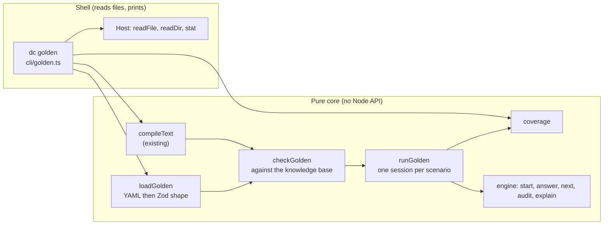

# Design Document: kb-golden

## Overview

kb-golden adds golden scenarios to `packages/kb-tools`. A golden file is a small YAML file at `apps/<app>/golden/<name>.yaml`. It names a knowledge base and lists scenarios: the facts given, and the verdict the engine must reach. `dc golden` compiles each knowledge base in memory, runs every scenario against it with the engine, and reports each difference. It also reports every rule that no passing scenario fires, so Gate G2 is checked by a tool.

What I read before designing, and what it implies:

| Source | Finding | Consequence for the design |
| --- | --- | --- |
| `packages/kb-tools/src/index.ts` | Exports `validateText`, `validateRaw`, `compileText`, `loadText`, `readKbFile`, `runCli`, the `Host` interface and the diagnostic types. `Diagnostic.code` is a closed union, `DiagnosticCode`. | Golden gets its own `GoldenDiagnostic` and `GoldenCode` types with the same fields. The KB code list, its catalogue test and its table in `kb-format.md` stay untouched. |
| `src/cli/run.ts`, `args.ts`, `discover.ts` | `runCli(argv, host)` is pure apart from the `Host`. `Command` is `"validate" \| "build"`. Discovery matches `^apps/[^/]+/kb/[^/]+\.yaml$` and rejects every other path with exit 2. | `golden` is a third command with its own discovery regex. The KB regex is not loosened, so `dc validate` can never read `golden/` (Requirement 1). |
| `src/cli/host.ts` | `Host` has `readFile`, `readDir`, `stat`, `writeFile`, `makeDir`, `cwd`. | `dc golden` uses only the three read methods. A test passes a `Host` whose `writeFile` and `makeDir` throw (Requirement 1, criterion 5). |
| `src/load/yaml-load.ts` | `loadText` parses YAML with `yaml`, enforces the 1 MiB limit, alias and depth limits, duplicate keys and non-string keys, and returns `YAML_SYNTAX` or `SCHEMA_INVALID` with a location. It is shaped by the knowledge-base file (a `facts` and a `clauses` context). | The golden loader reuses it for the YAML stage, so the limits and messages are the same. Task 1 checks that a golden `facts` mapping nested inside `scenarios` is not read as the top-level `facts` context. If it is, the context becomes a parameter. |
| `src/schema.ts` | `shown(value)` turns a bad value into message text and, after the `kb-validate-never-throws` fix, never throws. It is not exported. | Export it and use it for every value a golden message prints, so one function owns "never throws". |
| `src/compile.ts` | `compileText(text, file)` returns `{ ok: true, kb, json, diagnostics }` or `{ ok: false, diagnostics }`. | `dc golden` calls it for each KB_File. `kb-tools` Requirement 17 says a compiled knowledge base is accepted by `start`. |
| `packages/engine/src/types.ts`, `explain.ts` | `start`, `answer`, `next`, `audit`, `explain` are public. `next` returns a `Question` or a `Verdict` whose `needed` is empty. `audit` returns a `Verdict` whose `needed` lists the questions for unknown facts. `explain(session, fact)` returns a `ProofNode` tree whose `rule` is the deciding rule, and throws the same `EngineError` codes `next` would. | A scenario's session is built by folding `answer` over `facts`, in both modes, so `explain` is always called on a real session. The Fired_Rules are read from the `rule` fields of those trees. |
| `src/testkit/kb.ts` | `kbArb` generates knowledge bases and `answersArb(kb)` generates type-valid answers for their askable facts. | The record-and-replay and mutation properties reuse them. |
| `src/source-scan.test.ts` | A scan of every non-test file under `src` forbids network modules, `Date`, `Math.random`, `process.env`, and Node imports outside the host files. | It covers the new `golden/` files with no change, and it enforces Requirement 12, criterion 4 and Requirement 5, criterion 8. |

Design goals, in priority order:

1. **A pass means the app would show the same verdict.** The runner uses only the engine's public API, in the order an app uses it.
2. **Strict, so nothing passes by accident.** Unknown fields are errors, every goal must be listed, and a line-item list must match exactly.
3. **Total and deterministic.** The same text, knowledge base and file name give the same result. Nothing throws on bad input.
4. **Pure core, thin shell.** The loader, the checker and the runner take values and return values, with no Node API. Reading files and printing stay in the command, so Playwright can call the core.
5. **No new dependency.** `zod` and `yaml` are already in kb-tools.

### Design decisions and where they depart from the requirements text

Rows marked "Open? Yes" are for the human to approve. The requirements text stays as written until they do.

| # | Decision | Why | Open? |
| --- | --- | --- | --- |
| 1 | **Golden gets its own diagnostic types.** `GoldenDiagnostic` has the same fields as `Diagnostic` (`severity`, `code`, `file`, `message`, optional `id` and `field`) and `code: GoldenCode`. `READ_ERROR`, `YAML_SYNTAX`, `SCHEMA_INVALID` and `UNKNOWN_FACT` are the same strings as in the KB list. | Adding eleven codes to `ErrorCode` would change the KB catalogue test and the KB code table for a command that never emits them. Requirement 10 and 12 only need the same shape. `formatDiagnostic` takes the shared shape. | No |
| 2 | **Two stages: shape, then fit.** `loadGolden` checks the shape of the file with no knowledge base. `checkGolden(set, kb)` checks the set against a knowledge base: fact names, askable facts, value types, goal names, rule ids. | The loader cannot know the goals or the facts. Requirement 4, criterion 1 puts "exactly one entry for each goal" on the Golden_Loader. In this design the stage-2 check reports it as `SCHEMA_INVALID` on field `expect.goals`, one diagnostic naming the missing and the extra goals. | **Yes** (moves one check from loader to checker; the code and the message are unchanged) |
| 3 | **Coverage is computed only when the run holds every Golden_File of the knowledge base's app.** That is a run with no path, or with an `apps/<app>` directory. A run with explicit file paths reports scenario results only. | Requirement 7.1 and 8.2 say coverage is per app but do not say what a single-file run does. Reporting `RULE_NOT_COVERED` for rules that a file outside the run covers would be false. `TOO_FEW_SCENARIOS` follows the same rule. | **Yes** (fills a gap in 7.1 and 8.2) |
| 4 | **Coverage diagnostics belong to the knowledge-base file.** `RULE_NOT_COVERED` and `TOO_FEW_SCENARIOS` carry `file` = the KB_File path (`apps/<app>/kb/<name>.yaml`) and `id` = the rule id (none for `TOO_FEW_SCENARIOS`). Scenario diagnostics carry the Golden_File path and `id` = the scenario id. | The rule lives in the KB_File. A reader jumps to the right file. Requirement 7 does not name the file. | No |
| 5 | **The run ends with one summary line of fixed wording:** `<F> files, <S> scenarios run, <P> passed, <C> of <R> rules covered, <E> errors, <W> warnings`. With nothing to run it reads `0 files, 0 scenarios run, 0 passed, 0 of 0 rules covered, 0 errors, 0 warnings`. `<R>` counts the rules of the knowledge bases whose coverage was computed (decision 3). | Requirements 7.5, 8.6 and 9.4 each ask for some of these numbers. One fixed form is easy to test and has no plural logic, as in `dc validate` (kb-tools decision 11). | **Yes** (7.5, 8.6 and 9.4 are merged into one form) |
| 6 | **A failure difference may have the field `outcome`.** It says `a verdict` was expected and `a question for '<fact>'` was observed, or the reverse. In the printed order it comes first: `outcome`, `ask`, `goals`, `line_items`, `needed`, `fires`. | The requirements list the fields but not the case where the kind of Outcome differs, which is the most common failure of a consult scenario that asks one question too many or too few. | **Yes** (adds one field to 5.4 and 9.5) |
| 7 | **A knowledge base is found by the `id` text in its YAML**, read with `loadText` from `raw.id`, even when the file has other errors. | Requirement 6.4 must say `KB_INVALID` for a knowledge base with errors, so the match cannot depend on a successful compile. A file with no readable string `id` matches nothing. | No |
| 8 | **`facts` is an ordered record.** Its key order is the order of answers in a consult run. | The engine is order independent (Property 4), so the order only decides which error shows first. A record is simpler for Playwright than a list of pairs. Fact names never look like integers, so JavaScript keeps their order. | No |
| 9 | **Dates are checked by arithmetic.** `isCalendarDate(text)` matches `YYYY-MM-DD` and checks the month length, with leap years. It uses no `Date`. | The source scan forbids `Date` outside the host files, and the engine's own calendar helper is not exported. A property test shows every date it accepts is also accepted by the engine's `answer`. | No |
| 10 | **`safe integer` for money.** A `money` value must satisfy `Number.isSafeInteger`. | The engine's `answer` rejects other values with `INVALID_ANSWER`, and a scenario must not claim a value the engine refuses. | No |

---

## Architecture



Files, all new except the marked edits (`packages/kb-tools/src`):

| File | Holds |
| --- | --- |
| `golden/model.ts` | `GoldenSet`, `Scenario`, `Expectation`, `Difference`, `ScenarioResult`, `GoldenRun`, `GoldenCode`, `GoldenDiagnostic`. Types only. |
| `golden/schema.ts` | The strict Zod schema of a golden file and the translation of its issues into `GoldenDiagnostic`s with fixed English text. |
| `golden/load.ts` | `loadGolden(text, file)` and `loadGoldenRaw(value, file)`. |
| `golden/values.ts` | `isCalendarDate`, `checkValue(def, value)` returning a reason or nothing, and `describeValue`. |
| `golden/check.ts` | `checkGolden(set, kb, file)`. |
| `golden/run.ts` | `runScenario`, `runGolden`. |
| `golden/coverage.ts` | `coverage(kb, results, kbFile)`. |
| `golden/index.ts` | The public exports of the above. |
| `cli/golden.ts` | The `dc golden` handler: discovery, reading, matching, compiling, printing. |
| `cli/args.ts` (edit) | `Command` gains `"golden"`; usage text gains one line. |
| `cli/discover.ts` (edit) | `GOLDEN_FILE` regex and `discoverGolden`; the KB regex is unchanged. |
| `cli/run.ts` (edit) | Routes `golden` to `cli/golden.ts`. |
| `cli/format.ts` (edit) | `formatDiagnostic` takes the shared shape; `formatGoldenSummary`. |
| `schema.ts` (edit) | Exports `shown`. |
| `index.ts` (edit) | Re-exports the golden API (Requirement 12). |

## Components and interfaces

### Public API (Requirement 12)

```ts
import type { FactValue, KnowledgeBase } from "@dead-certain/engine";

export type GoldenCode =
	| "READ_ERROR" | "YAML_SYNTAX" | "SCHEMA_INVALID" | "UNKNOWN_FACT"
	| "KB_NOT_FOUND" | "KB_AMBIGUOUS" | "KB_INVALID" | "DUPLICATE_SCENARIO"
	| "NOT_ASKABLE" | "BAD_VALUE" | "UNKNOWN_RULE" | "SCENARIO_FAILED"
	| "ENGINE_ERROR" | "RULE_NOT_COVERED"   // errors
	| "TOO_FEW_SCENARIOS";                  // warning

export interface GoldenDiagnostic {
	readonly severity: "error" | "warning";
	readonly code: GoldenCode;
	readonly file: string;
	readonly message: string;
	/** Scenario id, or rule id for RULE_NOT_COVERED. */
	readonly id?: string;
	readonly field?: string;
}

/** Null means unknown (YAML `null`). */
export type GoldenValue = FactValue | null;

export type Expectation =
	| { readonly ask: string }
	| {
			readonly goals: Readonly<Record<string, GoldenValue>>;
			readonly lineItems?: Readonly<Record<string, GoldenValue>>;
			readonly needed?: readonly string[];
			readonly fires?: readonly string[];
	  };

export interface Scenario {
	readonly id: string;
	readonly title: string;
	readonly mode: "consult" | "audit";
	/** Order is the order of answers in a consult run. No null values. */
	readonly facts: Readonly<Record<string, FactValue>>;
	readonly expect: Expectation;
}

export interface GoldenSet {
	readonly kb: string;
	readonly scenarios: readonly Scenario[];
}

export type LoadGoldenResult =
	| { readonly ok: true; readonly set: GoldenSet; readonly diagnostics: readonly GoldenDiagnostic[] }
	| { readonly ok: false; readonly diagnostics: readonly GoldenDiagnostic[] };

export function loadGolden(text: string, file: string): LoadGoldenResult;
export function loadGoldenRaw(value: unknown, file: string): LoadGoldenResult;

/** Stage 2: the set against its knowledge base. Returns the scenarios that are fit to run. */
export function checkGolden(set: GoldenSet, kb: KnowledgeBase, file: string): {
	readonly runnable: readonly Scenario[];
	readonly diagnostics: readonly GoldenDiagnostic[];
};

export interface Difference {
	/** `outcome`, `ask`, `goals.<name>`, `line_items.<name>`, `needed` or `fires`. */
	readonly field: string;
	readonly expected: string;
	readonly observed: string;
}

export interface ScenarioResult {
	readonly id: string;
	readonly status: "passed" | "failed" | "error";
	/** Rule ids that fired, in the knowledge base's rule order. Empty unless the outcome was a verdict. */
	readonly fired: readonly string[];
	readonly differences: readonly Difference[];
	/** Set when status is "error": the engine's code and message. */
	readonly engineError?: { readonly code: string; readonly message: string };
}

export function runScenario(kb: KnowledgeBase, scenario: Scenario): ScenarioResult;

export interface GoldenRun {
	readonly results: readonly ScenarioResult[];
	/** SCENARIO_FAILED and ENGINE_ERROR, in scenario order. */
	readonly diagnostics: readonly GoldenDiagnostic[];
}
export function runGolden(kb: KnowledgeBase, scenarios: readonly Scenario[], file: string): GoldenRun;

export function coverage(
	kb: KnowledgeBase,
	kbFile: string,
	results: readonly ScenarioResult[],
	scenarioCount: number,
): { readonly covered: readonly string[]; readonly diagnostics: readonly GoldenDiagnostic[] };
```

`loadGolden` follows the kb-tools pattern: success has a `GoldenSet` and no partial result on failure (Requirement 12, criterion 3). No function here throws.

### The YAML grammar, as the Zod schema reads it

```yaml
kb: claim-check                      # the knowledge base's `id`
scenarios:
  - id: G-01                         # [A-Za-z0-9][A-Za-z0-9_-]*, unique within the app
    title: Room rent over the limit  # non-empty
    mode: consult                    # optional: consult (default) or audit
    facts:                           # non-derived facts only; money in minor units; dates YYYY-MM-DD
      sum_insured: 500000
      room_rent_per_day: 600000
    expect:
      goals:                         # every goal of the knowledge base, null = unknown
        payable_amount: 14250000
        verdict: reduced
      line_items:                    # optional; exact match with the verdict's line items
        room_rent_deduction: 3800000
      needed: []                     # audit mode only; the question facts, in order
      fires: [ROOM-01, ROOM-02]      # optional; each must have fired
  - id: G-02
    title: The first question
    facts: {}
    expect:
      ask: sum_insured               # consult mode only; then `ask` is the only field
```

Zod schema: `z.strictObject` at the top, in each scenario and in `expect`. `expect` is parsed as a union: `{ ask }` alone, or `{ goals, line_items?, needed?, fires? }`. Mode-dependent rules (`needed` only with `audit`, `ask` only with `consult`) are a `superRefine` on the scenario so the message names the field and the mode. The loader maps `line_items` to `lineItems`.

### Running a scenario

```text
runScenario(kb, scenario):
  try
    session = start(kb)
    for (fact, value) in scenario.facts: session = answer(session, fact, value)      // both modes
    if mode = consult:
      out = next(session)                         // Question or Verdict
    else:
      out = audit(kb, scenario.facts)             // Verdict
    differences = []
    if out is Question:
      expect has ask?  compare out.fact with expect.ask   -> field "ask"
      else             difference "outcome": expected "a verdict", observed "a question for '<fact>'"
      fired = []
    else:
      expect has ask?  difference "outcome": expected "a question for '<ask>'", observed "a verdict"
      else compare:
        goals:       for each goal in kb.goals order: expected[goal] vs out.goals[goal] (undefined = null)
        line items:  if expect.lineItems present: same fact names as out.lineItems, then values (null = undefined)
        needed:      expected (default []) vs out.needed facts, in order      // audit mode only; consult verdicts have none
      fired = firedRules(kb, session, goals ∪ out.lineItems facts)
      if expect.fires: each id must be in fired                              -> field "fires"
    status = differences empty ? passed : failed
  catch EngineError e -> status "error", engineError { code, message }
```

`firedRules` calls `explain(session, fact)` once per goal and per line-item fact, walks each tree, collects every `rule` field, and returns the ids in the order the rules appear in `kb.rules`. Building the session for an audit scenario with `answer` is sound because the engine proves that `audit` and `answer` accept the same values (mode agreement). `runGolden` runs each scenario on a fresh session, so there is no shared state (Requirement 5, criterion 6).

Differences are compared on the engine's public values: `undefined` is `null`, numbers are compared with `===`, and `-0` is `0` (the engine already stores `-0` as `0`).

### Fit checks (`checkGolden`)

For each scenario, in order. A scenario with an error here is dropped from `runnable`; the others are unaffected (Requirement 3, criterion 6).

| Check | Code | Message |
| --- | --- | --- |
| A key of `facts` is not a fact | `UNKNOWN_FACT` | `Fact 'x' is not in the knowledge base 'claim-check'.` |
| A key of `facts` is derived | `NOT_ASKABLE` | `Fact 'x' is worked out by rules, so a scenario cannot give it. Give the facts it depends on.` |
| A value has the wrong type | `BAD_VALUE` | `Value 7 for fact 'x' is not a boolean.` The type phrase is `a boolean`, `a number`, `a whole number of minor units` (money), `a date written YYYY-MM-DD`, or `one of a, b, c` (enum). A `null` in `facts` is `BAD_VALUE` with `is not allowed in facts; null means unknown only in expect`. |
| A key of `expect.goals` or `expect.lineItems` is not a fact or goal | `UNKNOWN_FACT` | as above, with `field` `expect.goals` or `expect.line_items` |
| `expect.goals` misses or adds a goal | `SCHEMA_INVALID` | `expect.goals must list exactly the goals of the knowledge base. Missing: a, b. Not a goal: c.` |
| A line-item key is not a `role` fact, or an expected value has the wrong type | `UNKNOWN_FACT`, `BAD_VALUE` | as above |
| `ask` or a name in `needed` is not an askable fact | `UNKNOWN_FACT`, `NOT_ASKABLE` | as above |
| A rule id in `fires` is not a rule | `UNKNOWN_RULE` | `Rule 'R-9' is not in the knowledge base.` |

Duplicate scenario ids span the files of one app, so neither `loadGolden` nor `checkGolden` can see them. A pure function, `duplicateIds(files)`, takes the loaded sets of one app in file path order and returns a `DUPLICATE_SCENARIO` diagnostic on each later scenario, naming the earlier one. `cli/golden.ts` calls it once per app, and Playwright can call it too. The scenario with the duplicate id is dropped from `runnable`, as for any fit error.

### Coverage

```text
coverage(kb, kbFile, results, scenarioCount):
  covered = union of result.fired over results with status "passed"
  diagnostics = for each rule in kb.rules order not in covered:
                  RULE_NOT_COVERED, file = kbFile, id = rule.id
                  "No passing scenario fires rule 'R-3'."
              + (scenarioCount < 12 ? TOO_FEW_SCENARIOS (warning), file = kbFile)
                  "Knowledge base 'claim-check' has 7 scenarios; the build plan asks for at least 12."
```

The constant `MINIMUM_SCENARIOS = 12` is exported. A scenario that passed with outcome `ask` fires nothing.

### The command

`dc golden [path...]`:

1. `parseArgs` accepts `golden` with the same rules as `validate` (no flag starts with `-`; so `--json` is a usage error, which is decision 4 of the human).
2. `discoverGolden(paths, host)` returns the root, the Golden_Files (root-relative, sorted) and whether the run is a **whole-app run** (no path, or only `apps/<app>` directories). An explicit path that matches no Golden_File is a usage error (exit 2).
3. For each app in the run, list `apps/<app>/kb/*.yaml`, read each, and `compileText` it. Index the files by `raw.id` (decision 7).
4. For each Golden_File, in path order: `readKbFile`-style read (same size and UTF-8 checks, same `READ_ERROR`); `loadGolden`; find the knowledge base by `kb` (`KB_NOT_FOUND`, `KB_AMBIGUOUS`, `KB_INVALID`); `checkGolden`; collect `runnable`.
5. After all files of an app: `duplicateIds`; then `runGolden` per file.
6. For a whole-app run: `coverage` for each knowledge base that has at least one Golden_File, using all the results of that knowledge base's files.
7. Sort and print (below). Exit 1 if any error, else 0.

The command never calls `writeFile` or `makeDir`, and it never reads `kb/dist/` (Requirement 6, criterion 5).

**Output order** (Requirement 9, criterion 3), by this key: app name; then phase (0 Golden_File diagnostics, 1 coverage, 2 `TOO_FEW_SCENARIOS`); then file path; then position (scenario order, or rule order for coverage); then code. Passing scenarios print nothing. Each line is `<file>: <severity> <code> [<id>] <message>`, as in `dc validate`.

**Failure message** (Requirement 5, criterion 4 and 9, criterion 5):

```text
apps/claim-check/golden/main.yaml: error SCENARIO_FAILED [G-03] Scenario 'G-03' (Room rent over the limit) failed: goals.payable_amount expected 14250000, observed 14000000; line_items.room_rent_deduction expected 3800000, observed 4000000
```

An `ENGINE_ERROR` reads `Scenario 'G-03' (...) stopped: the engine threw INVALID_ANSWER: <message>.`

**Exit codes** are those of `dc validate`: 0 no errors, 1 errors, 2 usage. The usage text gains `  dc golden [path...]     run golden scenarios against the compiled knowledge bases`, and its path line gains `apps/<app>/golden/<name>.yaml`.

## Data models

`Difference.expected` and `.observed` are strings made by `describeValue`: `null` and `undefined` print `unknown`; strings print as they are; numbers and booleans print as JSON. A value that cannot be written (it never occurs for engine values, but the function is total) prints `[value that cannot be shown]`, through the exported `shown`.

`GoldenRun` and `ScenarioResult` contain only strings, numbers and arrays, so Playwright can serialise them.

## Error handling

| Situation | Result |
| --- | --- |
| File unreadable, not UTF-8, over 1 MiB | `READ_ERROR` or `SCHEMA_INVALID`, as in kb-tools. No scenario runs from that file. |
| Invalid YAML | `YAML_SYNTAX` with line and column. |
| Shape errors | `SCHEMA_INVALID`, one per problem, with `field` and the scenario `id` where known. The loader returns no set. |
| A scenario fails the fit checks | Its diagnostics only; the rest of the file runs. |
| `kb` names no knowledge base, or two, or one with errors | `KB_NOT_FOUND`, `KB_AMBIGUOUS`, `KB_INVALID`; the file's scenarios do not run, and coverage for that knowledge base is not computed from them. |
| The engine throws | `ENGINE_ERROR` for that scenario; the run goes on. |
| Anything unexpected inside the runner | Not caught. Kb-tools' totality (Requirement 17) and the engine's own contract mean there is none; a property test hunts for one (Property 7). |

## Correctness Properties

A property is a statement that holds for all inputs of its kind. Each is tested with fast-check (`numRuns` of 100 or more), in files named `*.props.test.ts`, each starting with a `// Feature: kb-golden, Property N: <title>` comment.

### Property 1: Record and replay

*For all* valid knowledge bases `kb` and type-valid assignments `facts` to its askable facts, and for each mode, the scenario built from what the engine returns for that assignment passes `runScenario`. For `audit`, the scenario holds `goals`, `lineItems` and `needed` of `audit(kb, facts)`, and `fires` of its fired rules. For `consult`, it holds `ask` when `next` returns a question, else the verdict's `goals` and `lineItems`.

**Validates: Requirements 5.1, 5.2, 5.3, 4.2, 4.3, 4.4, 4.5, 11.1**

### Property 2: Mutation is caught

*For all* passing scenarios and each goal in `expect.goals`, changing that one value to a different type-valid value makes `runScenario` return `failed` with a difference whose field is `goals.<name>`, and no other field.

**Validates: Requirements 5.4, 4.8, 11.2**

### Property 3: Scenario order does not matter

*For all* golden sets and permutations of their scenarios, `runGolden` returns the same status for each scenario id, and `coverage` returns the same covered set and the same `RULE_NOT_COVERED` ids.

**Validates: Requirements 5.6, 11.3**

### Property 4: Facts order does not matter

*For all* consult scenarios and permutations of the entries of `facts`, `runScenario` returns an equal result.

**Validates: Requirements 11.4**

### Property 5: Coverage is exact

*For all* golden sets, a rule id is in `RULE_NOT_COVERED` if and only if it is in no passing scenario's `fired`; the diagnostics follow the order of `kb.rules`; and a failed or erroring scenario contributes nothing.

**Validates: Requirements 7.1, 7.2, 11.5**

### Property 6: Golden files do not change validation

*For all* trees, `runCli(["validate"])` and `runCli(["build"])` return the same stdout, stderr, exit code and written files with golden files added to `apps/<app>/golden/`, and `discover` for `validate` and `build` never returns a path that contains `/golden/`. `dc golden` never returns a path under `kb/`.

**Validates: Requirements 1.2, 1.3, 1.4, 11.6**

### Property 7: Total

*For all* strings, `loadGolden` returns a result and does not throw. *For all* arbitrary raw values, including wrong types, null, deep nesting, a BigInt, a symbol and a function, `loadGoldenRaw` returns an error diagnostic or a valid set and does not throw. *For all* generated knowledge bases and golden sets, `checkGolden` and `runGolden` return one result per runnable scenario and do not throw.

**Validates: Requirements 10.1, 10.2, 10.3, 10.4**

### Property 8: Deterministic and pure

*For all* inputs, two calls return deep-equal results, and a `Host` whose `writeFile` and `makeDir` throw never sees a call from `dc golden`.

**Validates: Requirements 5.7, 1.5, 8.7**

### Property 9: Accepted dates are real dates the engine accepts

*For all* strings, if `isCalendarDate` accepts the string then `answer` on a date fact does not throw `INVALID_ANSWER`, and every well-formed ISO date the engine accepts is accepted. *For all* values, `checkValue` accepts a value only if the engine's `answer` accepts it for that type.

**Validates: Requirements 3.3, 3.4**

### Property 10: Output is stable

*For all* runs, the printed lines are sorted by the key in "Output order", a clean run prints only the summary line, and the output holds no absolute path, colour code or timestamp.

**Validates: Requirements 9.1, 9.2, 9.3, 9.4, 9.6**

Examples, not properties: Requirements 2.1 to 2.7, 3.1, 3.2, 3.5, 4.6, 4.7, 6.1 to 6.5, 8.1 to 8.8, 9.5, 12 and 13 are checked by unit tests with named cases, and by the source scan for 12.4.

## Testing Strategy

- **Unit tests** in `src/golden/*.test.ts`: every diagnostic code with its exact message; the YAML grammar, including each `SCHEMA_INVALID` cause; value checks for the five types, including `-0`, `1e21`, `2024-02-29`, `2023-02-29` and an enum not in its options; the `ask` and verdict outcomes; the `outcome` difference; duplicate ids across two files; coverage with zero, some and all rules covered; the summary line.
- **CLI tests** in `src/cli/golden.test.ts` with an in-memory `Host`: no path, a directory, a file, a missing path (exit 2), `--json` (exit 2), a tree with golden files and no knowledge base, a knowledge base with errors, two knowledge bases with one `id`, a file-only run that skips coverage.
- **Property tests** as above, reusing `kbArb`, `answersArb` and `renderYaml` from the testkit. The golden generators go in `src/testkit/golden.ts`.
- **A fixture app** under `packages/kb-tools/src/golden/fixtures/` as strings in a test module (no files on disk), small enough to read: a knowledge base with a rounded money rule, a guarded rule and a fallback, and a golden file whose scenarios cover each, so the whole path from text to exit code runs once.
- **Source scan**: the existing `source-scan.test.ts` already covers `golden/`. A new assertion lists the files under `golden/` that import nothing from `node:*`, to state Requirement 12, criterion 4 as a test of its own.
- **Dist smoke**: the built `dist/dc.mjs` is run by the existing `dist-smoke.test.ts` pattern on a temporary tree with one knowledge base and one golden file, once with a passing and once with a failing scenario.
- **Docs**: a test reads `docs/kb-format.md` and checks that the "Golden scenarios" section lists every `GoldenCode`, as `codes.test.ts` does for the KB codes.

## Handoffs and what this spec does not do

- **Root `dc` script:** `pnpm dc golden` goes through the existing script (`pnpm -s --filter @dead-certain/kb-tools exec vite build --logLevel warn && node packages/kb-tools/bin/dc.mjs`). `pnpm dc validate` already works by pnpm appending its arguments to the script, so `golden` needs no change. Task 1 confirms it with a run. If it ever fails, the fix is a handoff note to the Claude Code lane (root config).
- **Playwright end-to-end tests** for every golden scenario are the Claude Code lane's work (build plan, Phase 3). They import `loadGolden`, `checkGolden` and `runScenario` from `@dead-certain/kb-tools`, or read the same YAML.
- **The golden scenarios themselves** are written in Phase 2 by the `knowledge-engineer` agent and the human, after the rulebooks exist. This spec builds only the format and the runner.
- **The agent prompt** (`.kiro/agents/knowledge-engineer.json`) and the "Golden scenarios" section of `docs/kb-format.md` are updated by this spec's tasks (Requirement 13).
