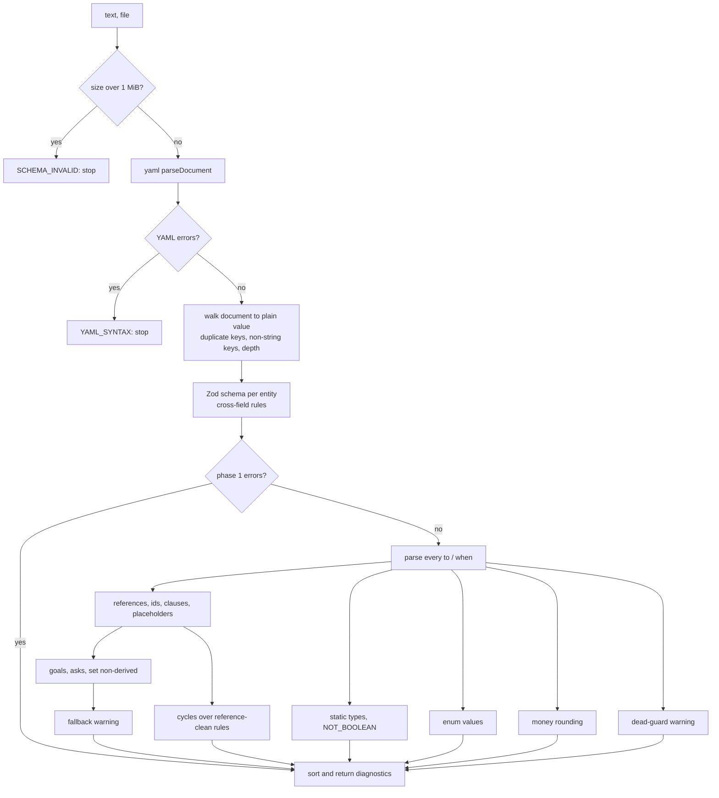
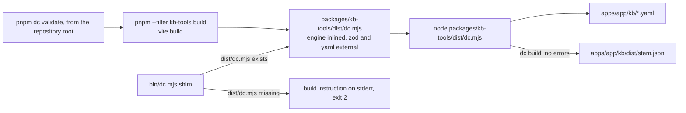

# Design Document: kb-tools

## Overview

kb-tools is the knowledge-base toolchain of Dead Certain. It lives in `packages/kb-tools` (package `@dead-certain/kb-tools`). It reads `apps/<app>/kb/*.yaml`, checks each file, and compiles it to the `KnowledgeBase` type declared in `packages/engine/src/types.ts`. It exposes four library functions (`loadText`, `validateText`, `compileText`, `readKbFile`) and one command, `dc`, with the subcommands `validate` and `build`.

What I read before designing, and what it implies:

| Source | Finding | Consequence for the design |
| --- | --- | --- |
| `packages/engine/src/index.ts` | Exports `parse`, `print`, `evaluate`, `start`, `next`, `audit`, `EngineError`, `UNKNOWN` and the shared types. Does not export `hasOwn`, `factRefs` or `findCycle`. | kb-tools imports only from `@dead-certain/engine`. It writes its own reference walker and cycle search, and tests them against the engine's `start` (the engine throws `CYCLE` or `INVALID_KB`). |
| `lang/parse.ts` | `parse(source)` returns `{ ok: true, expr }` or `{ ok: false, error: { code, message, position } }`. It tags every number literal `number`; it never produces a `money` literal. | `PARSE_ERROR` messages are built from `error.code`, `error.position` and `error.message`. Money typing is done by kb-tools from the fact definitions. |
| `types.ts` | `FactDef` already has `label`. `Clause` carries its own `id`. `KnowledgeBase.facts` and `.clauses` are records. | The compiler sets `Clause.id` from the map key. Maps keep file order. |
| `packages/engine/package.json` | `exports` point at TypeScript source (`./src/index.ts`). `dependencies` is absent. `fast-check` is pinned to `4.10.2`. | kb-tools declares `@dead-certain/engine` as `workspace:*` and adds nothing to the engine. |
| Engine source files | Relative imports have no extension (`from "./api"`). `codec/bytes.ts` uses a constructor parameter property (`constructor(private readonly data: Uint8Array)`). | Node cannot run the engine source directly, even with type stripping. See decision 1. |
| `engine/src/resolve.ts` | `NON_INTEGER_MONEY` is thrown when a derived money value fails `Number.isInteger`. | `MONEY_NOT_ROUNDED` guards exactly that. The integer-literal test uses `Number.isInteger`, the same test. |
| Root `package.json`, `vitest.config.ts`, `tsconfig.json` | One root `vitest` (`packages/**/*.test.ts` is included). `tsc` runs strict with `noUncheckedIndexedAccess` and `verbatimModuleSyntax` over `packages/*/src`. `build` is `pnpm -r --if-present build`. There is no `@types/node` anywhere in the workspace. | Tests live next to the source and need no config change. A `build` script in kb-tools is picked up by the root `pnpm build` without a root edit. Node I/O is typed locally (decision 5). |
| `.github/workflows/ci.yml` | CI runs `pnpm install --frozen-lockfile`, then `pnpm check`, then `pnpm run --if-present dc validate`. | The root `dc` script rebuilds the bundle on every run (decision 8), so CI needs no change. |
| Node on this machine | `.nvmrc` says `22`. Native `.ts` execution needs a flag before Node 22.18. | The design does not run `.ts` in Node. It runs a bundle, so it needs no Node feature beyond the Node 22 line and sets no minor-version floor. |
| `docs/kb-format.md` | Defines the YAML schema, the expression language, the quoting hazard, and four validator notes. | The Zod schema is a direct transcription. The four notes become tests (Requirement 19, criterion 3). |

Design goals, in priority order:

1. **A passing file is a file the engine accepts.** The validator is built to be sound against the engine, and the property tests use the engine as the oracle.
2. **Total and deterministic.** The same text and file name always give the same diagnostics, in the same order. Nothing throws on bad input.
3. **One analysis, two uses.** `validateText` and `compileText` run the same `analyse` function once. A compiled file is, by construction, a validated file.
4. **Small surface, one build-time dependency.** At run time only `zod` and `yaml` (both approved, exact versions) beyond the workspace. `vite` is a devDependency used only to build `dist/dc.mjs`.

### Design decisions and where they depart from the requirements text

The human has settled every question that was open in the first draft: decisions 1, 3 and 5 as written below; decisions 2, 4, 6 and 7 as first written; the `zod` 4.6.7 and `yaml` 2.9.1 pins; and `vite@8.3.8` as a kb-tools devDependency. No item is waiting for the human in this table. The root `dc` script is a handoff to the Claude Code lane, written out under decision 8.

| # | Decision | Why | Open? |
| --- | --- | --- | --- |
| 1 | **The `dc` bin runs one bundled file, `dist/dc.mjs`, built by Vite.** `vite@8.3.8` (exact pin) is an approved devDependency of kb-tools. A Vite SSR build of `src/cli/main.ts` inlines `@dead-certain/engine` and keeps `zod`, `yaml` and the `node:*` built-ins external. The package has a `build` script and no other lifecycle script. Full account in "How the `dc` bin runs TypeScript under Node 22". | The engine source cannot run in Node as written (extensionless imports, a parameter property). A bundler resolves both. Vite 8.3.8 is already in the stack table and in `pnpm-lock.yaml` (used by `apps/site`), so this adds no new version to the workspace. | No |
| 2 | **Validation runs in two phases.** Phase 1 is structure (read, size, YAML, schema, duplicate keys, non-string keys). If phase 1 has an error, phase 2 (parse, references, types, cycles and the rest) does not run. | Phase 2 needs well-formed facts, rules and clauses. Running it on malformed entities would produce misleading second errors (Requirement 8, criterion 5 states the same idea for cycles). Within phase 2 every check is independent and all run. | No |
| 3 | **A file that cannot be read, or is not valid UTF-8, uses the new code `READ_ERROR`.** The message names the file. For an unreadable file it gives the operating-system reason. For invalid bytes it says the file is not valid UTF-8 and gives no operating-system reason. `YAML_SYNTAX` is not used for either (Requirement 2, criteria 7 to 9). | A file that cannot be read has no YAML document to be wrong about. A separate code lets a caller tell "fix the file's contents" from "the file never reached the parser". | No |
| 4 | **One `CYCLE` diagnostic per strongly connected component.** The reported path is the shortest cycle back to the alphabetically first fact, taking neighbours in alphabetical order. | Requirement 8, criterion 2 says "one diagnostic" without saying how to count a graph with two separate cycles. A shortest-path rule makes the output independent of rule order (criterion 4). | No |
| 5 | **Node I/O without `@types/node`.** `host-node.ts` imports `node:fs` and `node:path` with `// @ts-expect-error TS2591`, exactly as the engine's tests do, and wraps them in a small typed `Host` interface. No ambient `declare module "node:fs"` is added, and `@types/node` is not added. | An ambient declaration would turn the engine tests' `@ts-expect-error` lines into "unused directive" errors. Adding `@types/node` is a new devDependency and would do the same. | No |
| 6 | **Compiled JSON key order.** Field names use a fixed order (tables in Data Models). The maps keyed by fact name and clause id keep the order in the YAML file. | The engine orders line items and what-if results by the order of `facts`, and its replay fingerprint is order-sensitive. Sorting fact names would change engine behaviour. Same text still gives the same bytes (criterion 9). | No |
| 7 | **`dc` has two exit-code families plus help.** 0 means no errors, 1 means errors, 2 means a usage problem. `dc help`, `dc --help` and `dc -h` print usage to standard output and exit 0. | Requirement 16 fixes 0, 1 and 2. A help flag is an addition and costs nothing. | No |
| 8 | **The command is rebuilt on every run through the root script, and paths are resolved against the repository root.** The root `dc` script, added by the Claude Code lane, is `"dc": "pnpm --filter @dead-certain/kb-tools build && node packages/kb-tools/dist/dc.mjs"`. It always starts with the repository root as the working directory, so a path argument such as `apps/claim-check` is relative to the root. The program still finds the root as the nearest ancestor of the working directory that holds `pnpm-workspace.yaml`, so a direct `node packages/kb-tools/dist/dc.mjs` from a subdirectory gives the same result. Diagnostics show root-relative POSIX paths. `bin/dc.mjs` is a small committed shim for the package `bin` entry. | Rebuilding on each run means the command can never be stale, so there is no postinstall script and no staleness check. Root-relative paths keep the output independent of the machine and of the working directory. | No (handoff to the Claude Code lane) |
| 9 | **Two small additions to the schema and parse stages.** A `to` or `when` value that is a non-finite YAML number (`.inf`, `.nan`) is a `SCHEMA_INVALID` error. A `RangeError` raised by `parse` or by a recursive walk over one expression is turned into a `PARSE_ERROR` that says the expression is too deeply nested. | Without the first, `String(Infinity)` would parse as a fact name. Without the second, a 1 MiB file holding one very long chain could crash the validator (Requirement 17, criterion 1). | No |
| 10 | **`DEAD_GUARD` detects exactly what Requirement 14 lists.** `a and b and not a` is not reported, because the dead pair is not an operand of the same `and` node (`(a and b) and not a`). A dead operand anywhere in a nested `and` chain is reported (criterion 3). | Requirement 14, criterion 6 forbids reporting a guard that criteria 1 to 3 do not match. | Optional: a later requirement could ask for flattened-chain detection. It is also sound. |
| 11 | **The summary line has fixed wording**: `<N> files checked, <E> errors, <W> warnings`. | Requirement 16, criterion 10 asks for the three numbers only. A fixed form avoids plural logic and is easy to test. | No |

Removed from the first draft: the Node 22.13 floor (the bundle needs no Node API newer than the Node 22 line in `.nvmrc`), the `postinstall` script and the check that it runs for workspace packages (old decision 12), and the hand-written build script (old decisions 1 and 1a).

### How the `dc` bin runs TypeScript under Node 22

The constraint: `dc` is a Node program, kb-tools and the engine are TypeScript, and the only new dependency allowed is the approved `vite@8.3.8` devDependency.

Options considered:

| Option | Result |
| --- | --- |
| Run `src/cli/main.ts` with Node's type stripping (`node --experimental-strip-types`, or unflagged from Node 22.18) | **Fails.** The imports of the engine (`from "./api"`) have no file extension, and Node's ESM loader does not add one. The engine is the other lane's package, so I cannot rewrite its imports, and the root `tsconfig.json` does not allow `.ts` extensions. The engine's `codec/bytes.ts` also uses a parameter property, which strip-only mode rejects. |
| `tsx`, `esbuild`, `vite-node` or `jiti` | New dependency. Not approved. |
| `tsc` emit | The root TypeScript is 7.0.2 with `moduleResolution: bundler`. It emits the same extensionless specifiers, so the output does not run in Node ESM. |
| **A Vite SSR build of `src/cli/main.ts` into one file, `dist/dc.mjs`** | **Chosen.** Vite resolves extensionless imports and compiles the parameter property. It needs one approved devDependency and a 20-line config file. |

Vite 8 build options, checked against the Vite 8.3.5 documentation through Context7 (the nearest 8.3.x release it indexes; the design uses 8.3.8):

| Option | Value | Why |
| --- | --- | --- |
| `build.ssr` | `"src/cli/main.ts"` | An SSR build takes the entry as a string, and defaults its target to Node. |
| `ssr.target` | `"node"` (the default, set explicitly) | Node built-ins such as `node:fs` and `node:path` stay external. |
| `ssr.noExternal` | `["@dead-certain/engine"]` | The documentation says only linked dependencies are bundled by default. Naming the engine makes the inlining explicit and independent of how pnpm links it. |
| `ssr.external` | `["zod", "yaml"]` | These two stay external and resolve from `packages/kb-tools/node_modules` at run time. |
| `build.rolldownOptions.output.entryFileNames` | `"dc.mjs"` | Gives the output name. In Vite 8, `build.rollupOptions` is a deprecated alias of `build.rolldownOptions`, so the config uses the new name. |
| `build.rolldownOptions.output.format` | `"es"` | An ES module, which the `.mjs` name requires. |
| `build.outDir`, `build.emptyOutDir` | `"dist"`, `true` | The result is `packages/kb-tools/dist/dc.mjs` and nothing stale beside it. |
| `build.minify`, `build.sourcemap` | `false`, `true` | Readable stack traces for a command-line tool. A source map is a separate file, `dist/dc.mjs.map`. |
| `build.target` | `"node22"` | Keeps syntax inside what Node 22 runs. |

What I could not confirm from the documentation, and the first implementation task therefore checks: that `ssr.noExternal` with a `workspace:*` link inlines the engine's TypeScript source without a plugin, that `build.target: "node22"` is accepted by the Rolldown-based build, and that the `external` list is honoured for an entry built with `build.ssr`. If a setting is rejected, the fallback is `build.lib` with `formats: ["es"]` and `build.rolldownOptions.external: ["zod", "yaml", /^node:/]`, which the documentation describes for exactly this split. The dist smoke test (see Testing Strategy) proves the result.

How it fits together:

- `packages/kb-tools/package.json` declares `"type": "module"`, `"bin": { "dc": "./bin/dc.mjs" }` and a `"build": "vite build"` script. It has no `postinstall` or other lifecycle script. `vite.config.ts` sits in the package root.
- `src/cli/main.ts` runs when imported: it wires `host-node.ts` into `runCli`, writes the result and sets `process.exitCode`. `dist/dc.mjs` is therefore runnable directly with `node`.
- The root `dc` script rebuilds and then runs the bundle: `pnpm --filter @dead-certain/kb-tools build && node packages/kb-tools/dist/dc.mjs`. The command is rebuilt on every run, so a stale bundle cannot occur. CI needs no change: `pnpm run --if-present dc validate` goes through the same script. The root script is a handoff to the Claude Code lane (decision 8).
- `bin/dc.mjs` is a small committed JavaScript shim with a `#!/usr/bin/env node` line, for the package `bin` entry. It checks that `../dist/dc.mjs` exists. If so it imports it. If not it prints `dist/dc.mjs is missing: run "pnpm --filter @dead-certain/kb-tools build"` to standard error and sets exit status 2. It never builds, never writes, and never checks timestamps.
- Tests do not use `dist/`. Vitest imports `src` directly through the workspace link, as the engine's tests do.
- `bin/dc.mjs` and `vite.config.ts` sit outside `src`, so the root `tsc` does not check them. Biome does lint and format them (tabs, double quotes).
- `dist/` is already ignored by the root `.gitignore`.
- Source files keep static `import … from "…"` statements and use `import type` for types (already required by `verbatimModuleSyntax`). The bundler imposes no other rule.
---

## Architecture

### Module layout

All TypeScript lives under `packages/kb-tools/src`. Only `host-node.ts` and `cli/main.ts` touch Node.

```text
packages/kb-tools/
├── package.json            name, type module, bin, exports, build script, dependencies
├── vite.config.ts          Vite SSR build: src/cli/main.ts -> dist/dc.mjs
├── bin/dc.mjs              committed JS shim, imports ../dist/dc.mjs or prints the build instruction
├── fixtures/               toy knowledge bases used by tests (YAML)
└── src/
    ├── index.ts            public exports
    ├── diagnostics.ts      Diagnostic, DiagnosticCode, makers, sort comparator, clip
    ├── limits.ts           MAX_FILE_BYTES, MAX_QUOTE, MAX_DEPTH
    ├── load/
    │   ├── decode.ts       UTF-8 decoding with failure result
    │   └── yaml-load.ts    yaml Document -> plain value, key diagnostics
    ├── schema.ts           Zod schemas and the Zod-issue to Diagnostic mapping
    ├── model.ts            ParsedKb and related internal types
    ├── analyse.ts          the pipeline; validateText and compileText call it
    ├── checks/
    │   ├── parse-exprs.ts  parse every to / when
    │   ├── refs.ts         references, duplicate rule ids, placeholders, quoted-literal hint
    │   ├── goals.ts        GOAL_UNSET, MISSING_ASK, SET_NON_DERIVED
    │   ├── cycles.ts       dependency graph, SCCs, canonical cycle
    │   ├── types.ts        static type inference and TYPE_MISMATCH / NOT_BOOLEAN
    │   ├── enums.ts        ENUM_VALUE_NOT_IN_OPTIONS
    │   ├── money.ts        Rounded_Money_Expression classifier
    │   ├── fallback.ts     NO_FALLBACK_RULE
    │   └── dead-guards.ts  DEAD_GUARD
    ├── expr-walk.ts        factRefs, exprEqual, valueLeaves (shared, iterative where cheap)
    ├── compile.ts          ParsedKb -> KnowledgeBase -> Compiled_JSON
    ├── cli/
    │   ├── args.ts         argument parsing
    │   ├── discover.ts     find KB_Files, repository root
    │   ├── run.ts          runCli(argv, host) -> { exitCode, stdout, stderr }
    │   ├── format.ts       diagnostic line and summary line
    │   ├── host.ts         Host interface
    │   ├── host-node.ts    real file system Host (node: imports under @ts-expect-error)
    │   └── main.ts         entry: wires host-node, sets process.exitCode
    └── testkit/            fast-check generators and a YAML renderer (tests only)
```

`testkit/` is imported by test files only and is not re-exported from `index.ts`. The bundle starts at `cli/main.ts`, so test files and `testkit/` never enter `dist/dc.mjs`.

### Component dependencies

```mermaid
graph TD
    MAIN[cli/main.ts] --> RUN[cli/run.ts]
    RUN --> DISC[cli/discover.ts]
    RUN --> FMT[cli/format.ts]
    RUN --> LIB[index.ts library API]
    LIB --> AN[analyse.ts]
    LIB --> CMP[compile.ts]
    AN --> LOAD[load/*]
    AN --> SCH[schema.ts]
    AN --> CHK[checks/*]
    CHK --> EW[expr-walk.ts]
    CHK --> ENG[@dead-certain/engine: parse, print, types]
    CMP --> ENG
    LOAD --> YAML[yaml]
    SCH --> ZOD[zod]
    HOSTN[cli/host-node.ts] --> NODE[node:fs, node:path]
    MAIN --> HOSTN
    RUN --> HOST[cli/host.ts]
```

The library (`analyse`, `compile`, `checks`) never imports Node. The `Host` interface is the single seam for the file system, so the command is tested with an in-memory host.

### The analysis pipeline



The phase 2 boxes after `PE` do not feed each other, except that `RF` decides which rules are reference-clean for `CY`, and a sub-expression that already has `UNKNOWN_FACT` or `TYPE_MISMATCH` has the unknown type for `TY` (Requirement 10, criterion 11).

### Build and run flow of the command



---

## Components and Interfaces

### Library API (`src/index.ts`, Requirement 16 criterion 13)

```typescript
import type { Expr, KnowledgeBase } from "@dead-certain/engine";

export type Severity = "error" | "warning";

export type ErrorCode =
	| "READ_ERROR" | "YAML_SYNTAX" | "SCHEMA_INVALID" | "PARSE_ERROR" | "DUPLICATE_FACT"
	| "DUPLICATE_RULE" | "DUPLICATE_CLAUSE" | "UNKNOWN_FACT" | "UNKNOWN_GOAL"
	| "UNKNOWN_SET_FACT" | "UNKNOWN_CLAUSE" | "UNKNOWN_PLACEHOLDER" | "CYCLE"
	| "GOAL_UNSET" | "MISSING_ASK" | "ENUM_VALUE_NOT_IN_OPTIONS" | "SET_NON_DERIVED"
	| "TYPE_MISMATCH" | "NOT_BOOLEAN" | "MONEY_NOT_ROUNDED";
export type WarningCode = "NO_FALLBACK_RULE" | "DEAD_GUARD";
export type DiagnosticCode = ErrorCode | WarningCode;

export interface Diagnostic {
	readonly severity: Severity;
	readonly code: DiagnosticCode;
	readonly file: string;
	readonly message: string;
	/** Rule id, fact name or clause id, where one applies. */
	readonly id?: string;
	/** "to" or "when" for expression diagnostics; the offending key for schema ones. */
	readonly field?: string;
}

/** Parse YAML and check its shape. No expression parsing. */
export function loadText(text: string, file: string): LoadResult;

/** Full validation of YAML text. Never throws. */
export function validateText(text: string, file: string): ValidationResult;

/** Validate arbitrary JavaScript values as a Raw_KB (used by the totality tests and the MCP server). */
export function validateRaw(value: unknown, file: string): ValidationResult;

/** Validate, then compile. Never returns a partial knowledge base. */
export function compileText(text: string, file: string): CompileResult;

/** Read bytes from a Host, decode as UTF-8, then validate. A read failure is a Diagnostic. */
export function readKbFile(path: string, file: string, host: Host): { text: string } | { diagnostics: readonly Diagnostic[] };

export interface ValidationResult {
	readonly file: string;
	readonly diagnostics: readonly Diagnostic[]; // sorted, see "Diagnostic order"
	readonly ok: boolean; // true when no Error_Diagnostic
}

export type CompileResult =
	| { readonly ok: true; readonly kb: KnowledgeBase; readonly json: string; readonly diagnostics: readonly Diagnostic[] } // warnings only
	| { readonly ok: false; readonly diagnostics: readonly Diagnostic[] };

export type LoadResult =
	| { readonly ok: true; readonly raw: ParsedRaw; readonly diagnostics: readonly Diagnostic[] }
	| { readonly ok: false; readonly diagnostics: readonly Diagnostic[] };
```

`validateText` and `compileText` both call `analyse(input, file)`, which returns `{ diagnostics, model? }`. `model` is present exactly when `diagnostics` holds no error. `compileText` serialises that same `model`; it never re-parses.

### Loader (`load/`)

`decodeUtf8(bytes)` uses `new TextDecoder("utf-8", { fatal: true })`. A `TypeError` becomes a `READ_ERROR` Diagnostic whose message says the file is not valid UTF-8 and gives no operating-system reason (decision 3, Requirement 2, criterion 8). An unreadable file is a `READ_ERROR` that gives the operating-system reason (criterion 7). `YAML_SYNTAX` is never used for either (criterion 9). A leading byte-order mark is dropped by the decoder.

The size check (Requirement 17, criterion 7) runs first. `text.length > MAX_FILE_BYTES` (1 MiB) rejects at once, because a string of that many UTF-16 units has at least that many UTF-8 bytes. Otherwise the exact UTF-8 length is measured with `TextEncoder`. `readKbFile` checks `bytes.byteLength` before decoding.

`yaml-load.ts`:

1. `parseDocument(text, { uniqueKeys: false, maxAliasCount: 100, prettyErrors: false })` inside one `try`/`catch`. The `catch` exists because `yaml` is third-party code that can raise a `RangeError` on extreme nesting. A caught error becomes `YAML_SYNTAX`.
2. Each entry of `doc.errors` becomes a `YAML_SYNTAX` diagnostic whose message includes `line L, column C` taken from `error.linePos[0]` and the error text. If any exists, loading stops.
3. A walk of the `Document` nodes (not `toJS`) builds the plain value. The walk is iterative or depth-limited (`MAX_DEPTH`, 64). It does the following in one pass:
   - It builds each mapping with `Object.fromEntries`, so `__proto__`, `constructor` and `prototype` are own data properties and no prototype changes (Requirement 2, criterion 5).
   - It finds repeated keys inside a mapping. A repeat in the top-level `facts` mapping is `DUPLICATE_FACT`, in the top-level `clauses` mapping is `DUPLICATE_CLAUSE`, and elsewhere is `YAML_SYNTAX` (criterion 3). The first occurrence wins.
   - It records a `SCHEMA_INVALID` diagnostic for every mapping key that YAML read as a non-string (the unquoted clause key `4.2`, a numeric key, a null key). The message says to quote the key (Requirement 3, criterion 6).
   - A nesting deeper than `MAX_DEPTH` is a `SCHEMA_INVALID` diagnostic and the walk stops there.
4. An empty document, or a top-level value that is not a mapping, is `SCHEMA_INVALID` (Requirement 2, criterion 4).

`yaml` runs with its default YAML 1.2 core schema, so `yes`, `no` and `on` stay strings, and an unquoted `2026-01-01` stays a string.

### Schema (`schema.ts`)

Zod validates the top level, then each fact, rule and clause on its own. Zod never receives the user-named `facts` or `clauses` maps. The code iterates `Object.entries` of those maps and gives Zod one entity at a time. This avoids relying on how Zod's record type treats a key called `__proto__`, and it gives every issue the fact name, rule id or clause id for the `id` field (Requirement 3, criterion 12).

| Schema | Fields | Notes |
| --- | --- | --- |
| Top level (`z.strictObject`) | `id: string`, `currency?: string`, `goals: string[]`, `facts: object`, `rules: object[]`, `clauses: object` | `currency` must match `/^[A-Z]{3}$/` (criterion 10). `facts` and `clauses` are checked as plain objects, then iterated. |
| Fact (`z.strictObject`) | `type` (enum of five), `ask?`, `why?`, `label?` strings, `derived?: boolean`, `options?: string[]`, `role?: "deduction" \| "check"` | Cross-field checks below. |
| Rule (`z.strictObject`) | `id`, `cite`, `set`, `because`: string. `to`: expression text. `when?`: expression text. | `cite` accepts only a YAML string (criterion 5). |
| Clause (`z.strictObject`) | `title`, `text`: string | The id is the map key. |

Cross-field rules on a fact (each is a `SCHEMA_INVALID` naming the fact):

- `type: enum` needs a non-empty `options` list (criterion 8).
- `options` on a non-enum fact, or a repeated option, is invalid (criterion 9).
- `role` on a fact that is not `derived: true` is invalid, because the engine lists only derived facts as line items (Requirement 7, criterion 5).

Expression text (Requirement 4, criterion 5): `to` and `when` accept a string, a boolean or a finite number. A boolean becomes `true` or `false`. A number becomes `String(n)` (the decimal digits). A non-finite number is a `SCHEMA_INVALID` (decision 9). A string is passed on untouched (Requirement 4, criterion 3).

Issue mapping: a pure function `describeIssue(issue, entity)` turns each Zod issue into one Diagnostic with fixed English text. It does not use Zod's own message text, so wording does not depend on the Zod release. The mapping:

| Zod issue | Diagnostic text |
| --- | --- |
| `unrecognized_keys` | `Unknown field 'colour' in fact 'rent'. Allowed fields: type, ask, why, derived, options, role, label.` One diagnostic per key. |
| `invalid_type`, path ends in `cite` and the received value is a number | `The 'cite' of rule 'ROOM-01' is a number. Quote it, for example cite: "4.2".` |
| `invalid_type`, other | `Field 'ask' of fact 'rent' must be a string, but is a number.` |
| `invalid_value` (enum) | `Field 'type' of fact 'rent' must be one of boolean, number, money, date, enum. Found 'int'.` |
| `invalid_format` (currency) | `Field 'currency' must be three upper-case letters, for example INR. Found 'inr'.` |
| Missing required field | `Rule 'ROOM-01' is missing the required field 'because'.` |

All issues from all entities are collected; the phase does not stop at the first (Requirement 3, criterion 11).

### Expression parsing (`checks/parse-exprs.ts`)

For each rule that passed the schema, `parse(rule.to)` and, if present, `parse(rule.when)` are called inside a `try`/`catch (RangeError)` (decision 9). A failed parse gives `PARSE_ERROR` with `id` set to the rule id and `field` to `to` or `when`:

`Cannot parse 'to' of rule 'ROOM-02': UNEXPECTED_TOKEN at position 4: <engine message>. Source: <source clipped to 200 characters>`

The result is a `ParsedRule` holding `toExpr?` and `whenExpr?`. Later checks treat a missing expression as "skip". `evaluate` is never called (Requirement 4, criterion 4). A number literal that is not finite (`Number.isFinite` false, from a very long digit string) is also reported here as `PARSE_ERROR`, so `compileText` can never meet one (Requirement 15, criterion 8). The compiler re-checks and returns the same code as a defence.

### Reference checks (`checks/refs.ts`)

Lookups use `Map` objects built from the validated entities (`Map<string, FactDef>`, `Map<string, ClauseSource>`, `Map<string, number>` for rule ids). A `Map` has no prototype-key problem, so `toString` and `__proto__` are ordinary names (Requirement 5, criterion 9).

| Check | Code | `id` | Notes |
| --- | --- | --- | --- |
| `fact` node names no fact | `UNKNOWN_FACT` | rule id, `field` set | Collected by `factRefs(expr)`. One diagnostic per distinct unknown name per field. |
| Rule id repeats | `DUPLICATE_RULE` | the repeated id | One per rule after the first. |
| Goal is not a fact | `UNKNOWN_GOAL` | goal name | |
| Rule `set` is not a fact | `UNKNOWN_SET_FACT` | rule id | |
| `cite` is not a clause key | `UNKNOWN_CLAUSE` | rule id | |
| `because` placeholder names no fact | `UNKNOWN_PLACEHOLDER` | rule id | Placeholders match `/\{([A-Za-z_][A-Za-z0-9_]{0,127})\}/g`. Reserved words are not excluded here; they simply name no fact. |

Quoted-literal hint (Requirement 6): when the whole `to` or `when` expression is a single `fact` node whose name is not a fact, the message is exactly

`Fact 'gold' is not defined — did you mean the enum literal 'gold'? Corrected YAML: "'gold'"`

Any other unknown fact gives `Fact 'gold' is not defined.` A bare identifier that is a defined fact gives no diagnostic. The structured `id` and `field` carry the rule and field, so the command line shows `[ROOM-02]`.

### Goals, questions and set targets (`checks/goals.ts`)

- `GOAL_UNSET`: a goal that is a fact, with no rule whose `set` equals it. A goal that is not a fact already has `UNKNOWN_GOAL` and is skipped.
- `MISSING_ASK`: a fact without `derived: true` and without `ask`.
- `SET_NON_DERIVED`: a rule whose `set` names a fact that exists and is not derived. A derived fact with `ask` text is accepted silently (Requirement 7, criterion 4).

### Cycles (`checks/cycles.ts`)

Input: the reference-clean rules (every `set`, `to` and `when` fact name exists, and the expressions parsed). Edges: `rule.set → name` for each name in `factRefs(to)` and `factRefs(when)`. The edge set is a `Map<string, Set<string>>`, so rule order cannot matter.

1. Find strongly connected components with an iterative Tarjan algorithm (no recursion, so a long chain cannot overflow the stack).
2. A component with two or more facts, or one fact with a self-edge, is a cycle.
3. For each such component, let `s` be its alphabetically first fact (code-unit order). Run a breadth-first search from `s` over the component's edges, taking neighbours in alphabetical order, until the search reaches `s` again. The path found is the shortest cycle through `s`, and it is unique because the order is fixed.
4. One `CYCLE` diagnostic per component, in the order of the component's first fact in the file. `id` is `s`. Message: `Dependency cycle: a -> b -> c -> a.` A self-reference gives `Fact 'a' depends on itself: rule 'R-1' sets it from an expression that reads it.` (criterion 3), naming the first such rule in file order.

### Static types (`checks/types.ts`)

`inferType(expr)` is a post-order walk that returns `Ty = "boolean" | "number" | "date" | "enum" | "unknown"` and pushes diagnostics. If any operand is `unknown`, the node is `unknown` and reports nothing (Requirement 10, criterion 11). A node that reports its own `TYPE_MISMATCH` returns `unknown`. This keeps one mistake from producing a chain of messages.

| Node | Accepts | Result |
| --- | --- | --- |
| `literal` | its own `type` | that type |
| `fact` | `FactDef.type`, with `money` read as `number` | that type |
| unary `not` | `boolean` | `boolean` |
| unary `-` | `number` | `number` |
| `+ - * /` | `number`, `number` | `number` |
| `== !=` | two operands of the same type | `boolean` |
| `< <= > >=` | `number`, `number` or `date`, `date` | `boolean` |
| `and`, `or` | `boolean`, `boolean` | `boolean` |
| `min`, `max` | `number`, `number` | `number` |
| `round` | `number` | `number` |
| `if(c, t, e)` | `c` is `boolean`; `t` and `e` have the same type | that type |
| `days_between` | `date`, `date` | `number` |

After inference, for each rule:

- `to` against the `set` fact: a `money` or `number` fact accepts `number`; a `boolean`, `date` or `enum` fact accepts only its own type. A mismatch is `TYPE_MISMATCH` naming the rule, the fact, the expected type and the found type. A number assigned to a date fact is therefore reported (criterion 9), and so is a money expression assigned to a date, boolean or enum fact (Requirement 11, criterion 3).
- `when` must be `boolean`, else `NOT_BOOLEAN` naming the rule and the found type.
- Each `TYPE_MISMATCH` inside an expression names the rule, the field and `print(subExpr)`, clipped to 200 characters.

### Enum values (`checks/enums.ts`)

`valueLeaves(expr)` returns the literals that can become the value of `expr`: a literal is itself, `if(c, t, e)` is the leaves of `t` and `e` (never of `c`), and everything else is empty. Two checks:

1. For a rule whose `set` fact is an enum: every enum literal in `valueLeaves(to)` must be in that fact's `options` (Requirement 9, criterion 1).
2. Anywhere in `to` or `when`: a `==` or `!=` node with one operand an enum `literal` and the other a `fact` node of enum type needs the literal in that fact's `options` (criterion 2). Either operand order is handled.

The diagnostic is `ENUM_VALUE_NOT_IN_OPTIONS`, naming the rule, the field, the literal and the fact.

### Money (`checks/money.ts`)

`isRoundedMoney(expr, facts)` implements Requirement 12, criterion 1 on the parsed `Expr`:

| Expression | Rounded when |
| --- | --- |
| `call round` | always |
| `literal` of type `number` | `Number.isInteger(value)` |
| `fact` | the fact's type is `money` |
| `call min` / `call max` | both arguments are rounded |
| `call if` | both branches (not the condition) are rounded |
| `binary + -` | both operands are rounded |
| unary `-` | the operand is rounded |
| `binary *` | one operand is rounded and the other is an integer `number` literal |
| anything else (division, `*` of two non-literals, a `number` fact, `days_between`) | not rounded |

For a rule whose `set` fact has type `money`, a `to` that is not rounded gives `MONEY_NOT_ROUNDED` with `id` the rule id. The message always contains the rule id, the fact name and `print(to)`, in this form:

`Rule 'ROOM-03' sets money fact 'room_rent_excess' from 'sum_insured * 0.01', which can produce a fraction. Wrap the expression in round(...).`

The check runs when `to` parsed. It does not wait for the type check.

### Fallback and dead guards (`checks/fallback.ts`, `checks/dead-guards.ts`)

`NO_FALLBACK_RULE` (warning): a fact with `role: deduction` that no rule without `when` sets. Message: `Deduction fact 'x' has no rule without a 'when' guard, so the engine reports it as undefined whenever every guard is false. Add an unguarded default rule.` Facts with `role: check` or no role are skipped.

`DEAD_GUARD` (warning), `isDead(when)`:

```typescript
function isDead(e: Expr): boolean {
	if (e.kind === "literal") return e.type === "boolean" && e.value === false;
	if (e.kind !== "binary" || e.op !== "and") return false;
	return isDead(e.left) || isDead(e.right) || contradicts(e.left, e.right);
}
// contradicts(a, b): b is { kind: "unary", op: "not", operand: x } and exprEqual(a, x), or the same with a and b swapped.
```

`isDead` recurses through nested `and` nodes at any depth, as Requirement 14, criterion 3 asks. The parser nests `a and b and c` to the left, so a dead operand buried in a long chain is found. One dead operand makes the whole chain dead, so the recursion cannot give a false warning. The recursion depth equals the nesting depth of `and` nodes; the `RangeError` guard in decision 9 covers extreme chains. `exprEqual` is structural equality of the parsed `Expr` values (Requirement 14, criterion 4).

### Compiler (`compile.ts`)

`compileModel(model)` builds the `KnowledgeBase` and its JSON:

- `id`, `currency` (only if present), `goals` in file order, `facts` in file order, `rules` in file order, `clauses` with `id` set from the key (Requirement 15, criteria 1 to 5).
- Fact properties `ask`, `why`, `derived`, `options`, `role`, `label` are copied only where the YAML had them. No `label` is invented.
- Each rule's `to` and `when` are the `Expr` objects `parse` returned, unchanged (Requirement 4, criterion 6).
- Objects are rebuilt with keys in the fixed order given in Data Models, using `Object.fromEntries` so names such as `__proto__` stay own properties. Then `JSON.stringify(value, null, 2) + "\n"`.
- Nothing in the output depends on the clock, the machine or a path (criterion 7).
- A non-finite number literal, if one ever reaches the compiler, returns `{ ok: false }` with a `PARSE_ERROR` naming the rule (criterion 8).

### Command (`cli/`)

```typescript
export interface Host {
	readFile(path: string): Uint8Array;                 // throws HostError { reason: string }
	readDir(path: string): readonly { name: string; kind: "file" | "dir" | "other" }[];
	stat(path: string): "file" | "dir" | "none";
	writeFile(path: string, text: string): void;
	makeDir(path: string): void;                        // recursive
	cwd(): string;
}

export interface CliResult { readonly exitCode: 0 | 1 | 2; readonly stdout: string; readonly stderr: string }
export function runCli(argv: readonly string[], host: Host): CliResult;
```

`runCli` is pure apart from the `Host`. `main.ts` calls it with the real host, writes `stdout` and `stderr`, and sets `process.exitCode` (it does not call `process.exit`, so output is flushed).

Argument grammar: `dc <validate|build> [path…]`, `dc help`, `dc --help`, `dc -h`. Anything else (unknown command, no command, an option that is not recognised) is a usage error: usage text on standard error, exit 2 (Requirement 16, criterion 14).

Discovery (`discover.ts`):

1. The repository root is the nearest ancestor of `host.cwd()` that holds `pnpm-workspace.yaml`. No root found is a usage error.
2. With no path arguments: for each directory in `apps/*` (sorted), list `kb/*.yaml` (non-recursive, files only, sorted by name). `kb/dist/` is therefore never read.
3. With path arguments: a path is resolved against the root. A directory `apps/<app>` expands to its `kb/*.yaml`. A file must match `apps/<app>/kb/<name>.yaml`, with no `..` segment after normalisation. A path that matches no KB_File, or a file outside that shape, is a usage error (exit 2). Duplicates are removed. The final list is sorted by path.
4. With no path arguments and no file found: print `0 files checked, 0 errors, 0 warnings` and exit 0 (criterion 7).

Run (`run.ts`):

1. For each file, `readKbFile`, then `compileText` (for `build`) or `validateText` (for `validate`).
2. Collect all diagnostics. The file path in each is the root-relative POSIX path.
3. For `build`: if no file had an error, create `apps/<app>/kb/dist/` and write `<stem>.json` for each file. If any file had an error, write nothing (criteria 3 and 4). Compilation is done in memory for all files first, and writes happen only after that.
4. Output: one line per diagnostic, `<file>: <severity> <code> [<id>] <message>` (the `[<id>]` part only when `id` is set), then the summary line. Diagnostics are ordered as in "Diagnostic order".
5. Exit 0 when there are zero errors (warnings do not count), 1 otherwise.

The command writes only below `apps/<app>/kb/dist/`. It makes no network call and reads no environment variable.

---

## Data Models

### Diagnostic order

Each phase-2 check pushes a draft `{ diagnostic, at }`, where `at = { section, index }` locates the entity in the file: section 0 is the file as a whole, 1 is `facts`, 2 is `goals`, 3 is `rules`, 4 is `clauses`; `index` is the position of the fact, goal, rule or clause in the file. Within one file the final order is `(section, index, code, field, message)`, compared by code unit. Across files the command sorts by root-relative path first. The order depends only on the file content (Requirement 16, criterion 9). `at` is dropped before the result is returned.

### Internal model

```typescript
interface ParsedKb {
	readonly id: string;
	readonly currency?: string;
	readonly goals: readonly string[];
	readonly facts: readonly (readonly [name: string, def: FactDef])[]; // file order
	readonly rules: readonly ParsedRule[];
	readonly clauses: readonly (readonly [id: string, clause: { title: string; text: string }])[];
}
interface ParsedRule {
	readonly id: string; readonly cite: string; readonly set: string;
	readonly because: string; readonly to: Expr; readonly when?: Expr;
}
```

`FactDef`, `Expr` and every other shared type are imported from `@dead-certain/engine`. None is declared again (Requirement 1, criterion 6). `ParsedKb` exists only inside kb-tools and holds entries as arrays and `Map`s, never as prototype-bearing records keyed by user names.

### Diagnostic catalogue

This table is the source for the new section of `docs/kb-format.md` (Requirement 18, criterion 6). The human confirms that edit.

| Code | Severity | `id` | Example message |
| --- | --- | --- | --- |
| `READ_ERROR` | error | none | `Cannot read 'apps/x/kb/y.yaml': ENOENT (no such file or directory).` |
| `YAML_SYNTAX` | error | none | `YAML syntax error at line 4, column 3: Implicit map keys need to be followed by map values.` |
| `SCHEMA_INVALID` | error | entity id | `The 'cite' of rule 'ROOM-01' is a number. Quote it, for example cite: "4.2".` |
| `PARSE_ERROR` | error | rule id | `Cannot parse 'to' of rule 'ROOM-02': UNEXPECTED_END at position 3: Unexpected end of input. Source: 1 +` |
| `DUPLICATE_FACT` | error | fact name | `Fact 'sum_insured' is defined more than once.` |
| `DUPLICATE_RULE` | error | rule id | `Rule id 'ROOM-01' is used by more than one rule.` |
| `DUPLICATE_CLAUSE` | error | clause id | `Clause '4.2' is defined more than once.` |
| `UNKNOWN_FACT` | error | rule id | `Fact 'gold' is not defined — did you mean the enum literal 'gold'? Corrected YAML: "'gold'"` |
| `UNKNOWN_GOAL` | error | goal | `Goal 'payable' is not a fact.` |
| `UNKNOWN_SET_FACT` | error | rule id | `Rule 'ROOM-01' sets 'room_cap', which is not a fact.` |
| `UNKNOWN_CLAUSE` | error | rule id | `Rule 'ROOM-01' cites clause '4.3', which is not in clauses.` |
| `UNKNOWN_PLACEHOLDER` | error | rule id | `The 'because' text of rule 'ROOM-01' uses {rent}, which is not a fact.` |
| `CYCLE` | error | first fact | `Dependency cycle: a -> b -> a.` |
| `GOAL_UNSET` | error | goal | `Goal 'payable' is not set by any rule.` |
| `MISSING_ASK` | error | fact | `Fact 'sum_insured' is not derived and has no 'ask' text.` |
| `ENUM_VALUE_NOT_IN_OPTIONS` | error | rule id | `Rule 'TIER-01' field 'to': 'platinum' is not an option of enum fact 'tier' (options: gold, silver).` |
| `SET_NON_DERIVED` | error | rule id | `Rule 'ROOM-01' sets 'sum_insured', which is not marked derived: true.` |
| `TYPE_MISMATCH` | error | rule id | `Rule 'ROOM-02' field 'when': cannot compare date with enum in 'admit_date == 'gold''.` |
| `NOT_BOOLEAN` | error | rule id | `Rule 'ROOM-03' field 'when' has type number, but a guard must be boolean.` |
| `MONEY_NOT_ROUNDED` | error | rule id | `Rule 'ROOM-03' sets money fact 'room_rent_excess' from 'sum_insured * 0.01', which can produce a fraction. Wrap the expression in round(...).` |
| `NO_FALLBACK_RULE` | warning | fact | `Deduction fact 'room_rent_excess' has no rule without a 'when' guard, so the engine reports it as undefined whenever every guard is false. Add an unguarded default rule.` |
| `DEAD_GUARD` | warning | rule id | `Rule 'ROOM-04' has a guard that can never be true: 'rent_over_cap and not rent_over_cap'.` |

`READ_ERROR` has two messages (decision 3). The first gives the operating-system reason. The second gives no operating-system reason:

- `Cannot read 'apps/x/kb/y.yaml': ENOENT (no such file or directory).`
- `Cannot read 'apps/x/kb/y.yaml': the file is not valid UTF-8.`

The size limit uses `SCHEMA_INVALID`: `File is larger than the limit of 1 MiB (1048576 bytes).`

Quoted source text in any message (an expression, a value) is clipped to 200 characters with a trailing `…`. The clip is applied by one helper in `diagnostics.ts`, `clip(text, 200)`.

### Compiled_JSON key order

| Object | Key order |
| --- | --- |
| `KnowledgeBase` | `id`, `currency`, `goals`, `facts`, `rules`, `clauses` |
| `FactDef` | `type`, `ask`, `why`, `derived`, `options`, `role`, `label` |
| `Rule` | `id`, `cite`, `set`, `to`, `when`, `because` |
| `Clause` | `id`, `title`, `text` |
| `Expr` `literal` | `kind`, `type`, `value` |
| `Expr` `fact` | `kind`, `name` |
| `Expr` `unary` | `kind`, `op`, `operand` |
| `Expr` `binary` | `kind`, `op`, `left`, `right` |
| `Expr` `call` | `kind`, `fn`, `args` |
| `facts`, `clauses` maps | file order of the keys |

Absent optional fields are omitted. Indentation is two spaces. The text ends with one line feed.

### Exit codes and output

| Situation | Exit code | Standard output | Standard error |
| --- | --- | --- | --- |
| Zero errors (warnings allowed) | 0 | diagnostics, summary | empty |
| One or more errors | 1 | diagnostics, summary | empty |
| Unknown command, malformed argument, explicit path matches no KB_File, no repository root | 2 | empty | usage text |
| `dc help`, `dc --help`, `dc -h` | 0 | usage text | empty |
| `bin/dc.mjs` finds `dist/dc.mjs` missing | 2 | empty | one-line instruction to build |

### Package manifest

```json
{
	"name": "@dead-certain/kb-tools",
	"version": "0.0.0",
	"private": true,
	"type": "module",
	"bin": { "dc": "./bin/dc.mjs" },
	"exports": { ".": "./src/index.ts" },
	"scripts": {
		"build": "vite build"
	},
	"dependencies": {
		"@dead-certain/engine": "workspace:*",
		"yaml": "2.9.1",
		"zod": "4.6.7"
	},
	"devDependencies": {
		"fast-check": "4.10.2",
		"vite": "8.3.8"
	}
}
```

The `zod` and `yaml` versions are the latest releases `npm view` reported while designing, and the human has approved them together with `vite@8.3.8`. `vite` appears only under `devDependencies`, because it builds `dist/dc.mjs` and is not needed to run it. The implementation task confirms the versions when it runs `pnpm install` (which edits the root `pnpm-lock.yaml`; that is a hand-off to the Claude Code lane or the human, since root config is not edited here). The engine keeps zero `dependencies` (Requirement 1, criterion 5).

---

## Correctness Properties

*A property is a characteristic or behavior that should hold true across all valid executions of a system-essentially, a formal statement about what the system should do. Properties serve as the bridge between human-readable specifications and machine-verifiable correctness guarantees.*

Reflection on redundancy: the prework produced about 90 testable criteria. I merged them as follows. The per-reference checks (5.1, 5.2, 5.5 to 5.8, 7.1 to 7.3) share one model-based generator (the reference-checks property below). The two cycle criteria that need an oracle (8.2, 8.3, 8.6) share the engine's `start` (the cycle-agreement property below). Criteria 15.1 to 15.5, 4.1, 4.3 and 4.6 are all "the compiled value equals what the YAML said" (the compile-rendering property below). Criterion 15.10 and 15.9 share a result (the determinism property below). Type, money and dead-guard rules each have a soundness property against the engine's `evaluate`, and their per-rule messages are example tests (see Testing Strategy). Criteria that are fixed examples, manifest checks or source scans are not properties.

The generators build knowledge bases with a known expected `KnowledgeBase`, render them to YAML text with the `yaml` package, and then run the tools. Generated expressions are typed by sort, derived facts depend only on earlier facts (so no cycle by construction), and money rules are wrapped in `round(...)` or built from rounded parts. Numeric answers and literals are kept small (see Testing Strategy) so that overflow does not hide the property being tested.

### Property 1: Validation is total and deterministic

*For any* string, and *for any* JSON-like value (including values with wrong types, nulls, arrays in place of objects, `__proto__` keys and deep nesting), `validateText` and `validateRaw` return a result without throwing, and a second call with the same arguments returns deeply equal diagnostics.

**Validates: Requirements 17.1, 17.2, 17.6**

### Property 2: Diagnostics are well formed and sorted

*For any* input, every returned diagnostic has a `code` from the Diagnostic_Code list, a `severity` that matches the code, a `file` equal to the file name given, and a non-empty `message`. A diagnostic whose code is rule-scoped has an `id` equal to a rule id present in the input. A diagnostic whose code is fact-scoped has an `id` equal to a fact name present in the input. Any quoted source text in a message is at most 200 characters. The list is in the order of the comparator in "Diagnostic order".

**Validates: Requirements 3.12, 5.10, 16.9, 18.1, 18.2, 18.3, 18.5**

### Property 3: A passing knowledge base is accepted by the engine

*For any* generated knowledge base with zero Error_Diagnostics, the compiled `KnowledgeBase` makes the engine's `start` return without throwing a `KB_Shape_Error`, and `next(start(kb))` returns without throwing a `KB_Shape_Error`.

**Validates: Requirements 17.3, 17.5**

### Property 4: Compiling the rendering of a knowledge base gives that knowledge base

*For any* generated `KnowledgeBase` `k` (with its optional fields present or absent, with clauses whose ids look like numbers, and with fact names such as `constructor` and `__proto__`), `compileText(render(k))` succeeds and its `kb` is deeply equal to `k`. In particular the rules and goals keep file order, each clause `id` equals its key, no `label` is added, and each expression equals `parse` of the source string.

**Validates: Requirements 2.1, 3.2, 4.1, 4.3, 4.6, 15.1, 15.2, 15.3, 15.4, 15.5**

### Property 5: Compiled output is deterministic and round-trips through JSON

*For any* valid YAML text, compiling it twice gives byte-identical `json`. `JSON.parse(json)` is deeply equal to the compiled `kb`. The text ends with exactly one line feed, uses two-space indentation, and lists the keys of each object in the order of the key-order table. It contains no absolute path. A failed compile has no `kb` and no `json`.

**Validates: Requirements 15.6, 15.7, 15.9, 15.10, 15.12**

### Property 6: Printing and parsing compiled expressions is the identity

*For any* expression in a compiled knowledge base, `parse(print(e))` returns `{ ok: true }` with an expression deeply equal to `e`.

**Validates: Requirements 15.11**

### Property 7: Cycle reports agree with the engine and are canonical

*For any* generated knowledge base that has no other error, `validateText` reports a `CYCLE` diagnostic if and only if the engine's `start` throws `CYCLE` on the same rules. This includes graphs with self-references. Each reported path starts at the alphabetically first fact of its component, each consecutive pair on it is an edge of the dependency graph, and the last fact has an edge back to the first.

**Validates: Requirements 8.2, 8.3, 8.6**

### Property 8: The CYCLE diagnostics do not depend on rule order

*For any* generated knowledge base and *for any* permutation of its rules, the `CYCLE` diagnostics (code, id and message) are identical.

**Validates: Requirements 8.4**

### Property 9: A type-checked expression never fails the engine's type checks

*For any* generated expression and fact definitions (including money facts, mixed with number facts) that the validator accepts with no `TYPE_MISMATCH` or `NOT_BOOLEAN`, and *for any* environment of type-valid values, with some facts left unknown, `evaluate` never returns `TYPE_MISMATCH`. The only errors it may return are `DIVISION_BY_ZERO` and `NUMERIC_OVERFLOW`. A well-typed generator expression produces no type diagnostic.

**Validates: Requirements 10.1, 10.12, 11.1, 11.2**

### Property 10: One mistake does not cascade

*For any* well-typed expression in which one sub-expression is replaced by a reference to an undefined fact, the validator returns exactly the `UNKNOWN_FACT` diagnostic for that reference and no `TYPE_MISMATCH` or `NOT_BOOLEAN` that depends only on it.

**Validates: Requirements 10.11**

### Property 11: Rounded money expressions evaluate to whole numbers

*For any* generated expression that `isRoundedMoney` accepts, and *for any* environment in which every money fact holds a small integer, `evaluate` returns an integer or `UNKNOWN`. *For any* money rule, `MONEY_NOT_ROUNDED` is reported if and only if its `to` is not accepted by `isRoundedMoney`, and the message contains the rule id, the fact name, the printed `to` and the text `round(`.

**Validates: Requirements 12.1, 12.2, 12.3, 12.4**

### Property 12: Reference, goal and question checks report exactly the broken items

*For any* generated knowledge base with injected faults (unknown facts in expressions, repeated rule ids, goals that are not facts, a `set` that is not a fact, a `cite` that is not a clause, placeholders that name no fact, goals no rule sets, askable facts without `ask`, rules that set a non-derived fact), the diagnostics with the codes `UNKNOWN_FACT`, `DUPLICATE_RULE`, `UNKNOWN_GOAL`, `UNKNOWN_SET_FACT`, `UNKNOWN_CLAUSE`, `UNKNOWN_PLACEHOLDER`, `GOAL_UNSET`, `MISSING_ASK` and `SET_NON_DERIVED` are exactly the injected faults, each naming the right id and name, and a knowledge base with none injected gives none.

**Validates: Requirements 5.1, 5.2, 5.5, 5.6, 5.7, 5.8, 7.1, 7.2, 7.3**

### Property 13: Names are looked up as own properties only

*For any* name, including `toString`, `constructor`, `prototype` and `__proto__`: a rule that reads that name as a fact gives `UNKNOWN_FACT` when the knowledge base does not define it, and a knowledge base that does define it validates, compiles, and leaves the prototypes of the results unchanged.

**Validates: Requirements 2.5, 5.9**

### Property 14: The quoted-literal hint appears for a lone unknown identifier only

*For any* identifier that is not a defined fact, a `to` or `when` that is exactly that identifier gives an `UNKNOWN_FACT` whose message is `Fact '<name>' is not defined — did you mean the enum literal '<name>'?` followed by the corrected YAML. The same identifier inside a larger expression (`<name> + 1`) gives the plain message without the hint. *For any* identifier that is a defined fact, a bare reference gives no diagnostic.

**Validates: Requirements 6.1, 6.2, 6.3, 6.4**

### Property 15: Enum literals are checked against options

*For any* enum fact with options `O` and *for any* enum literal `l` placed (a) as a branch leaf of a `to` that sets that fact, or (b) as one side of `==` or `!=` against that fact in either order, an `ENUM_VALUE_NOT_IN_OPTIONS` is reported if and only if `l` is not in `O`. A literal in the condition of an `if` is not checked for rule (a).

**Validates: Requirements 9.1, 9.2, 9.3, 9.4**

### Property 16: The fallback warning is exactly characterised and never fails a run

*For any* generated knowledge base, `NO_FALLBACK_RULE` is reported for a fact if and only if its `role` is `deduction` and no rule without a `when` sets it. A knowledge base whose only diagnostics are warnings has `ok: true`, compiles, and gives exit code 0 from the command.

**Validates: Requirements 13.1, 13.2, 13.3, 13.4, 14.5**

### Property 17: A reported dead guard is never true, and nested dead operands are found

*For any* expression `x`, the guards `x and not x` and `not x and x` give `DEAD_GUARD`. *For any* `and` chain of any length with a dead operand at any position (the literal `false`, or a contradictory pair as one operand), `DEAD_GUARD` is reported. *For any* guard that `DEAD_GUARD` is reported for, and *for any* environment (including unknown values), `evaluate` never returns `true`.

**Validates: Requirements 14.1, 14.2, 14.3, 14.4**

### Property 18: Shape violations are named

*For any* valid knowledge base and *for any* one of: a required field removed from the top level, a rule or a clause; a string field replaced by a number or a boolean; an unknown key added at any level; a `currency` that is not three upper-case ASCII letters, the validator reports a `SCHEMA_INVALID` that names the field and, inside a fact, rule or clause, the id of that entity. Phase 2 checks do not run on that file.

**Validates: Requirements 3.1, 3.3, 3.4, 3.5, 3.7, 3.10**

### Property 19: UTF-8 decoding and read failures

*For any* text, encoding it as UTF-8 and reading it through `readKbFile` returns that text (a leading byte-order mark is dropped). *For any* byte sequence that is not valid UTF-8, `readKbFile` returns exactly one diagnostic with code `READ_ERROR` that names the file, whose message contains `not valid UTF-8` and no operating-system reason, and does not throw. *For any* reason string raised by the host when a read fails, `readKbFile` returns exactly one `READ_ERROR` diagnostic that names the file and contains that reason. No read failure ever has the code `YAML_SYNTAX`.

**Validates: Requirements 2.6, 2.7, 2.8, 2.9**

### Property 20: A failing run writes nothing, a passing run is repeatable, and writes stay inside `kb/dist`

*For any* generated repository tree held by an in-memory host, `dc build` writes no file when at least one KB_File has an Error_Diagnostic. When none has, it writes exactly one `apps/<app>/kb/dist/<stem>.json` per file, each equal to `compileText(...).json`, and running it a second time on the unchanged tree leaves every written file byte-identical. Every path written matches `apps/<app>/kb/dist/<stem>.json`.

**Validates: Requirements 16.3, 16.4, 16.11, 16.12**

### Property 21: Exit code, line format and summary agree with the diagnostics

*For any* generated repository tree, the exit code is 1 if and only if at least one Error_Diagnostic exists, and 0 otherwise. Every diagnostic line matches `<file>: <severity> <code> [<id>] <message>` with the `[<id>]` part present only when the diagnostic has an `id`. The summary line shows the number of files checked, errors and warnings that equal the counts of the printed lines.

**Validates: Requirements 16.5, 16.6, 16.8, 16.10**

### Property 22: Discovery finds exactly the matching files

*For any* generated in-memory tree of directories and files, `dc validate` with no path checks exactly the files that match `apps/<app>/kb/<name>.yaml`, and the order of the output does not depend on the order in which the host lists directories.

**Validates: Requirements 16.1, 16.9**

---

## Error Handling

A validation problem is a returned Diagnostic and never a thrown exception. The only `try`/`catch` blocks are at the two places where code outside kb-tools can throw on extreme input.

| Situation | Handling |
| --- | --- |
| File cannot be read | `readKbFile` catches the `HostError` and returns a `READ_ERROR` diagnostic with the file and the operating-system reason. No throw. |
| File is not valid UTF-8 | `TextDecoder` with `fatal: true` throws a `TypeError`. It is caught inside `decodeUtf8` and becomes a `READ_ERROR` diagnostic with the message `…the file is not valid UTF-8.` No operating-system reason is given. |
| File larger than 1 MiB | `SCHEMA_INVALID` stating the limit. Nothing else is read. |
| `yaml` parse error or alias-count error | `YAML_SYNTAX` with line and column. Loading stops. |
| `yaml` raises a `RangeError` | Caught around the single `parseDocument` call, reported as `YAML_SYNTAX`. |
| Repeated key, non-string key, nesting deeper than 64 | Reported by the document walk as described under Loader. |
| Any Zod issue | Mapped to `SCHEMA_INVALID` by `describeIssue`. Zod's own message text is not shown. |
| `parse` returns `{ ok: false }` | `PARSE_ERROR`. |
| `parse` or a recursive walk raises a `RangeError` on one expression | Caught per rule, reported as `PARSE_ERROR` ("too deeply nested to analyse"). The other rules are still checked. |
| Non-finite number literal | `PARSE_ERROR` naming the rule. The compiler returns `{ ok: false }` with the same code if one ever reaches it. |
| Compile of a file that has errors | `compileText` returns `{ ok: false, diagnostics }`. No `kb`, no `json`. |
| Unknown command, malformed argument, path with no KB_File, no repository root | Usage text on standard error, exit 2, nothing written. |
| `dist/dc.mjs` missing when `bin/dc.mjs` starts | One-line instruction on standard error, exit 2. |
| `vite build` fails (unresolvable import, rejected option) | `pnpm --filter @dead-certain/kb-tools build` exits non-zero with Vite's message, so the root `dc` script stops before it runs the command. |
| A write fails during `dc build` (disk full, permission) | The `Host` throws a `HostError`. `runCli` catches it, prints `<path>: error` with the reason on standard error, and exits 1. Files already written stay; the next successful build rewrites them. This is the one place a command-level I/O error is reported outside a Diagnostic. |
| Programming error inside kb-tools (a bug) | Not caught. A thrown exception is a defect, and the totality property tests exist to find it. |

---

## Testing Strategy

Property-based testing applies: the validator and compiler are pure functions over text and values, with a large input space, and the engine gives an independent oracle. The command is tested through the in-memory `Host`, so file-system effects do not slow or flake the properties.

### Tooling

- Runner: the root `vitest` (`vitest run`, config in the root `vitest.config.ts`). kb-tools declares no `vitest`. The root include `packages/**/*.test.{ts,tsx}` already covers the new package, so no root config changes.
- Property library: `fast-check` 4.10.2 (devDependency of kb-tools only). Property files are named `*.props.test.ts`, so `pnpm test:props` picks them up.
- Every property test runs at least 100 iterations (`numRuns: 100` or higher) and carries a comment in this form:
  `// Feature: kb-tools, Property 7: Cycle reports agree with the engine and are canonical`.
- Each correctness property above is implemented by one property test.
- `pnpm check` runs all of it, because it runs `vitest run` over the whole repository.

### Generators (`src/testkit/`)

- `exprArb(sort, scope, depth)`: builds well-typed expressions by sort (boolean, number, date, enum). Integer literals are limited to 0 to 100, decimal literals to two places. Division right-hand sides can be zero.
- `moneyExprArb`: produces either a rounded money expression or a deliberately unrounded one, tagged with which it is.
- `kbArb`: builds a `KnowledgeBase` with 1 to 6 askable facts and 0 to 6 derived facts. A derived fact depends only on facts earlier in a fixed order, so the base is acyclic by construction. Names are drawn from ordinary identifiers plus `constructor`, `toString` and `__proto__`. Clause ids include number-like strings such as `4.2` and `10`.
- `faultArb(kb)`: injects exactly one named fault from Property 12, 15 or 18 and returns the expected diagnostic.
- `cyclicKbArb`: adds back-edges and self-edges to an acyclic base, for Properties 7 and 8.
- `renderYaml(kb)`: turns a `KnowledgeBase` into YAML text with `yaml.stringify`. Expressions are written with `print`, with quoting that survives YAML (the `to: "'gold'"` rule), and quoted keys where needed.
- `answersArb(kb)`: type-valid answers for askable facts. Money answers are integers in ±10,000. Number answers are finite and in ±1,000. Date answers are valid calendar dates. Enum answers come from the options. These bounds keep intermediate results inside the safe-integer range, so a failure of Property 3 or 11 is a validator defect and not an overflow artefact. Property 3 allows the engine to throw `EVALUATION_ERROR` (for example `DIVISION_BY_ZERO`) and asserts only that the code is not `NON_INTEGER_MONEY`, `INVALID_KB` or `CYCLE`.
- `treeArb`: a directory tree with `apps/<app>/kb/*.yaml` files, other files, `kb/dist/` contents and unrelated folders, for Properties 20 to 22.
- A sanity test asserts that `kbArb` produces a knowledge base with zero errors in at least 80 percent of 200 draws, so that Properties 3 and 4 are not vacuous.

### Example tests (Vitest, `*.test.ts`)

- One passing and one failing example for every code in the catalogue, driven by a table that lists all 22 codes. A test fails if a code in `DiagnosticCode` has no row (Requirement 19, criterion 1).
- Loader: malformed YAML with line and column; the three duplicate-key mappings; empty document, list and scalar; invalid UTF-8 bytes through a fake `Host`; unreadable file; exactly 1 MiB and one byte more.
- Schema: the unquoted `4.2` as a `cite` and as a clause key; enum fact without options; `options` on a non-enum fact; repeated option; `role` on a non-derived fact; several violations in one file all reported; `when: true` and `to: 5` accepted as text.
- Quoting: the YAML text `to: 'gold'` gives the hint message, and `to: "'gold'"` validates (Requirement 19, criterion 4).
- One test per static type rule of Requirement 10, including a date compared with an enum, a number assigned to a date fact, and a money expression assigned to a boolean fact (Requirement 19, criterion 5).
- The four notes at the end of `docs/kb-format.md`: `label` accepted, `NO_FALLBACK_RULE` raised, `MONEY_NOT_ROUNDED` raised, `UNKNOWN_CLAUSE` raised (Requirement 19, criterion 3).
- `DEAD_GUARD`: `false`, `x and not x`, `not x and x`, `(x and not x) and y and z`, `a and (b and false) and c`; and the non-matches `a and b and not a` and `a < b` (Requirement 14, criterion 6).
- The `MONEY_NOT_ROUNDED` repository test (Requirement 12, criterion 5): reads every `apps/*/kb/*.yaml` and every file in `packages/kb-tools/fixtures/`, fails on any `MONEY_NOT_ROUNDED`. When `apps/*/kb` has no files, it passes on the fixtures alone and says so in its name.
- Number literal of 400 digits gives `PARSE_ERROR` and `compileText` returns no output (Requirement 15, criterion 8). A chain of 5,000 `+ 1` terms gives a result without throwing (decision 9).
- Command: `validate` with no files, with a file argument and with a directory argument; `build` writes the expected paths; usage errors give exit 2 with an empty standard output; `help` exits 0.
- The size of `docs/kb-format.md`: every code in `DiagnosticCode` appears in the new catalogue table (Requirement 18, criterion 6), once the human confirms that edit.

### Smoke tests

- Manifest: package name, exact `zod` and `yaml` versions with no range operator, `@dead-certain/engine` as `workspace:*`, only `fast-check` and `vite` (both exact) under `devDependencies`, a `build` script and no `postinstall` or other lifecycle script, a `bin.dc` entry, and no `dependencies` entry in the engine package (Requirement 1).
- Source scans of `packages/kb-tools/src` excluding tests: no import from a network module, no `Date`, `Math.random` or `process.env` in the library folders (everything except `cli/main.ts` and `cli/host-node.ts`), no re-declaration of an engine type name (Requirements 1.6, 1.8, 17.8).
- Dist smoke test: runs the package `build` (`vite build`) into a temporary output directory and runs the built `dc.mjs` file. It runs `validate` on a toy tree and checks that the output and exit code equal those of `runCli` from the TypeScript source. It also loads the bundled engine and calls `audit` on the compiled toy knowledge base, which closes the gap noted in the engine experiment. It also checks that `zod` and `yaml` are imported rather than inlined, and that the engine is inlined. The shim `bin/dc.mjs` is checked with a missing `dist/dc.mjs`: it prints the build instruction and sets exit status 2.
- Root-script check (a task, not an automated test): from a clean clone, after `pnpm install --frozen-lockfile`, `pnpm dc validate` builds the bundle and runs it from the repository root (decision 8). This needs the root script from the Claude Code lane.

### What this strategy does not cover

- Property 9 covers the type rules that the generator can produce. A rule added to `evaluate` later that the validator does not mirror would be found only if the generator can reach it.
- Property 17 shows that reported guards are dead. It does not show that every dead guard is reported, and it is not meant to (Requirement 14, criterion 6).
- Whether messages are good English (Requirement 18, criterion 4) is reviewed by a person. Only their determinism and their naming of values are tested.
- The Vite settings that the documentation did not settle (decision 1) are proven only by the dist smoke test, not by a property.
