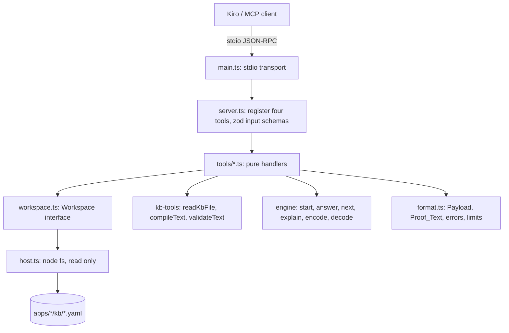

# Design Document: mcp-server

## Overview

`@dead-certain/mcp` is a small stdio MCP server over two packages that already exist: the engine and kb-tools. It has four read-only tools. It adds no inference and no parsing of its own. Its job is to turn a KB_Ref and some answers into the engine's own results, in JSON a language model can read.

Three decisions shape it.

1. **Compile from YAML on every call.** The server never reads `kb/dist`. Kiro uses it while writing rules, so the file on disk is the truth, and a stale compiled JSON would answer for rules that are no longer there. A knowledge base is at most 1 MiB and compiles in milliseconds.
2. **Stateless tools.** `consult` takes the whole set of answers (or a Replay_Token) each time. The server holds no session. Two clients, or one client after a restart, get the same result.
3. **Pure core, thin shell.** Every tool is a pure function `(workspace, args) => Payload` over an injected `Workspace`. The SDK wiring is a few lines that call them. Tests drive the pure core with a temporary workspace and, once, the real stdio process.

This spec is executed by the Kiro lane. Nothing here touches `packages/engine`, `packages/kb-tools` or any Claude Code path.

### Findings from reading the repo

| Finding | Consequence |
| --- | --- |
| `packages/mcp` does not exist. `.kiro/settings/mcp.json` already names `pnpm -s --filter @dead-certain/mcp start` with `"disabled": true`. | Task 1 creates the package so that exact command works. Task 7 flips `disabled` after the tests pass. |
| `kb-tools` exports `compileText`, `validateText`, `loadText`, `Diagnostic` and `runCli` from `src/index.ts`. It does not export its Node host or its file discovery. | The server has its own 20-line Node host that lists `apps/*/kb/*.yaml`. It does not call `dc` and needs no change to kb-tools. |
| kb-tools is bundled by `vite build` with the engine's TypeScript inlined, because the engine's imports have no file extensions and Node cannot run them. Its `zod` and `yaml` stay external. | The server is bundled the same way: engine and kb-tools inlined, the SDK, `zod` and `yaml` external. `node --experimental-strip-types` cannot run it. |
| The repo has no `@types/node`. Packages declare the few Node names they use and put `// @ts-expect-error TS2591` on `node:*` imports. | The server follows that convention. Open question 1 covers the SDK's own types. |
| `compileText(text, file)` returns `{ ok, kb, json, diagnostics }` and never throws. `validateText(text, file)` returns `{ file, diagnostics, ok }`. `readKbFile(path, file, host)` reads and decodes with the 1 MiB limit and returns a diagnostic instead of throwing. | `load` uses `readKbFile` with the server's Host, then `compileText`. A read or decoding failure becomes a diagnostic. |
| The engine throws only `EngineError` with ten codes. `answer` checks the value against the fact's type, so `consult` need not coerce or validate. `next` also validates the knowledge base and the answers. | Tool errors reuse the engine's codes. The server adds five of its own. |
| `explain` takes a `Session` and a fact and returns a `ProofNode`. `ProofNode.source` is `answered` or `derived` only. | Proof_Text prints `answered` and `derived` as they come. The server does not relabel. |
| `Session` is `{ kb, answers }`. Claim Check replays with `encode`/`decode`, and its link is `#/?r=<token>`. | `consult` returns the Replay_Token so a person can open the same state in the app. |
| Root `vitest.config.ts` includes `packages/**/*.test.{ts,tsx}`, so tests in `packages/mcp` run under `pnpm check` with no change. | No root config edit. |

## Architecture



### Modules

| Module | Responsibility | Pure? |
| --- | --- | --- |
| `src/main.ts` | Create the server over the real Host and connect the stdio transport. Writes nothing else to standard output. | no |
| `src/server.ts` | `createServer(workspace)`: registers the four tools with their zod schemas and annotations, and maps a handler's result to a Tool_Result | yes (given a Workspace) |
| `src/workspace.ts` | `Workspace` interface: `root(): string or undefined`, `listKbFiles()`, `read(path)`. `makeWorkspace(host)` | yes |
| `src/host.ts` | The Node host: `readFileSync`, `readdirSync`, `statSync`, `cwd`. The only file that imports `node:*` | no |
| `src/kbs.ts` | `discover(ws)`, `resolve(ws, ref)` giving `{ ok, file, text }` or a Tool_Error, and `compile(ws, ref)` | yes |
| `src/tools/list.ts` | `listKbs(ws)` | yes |
| `src/tools/consult.ts` | `consult(ws, args)` and the shared `buildSession(kb, answers, token)` | yes |
| `src/tools/explain.ts` | `explainFact(ws, args)` and `proofText(node)` | yes |
| `src/tools/validate.ts` | `validateKbs(ws, args)` | yes |
| `src/payload.ts` | `ok(payload)`, `fail(code, message)`, the size cap, key order, `clip` | yes |
| `src/limits.ts` | The limits of requirement 6.3 and 6.4 | yes |
| `vite.config.ts` | SSR build of `src/main.ts` to `dist/server.mjs` | n/a |
| `bin/start.mjs` | Build if stale, quietly, then import `dist/server.mjs` | no |

### The `start` script

`package.json` has `"start": "node bin/start.mjs"`. The script compares the modification time of `dist/server.mjs` with the newest file under `src/` (and `package.json`). If the bundle is missing or older, it runs `vite build --logLevel silent` as a child process with its standard output sent to standard error, then imports the bundle. Standard output carries nothing but MCP messages (requirement 1.5). `pnpm -s` already silences pnpm's own banner.

This is the only place the package starts a child process, and it does so at build time, not inside the server. Requirement 7.2 is about the server; `bin/start.mjs` is its launcher. A test pins both statements: `src/` imports no `node:child_process`, and `bin/start.mjs` is the only file that does.

## Components and Interfaces

### Tools

All four are annotated `readOnlyHint: true`, `destructiveHint: false`, `idempotentHint: true`, `openWorldHint: false`.

| Tool | Input | Payload |
| --- | --- | --- |
| `list_kbs` | none | `{ kbs: KbEntry[] }` |
| `consult` | `kb`, `answers?`, `token?` | `QuestionPayload` or `VerdictPayload` |
| `explain` | `kb`, `fact`, `answers?`, `token?` | `ExplainPayload` |
| `validate` | `kb?` | `{ results: ValidateResult[] }` |

Input schemas are zod objects, `.strict()`, with the limits of requirement 6.3 (`max` on strings and on the key count through a refinement). The `answers` schema is `z.record(z.string().max(100), z.union([z.boolean(), z.number(), z.string().max(500)]))`. A number that is not finite is refused by the schema (`.finite()`).

Each tool's description is written for a model: what it does, what `kb` must be (and that `list_kbs` gives the valid values), that money is an integer in minor units, that unknown facts are simply left out, and what to do next ("call `explain` with a goal to see why"). The text is short and is part of the task, since it decides how well Kiro uses the tool.

### Data models

```ts
type Json = null | boolean | number | string | Json[] | { [k: string]: Json };

interface KbEntry {            // ok: true
  ref: string; path: string; id: string; currency: string | null;
  goals: string[]; facts: number; askable: number; rules: number; clauses: number; ok: true;
}
interface BrokenKbEntry { ref: string; path: string; ok: false; errors: number }

interface QuestionOut {
  fact: string; text: string; type: FactType; options?: string[];
  why?: string; clause?: string;
}
interface QuestionPayload { status: "question"; question: QuestionOut; answers: Record<string, FactValue>; token: string }
interface VerdictPayload {
  status: "verdict";
  goals: Record<string, FactValue | null>;
  line_items: { fact: string; label: string; role: "deduction" | "check"; value: FactValue | null; rule: string; clause: string }[];
  needed: QuestionOut[];
  answers: Record<string, FactValue>; token: string;
}
interface ExplainPayload {
  fact: string; value: FactValue | null;
  proof: ProofOut; text: string;
  clauses: Record<string, { title: string; text: string }>;
}
interface ProofOut { fact: string; value: FactValue | null; source: FactSource; rule?: string; clause?: string; because?: string; children: ProofOut[] }
interface ValidateResult { ref: string; path: string; ok: boolean; errors: number; warnings: number; diagnostics: Diagnostic[] }
interface ToolError { error: { code: ErrorCode | "NO_WORKSPACE" | "UNKNOWN_KB" | "KB_INVALID" | "LIMIT_EXCEEDED" | "INTERNAL"; message: string } }
```

`undefined` becomes `null` at the boundary (`value ?? null`). `askable` counts facts that are not `derived`. The `Clause` type has a title and a text; the design's `clauses` map reads those two fields as `kb.clauses[id]` holds them.

### `consult` and `explain` in detail

```ts
function buildSession(kb: KnowledgeBase, answers: Answers, token?: string): Session {
  let s = token === undefined ? start(kb) : decode(kb, token);
  for (const [fact, value] of sortedEntries(answers)) s = answer(s, fact, value);
  return s;
}
```

`answers` are applied in sorted key order, after the token, so the token's values are replaced by the explicit ones (requirement 3.3). The engine's `answer` keeps its answers sorted, so the order of application cannot show in the result. The server does not rely on that: it sorts anyway, so a future engine change cannot make the Payload depend on JSON key order.

`consult` calls `next(s)` and shapes the result. `explain` calls `explain(s, fact)` and walks the ProofNode:

```ts
function proofText(n: ProofOut, depth = 0): string {
  const value = n.value === null ? "unknown" : String(n.value);
  const by = n.rule === undefined ? "" : ` by ${n.rule} (clause ${n.clause}): ${n.because ?? ""}`;
  return `${"  ".repeat(depth)}${n.fact} = ${value} [${n.source}]${by}\n` + n.children.map((c) => proofText(c, depth + 1)).join("");
}
```

`clauses` collects every `clause` id in the tree and looks each up in `kb.clauses`. An id with no entry is left out of the map (the engine's validation already refuses a rule that cites a missing clause, so this is defensive).

Proof trees can repeat a subtree (the engine returns an equal subtree at each occurrence, inference-engine 9.12). The text repeats it too. The 200,000-character cap bounds the worst case.

### Error mapping

```ts
function guard(run: () => Payload): ToolResult {
  try { return ok(run()); }
  catch (e) {
    if (e instanceof EngineError) return fail(e.code, e.message);
    return fail("INTERNAL", "The server could not complete this call.");
  }
}
```

An `EngineError` message is already clipped to 500 characters by the engine. `INTERNAL` carries a fixed sentence so no path or stack can leak. The real cause goes to standard error, clipped, with no arguments in it (requirement 7.3 forbids logging arguments).

### Discovery

```ts
interface Workspace {
  root(): string | undefined;                       // nearest pnpm-workspace.yaml upward from cwd
  listKbFiles(): { ref: string; path: string }[];   // apps/*/kb/*.yaml, sorted
  read(path: string): Uint8Array;                   // throws HostError
}
```

`listKbFiles` lists `apps/`, then `apps/<app>/kb/`, and keeps names that end in `.yaml` and are regular files. A symlink is not followed (`lstat`). `resolve(ws, ref)` looks the string up in that list. It never builds a path from the argument, which is why requirement 2.8 and Property 6 hold by construction.

### Stdio hygiene

The SDK's stdio transport owns standard output. `main.ts` does not call `console.log`, and a test fails if `src/` contains `console.log` or `process.stdout`. Standard error is allowed for one start-up line, `dead-certain mcp: ready`, so a person running the command by hand sees something.

## Correctness Properties

*A property holds for every valid input. These are checked with fast-check against temporary workspaces built from generated knowledge bases (the engine's `testkit` arbitraries, written to YAML through kb-tools' printer or built as raw KBs and written as JSON-in-YAML), and once against the real `claim-check/policy`.*

### Property 1: `consult` relays the engine

*For any* knowledge base and any valid Answers, the `consult` Payload carries the same Question, or the same goals and line items, as `next` over the session folded from those Answers.

**Validates: Requirements 3.2, 3.4, 3.5, 8.1**

### Property 2: Answer order does not show

*For any* Answers and any permutation of its keys, `consult` and `explain` return equal Payloads.

**Validates: Requirements 3.7, 8.2**

### Property 3: The Replay_Token round-trips

*For any* Payload from `consult`, `decode(kb, payload.token)` has the Payload's `answers`, and `consult` with only that `token` returns an equal Payload. When `answers` and `token` disagree on a fact, the value in `answers` is the one in the result.

**Validates: Requirements 3.3, 8.3**

### Property 4: `explain` agrees with `consult`

*For any* knowledge base, Answers and goal, the value at the root of the `explain` proof equals the goal's value in the `consult` Payload (or both are unknown), and `value` equals the root's value.

**Validates: Requirements 4.2, 4.3, 8.4**

### Property 5: Handlers are total

*For any* JSON value as arguments (including wrong types, huge strings, `__proto__` keys and non-finite numbers), each handler returns a Tool_Result and does not throw. A Tool_Error has a code from the allowed set and a message of at most 500 characters.

**Validates: Requirements 6.2, 6.5, 8.5**

### Property 6: A KB_Ref reaches only a discovered file

*For any* string used as `kb`, the Host records reads of discovered KB_Files and `pnpm-workspace.yaml` only. A string that is not a discovered KB_Ref gives `UNKNOWN_KB`.

**Validates: Requirements 2.8, 6.6, 7.1, 8.6**

### Property 7: `validate` agrees with `validateText`

*For any* generated YAML text (valid, with a seeded fault, or not YAML at all) written as a KB_File, the diagnostics `validate` returns equal `validateText`'s, in order.

**Validates: Requirements 5.2, 5.3, 5.4**

### Property 8: Payloads are bounded and stable

*For any* call, the Payload is at most 200,000 characters or is `LIMIT_EXCEEDED`, and calling twice with the same arguments gives byte-identical text.

**Validates: Requirements 3.7, 6.3, 6.4**

## Error Handling

| Condition | Result |
| --- | --- |
| No `pnpm-workspace.yaml` upward from the working directory | `NO_WORKSPACE` |
| `kb` is not a discovered KB_Ref | `UNKNOWN_KB`, message lists valid KB_Refs |
| The file does not compile | `KB_INVALID`, message `"<ref> has <n> errors"`, plus `diagnostics` (first 20) in the error body |
| The Engine throws `EngineError` | Same code and message |
| An argument breaks a limit that the schema cannot express (the size of `answers`, a Payload over the cap) | `LIMIT_EXCEEDED` |
| An argument breaks the schema | SDK invalid-params protocol error, handler not run |
| Anything else | `INTERNAL`, fixed sentence |
| `validate` meets an unreadable file | A result with the diagnostic, not an error |

`KB_INVALID` carries the first 20 diagnostics in an extra `diagnostics` field of the error body. The `ToolError` type in the data models gains `diagnostics?: Diagnostic[]` for it.

## Testing Strategy

| Layer | Tool | What |
| --- | --- | --- |
| Pure handlers | Vitest, with a `Workspace` over an in-memory map of files | Each tool's cases, errors and limits |
| Properties | Vitest and fast-check 4.10.2, files `*.props.test.ts`, at least 100 runs, tagged `// Feature: mcp-server, Property N: <title>` | Properties 1 to 8 |
| Real knowledge base | Vitest against `apps/claim-check/kb/policy.yaml` | Golden `G-01` through `consult` and `explain` |
| Stdio smoke | Vitest spawns `node bin/start.mjs` in a temporary workspace, speaks JSON-RPC over the pipes | `initialize`, `tools/list`, one `tools/call` each, clean exit on end of input, standard output holds only JSON-RPC lines |
| Source scan | Vitest reads `src/**` | No `console.log`, no `process.stdout`, no `node:child_process`, no `fetch`, no `writeFile`, `node:*` only in `host.ts` |
| In Kiro | A human-observed session | Requirement 9 |

The first four tasks of the plan run the three beats of test-first: write the test and keep the failing output, write the code, keep the passing output.

### Golden through the server

`G-01` in `apps/claim-check/golden/scenarios.yaml` gives the answers and the expected `payable` (13,200,000 paise) and `outcome` (`reduced`). The test calls `consult` with those answers, expects `status: "verdict"` and those goals, and calls `explain` on `payable` and on `room_rent_deduction` and expects a proof whose leaves are all `answered`. It reads the scenario through kb-tools' golden loader so that a change to the scenario shows here.

## Design decisions

| Decision | Alternatives | Why this one |
| --- | --- | --- |
| Compile YAML on each call | Read `kb/dist`; cache by modification time | Kiro uses the server while editing rules, and `dist` is stale then. The cost is milliseconds. A cache adds a way to be wrong. |
| Stateless `consult` with `answers` and `token` | A session id held in the server | No hidden state, restart-safe, and the Replay_Token already exists and opens the same state in the app. |
| KB_Ref from the discovered list, never a path | Accept a path | Removes the traversal question entirely. |
| Four tools, no `audit` | A fifth tool | Mode agreement makes `consult` over all facts equal to `audit`, and `needed` shows what is open. |
| Engine codes reused in errors | A new error vocabulary | The model sees the same codes the app and the tests use. |
| Both JSON and Proof_Text in `explain` | JSON only | A model reads the outline faster, and the JSON stays exact. |
| Bundle with Vite, build on start | Run TypeScript with a loader; ship a built `dist` | The engine's imports have no extensions, and a loader is a new dependency. A committed `dist` goes stale. |
| Own Node host in `packages/mcp` | Export kb-tools' host | Exporting `node:fs` from the kb-tools index would reach any browser bundle that imports it. The server needs 20 lines. |
| Read-only | Tools that write rules | The `knowledge-engineer` agent is the only writer of `kb/`. A second writer would blur the lane. |
