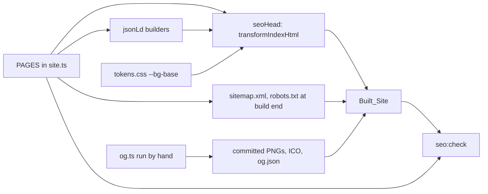

# Design Document: seo

## Overview

Search metadata is data about pages, so it lives in one typed table, `PAGES`, and everything else is generated from it: head tags, the sitemap, the JSON-LD, and the checks that test the output against the same table. Nothing is written by hand twice, and nothing runs in the visitor's browser.

The work comes in four pull requests, in this order:

1. **Head, structured data, sitemap, icons, `seo:check`.** Nothing visible changes.
2. **OG images.**
3. **Prerender and hydration.** After the landing page tasks 9.1 to 9.3 and both app redesigns.
4. **Static rulebook pages.** After prerender, on their own.

Owner decisions (2026-11-26) that shape the design: the author in JSON-LD is an `Organization` named "Dead Certain"; the landing title keeps its full stop; prerender waits for the redesigns; rulebook pages come last.

### Findings from reading the repo

| Finding | Consequence |
| --- | --- |
| `apps/claim-check/index.html`, `apps/pre-flight/index.html`, `apps/site/index.html` and `404.html` each hold a hand-written title, description and (the site) three Open Graph text tags. The apps' descriptions differ from the owner's table. | The plugin owns these tags. The hand-written ones are removed in task 2, or every page would carry two. |
| The apps set `document.title` per screen (`useTitle.ts`: "<heading>. Claim Check"). | The start screen must leave the title as built, or the title a crawler sees after scripts differs from the HTML (requirement 3.3). |
| `packages/ui/src/useMediaQuery.ts` already has `getServerSnapshot` returning `false`. | The responsive switches hydrate without a mismatch. No change needed. |
| `ThemeToggle` reads `data-theme` through `useSyncExternalStore` with no server snapshot, so `renderToString` throws. | The ui-kit task 17 is a prerequisite of prerender (below). |
| CI already checks out with `fetch-depth: 0` in both jobs. | `git log -1 --format=%cs` works in CI. Only a local shallow clone lacks dates. |
| GitHub Pages serves this repository at `/dead-certain/`, a path of the user host. | `robots.txt` under it is not at a host root and is inert (requirement 5.4). |
| The kit has three HTML pages (`kit/index.html`, `shell.html`, `screen.html`). | All use the `kit` key, which is `noindex`. `og.html` joins them. |

## Architecture

### Files

| File | Lane | Purpose |
| --- | --- | --- |
| `packages/ui/src/site.ts` | Claude Code | `ORIGIN`, `BASE`, `REPO`, `PageSeo`, `PAGES`, `absolute`, `headTags`, `jsonLd`, `sitemapXml`, `robotsTxt`. Pure, imports nothing. |
| `packages/ui/src/site.test.ts`, `site.props.test.ts` | Claude Code | Limits, absolute URLs, JSON-LD, sitemap. |
| `scripts/seo-vite.ts` | Claude Code | The `seoHead(pageKey)` plugin and the build-end writer of `sitemap.xml` and `robots.txt`. Shared by the three `vite.config.ts`. |
| `scripts/seo-check.ts` | Claude Code | The Seo_Check behind `pnpm seo:check`. Its parsing and comparison are pure and tested. |
| `scripts/og.ts` | Claude Code | Renders the OG images and icons with Playwright from `apps/site/kit/og.html`, and writes `og.json`. Run by hand, not in `pnpm build`. |
| `apps/site/kit/og.html`, `apps/site/src/kit/og.tsx` | Claude Code | The noindex fixture page that draws the three images. |
| `apps/site/public/og/*.png`, `og.json`, `apps/site/public/{favicon.ico,apple-touch-icon.png,icon-192.png,icon-512.png}` | Claude Code | Committed assets. |
| `apps/*/public/manifest.webmanifest` or generated | Claude Code | One per app. |
| `apps/*/src/entry-server.tsx`, `scripts/prerender.ts` | Claude Code | Prerender (task 11 on). |
| `apps/*/src/main.tsx` | Claude Code | `hydrateRoot` or `createRoot` (requirement 9.3). |
| `.github/workflows/ci.yml` | Claude Code | Runs `pnpm seo:check` after the build. |

### Flow



## Components and Interfaces

### Site_Config

```ts
export const ORIGIN = "https://chitrakumarsai.github.io";
export const BASE = "/dead-certain/";
export const REPO = "https://github.com/chitrakumarsai/dead-certain";

export type PageKey = "home" | "claimCheck" | "preFlight" | "kit" | "notFound";

export interface PageSeo {
	path: string; // relative to BASE; "" is the home page; never "#" or "?"
	name: string; // the page's own name, for JSON-LD and manifests
	title: string; // at most 60
	description: string; // at most 155
	index: boolean;
	ogImage?: string; // relative to BASE; set in task 8, required for an indexable page from then on
	ogAlt?: string; // at most 125
}

export const PAGES: Record<PageKey, PageSeo>;
export function absolute(path: string): string; // new URL(path, ORIGIN + BASE).href, throws on "#", "?" or a path that leaves BASE
export function headTags(key: PageKey): HeadTag[];
export function jsonLd(key: PageKey): string | null; // serialised, "<" escaped as \u003c
export function sitemapXml(entries: { key: PageKey; lastmod?: string }[]): string;
export function robotsTxt(): string;
```

`absolute` throws on a hash or query so the rule in requirement 1.4 is enforced where the URL is made, not only checked afterwards. The rulebook pages (task 14) add two keys, `policy` and `checklist`, to `PageKey`.

### Seo_Head

`seoHead(key)` returns a Vite plugin. Its `transformIndexHtml` hook returns the tags from `headTags(key)` and the JSON-LD script as `{ tag, attrs, children, injectTo: "head" }` descriptors, so Vite writes them. The `theme-color` values come from `--bg-base` in the dark and light blocks of `tokens.css`, read once with a small parse at config time, so the plugin holds no hex. A `closeBundle` step writes `sitemap.xml` and `robots.txt` into the site's `dist` (the site's plugin only, not the apps').

`lastmod` per page is `git log -1 --format=%cs -- <folders>` where the folders are the page's source (`apps/site/src/landing` for home, `apps/claim-check/{src,kb,rulebook}` and so on). A shallow clone is detected with `git rev-parse --is-shallow-repository`, and `lastmod` is then omitted.

### JSON-LD

The home page holds one `@graph`:

```json
{
  "@context": "https://schema.org",
  "@graph": [
    { "@type": "Organization", "@id": ".../#org", "name": "Dead Certain", "url": ".../", "sameAs": ["<REPO>"] },
    { "@type": "WebSite", "@id": ".../#site", "name": "Dead Certain", "url": ".../", "publisher": { "@id": ".../#org" } },
    { "@type": "SoftwareSourceCode", "@id": ".../#code", "name": "Dead Certain", "codeRepository": "<REPO>", "programmingLanguage": "TypeScript", "license": "https://opensource.org/license/mit", "author": { "@id": ".../#org" } }
  ]
}
```

Each app page holds one `WebApplication` node whose `author` is `{ "@id": ".../#org" }`. The `@id` is a URL with a fragment. That is allowed, because an `@id` names a node and is not a page address, but requirement 1.4 forbids fragments in canonicals and sitemap entries only. The test therefore applies the "no fragment" rule to `canonical`, `og:url` and sitemap `loc`, not to `@id`.

### OG images and icons

`scripts/og.ts` builds the site, serves it with `vite preview` on a free port, opens `kit/og.html#home`, `#claim-check` and `#pre-flight` at a 1200 by 630 viewport with `deviceScaleFactor` 1 and the dark theme, and writes each PNG. The same script draws the four icon sizes from a fixture mark and writes `favicon.ico` (a PNG-in-ICO container, written by hand from the PNG bytes, so no dependency). It writes `og.json`:

```json
{ "home": { "alt": "...", "lines": ["Dead Certain", "LLMs guess. The dead are certain.", "₹1,32,000 of ₹2,10,000 will be paid"] }, ... }
```

The fixture builds each `lines` array from the Hero_Module and the compiled knowledge bases. A Vitest test builds the same arrays with no browser and compares them to the committed `og.json`. This catches stale text. It does not catch a stale drawing, and the review of the pull request looks at the three PNGs.

### Seo_Check

`scripts/seo-check.ts` walks the `dist` of the Built_Site, parses each HTML file's head with a small tolerant parser written for the fixed shape the plugin writes (no HTML parsing dependency), and compares it to `PAGES`. `checkPage(html, key)` returns a list of `{ page, rule, detail }`. The CLI prints one line per item and exits 1 when the list is not empty. From task 11 it also checks `<h1>` count and a non-empty `#root`.

### Prerender (after the prerequisites)

Each of the three pages gets `entry-server.tsx` exporting `render(): string`, which calls `renderToString` on the same root component as the client with the start route. `scripts/prerender.ts` runs after `vite build` and a `vite build --ssr` of the entry, imports the SSR bundle, and replaces `<div id="root"></div>` in the built HTML with `<div id="root">…</div>`. The client entry is:

```ts
const root = document.getElementById("root")!;
const isStart = location.hash === "" || location.hash === "#/";
if (root.hasChildNodes() && isStart) hydrateRoot(root, <App />);
else createRoot(root).render(<App />);
```

The landing page's Hero verdict is computed on the server by the same `audit` call (the engine is pure and deterministic), from the compiled JSON the build already reads.

**Start-screen title.** The start screens skip `useTitle`, so the title stays the built one (requirement 3.3).

**Theme.** The server renders no `data-theme`. The boot script sets it before first paint. Any component whose markup depends on the theme must render both variants and let the tokens choose, or hydration warns. That is the `ThemeToggle` work in ui-kit task 17.

**Why the hash decides the root call.** The server never sees a hash. A visitor who opens `#/report?repo=…` gets a client render of the start markup that does not match the report, so `createRoot` replaces it. Reports and verdicts are never prerendered, which is also why no private repository name can reach a built file.

### Static rulebook pages

`apps/claim-check/src/screens/Rulebook.tsx` and its Pre-Flight counterpart already render the clauses from the compiled knowledge base. Task 14 extracts the clause list into a component both the screen and the static page use, renders the static page with the prerender step, and adds two keys to `PAGES`. The static page's content is the screen's content, so they cannot disagree.

## Data Models

`PAGES` as in the requirements' table. `og.json` as above. `lastmod` is a `YYYY-MM-DD` string or absent. There is no other data.

## Error Handling

| Case | Behaviour |
| --- | --- |
| A page is built that is not in `PAGES` | The plugin leaves it untouched (a new app must not break the scaffold build), and `seo:check` fails on it in CI. `app-template` requirement 13 adds the entry. |
| `absolute` gets a hash, a query or a path outside `BASE` | It throws. |
| A title or description is over its limit | The unit test fails. The build also fails, since `headTags` throws. |
| `git log` fails or the clone is shallow | `lastmod` is omitted. The build does not fail. |
| `og.json` differs from the computed text | The Vitest test fails with both texts. |
| The prerender throws on a page | The build fails. There is no fallback to an empty `#root`, because that would hide a hydration problem. |
| Hydration finds a mismatch | The Playwright console gate fails. |

## Correctness Properties

### Property 1: Head tags are complete and single

*For any* valid `PageSeo`, `headTags` holds exactly one title, one description and one robots meta; for an indexable page exactly one canonical, equal to `absolute(path)` and without `#` or `?`, the complete Open Graph and Twitter sets, and `og:url` equal to the canonical; for a non-indexable page `noindex` and no canonical.

**Validates: Requirements 3.3, 4.1, 4.2, 4.3, 1.4**

### Property 2: JSON-LD round-trips and cannot close the script

*For any* strings used as names and descriptions, the serialised JSON-LD parses back to an equal object, contains no raw `<`, and has no node of `@type` `Person`.

**Validates: Requirements 6.3, 6.4, 1.3**

### Property 3: The sitemap lists exactly the indexable pages

*For any* `PAGES`-shaped record, `sitemapXml` has one `<url>` per indexable page and none for a page with `index` false, every `<loc>` is absolute and fragment-free, and a `lastmod`, when present, matches `YYYY-MM-DD`.

**Validates: Requirements 5.1, 5.2, 1.4**

### Property 4: `absolute` stays inside the base

*For any* path without `#` or `?` that does not climb out of `BASE`, `absolute(path)` starts with `ORIGIN + BASE`; for any path with `#` or `?`, it throws.

**Validates: Requirements 2.1, 2.4, 1.4**

### Property 5: The checker agrees with the builder

*For any* page the builder writes, `checkPage` returns no item; and for any single tag removed, duplicated or altered, it returns at least one item naming that rule.

**Validates: Requirements 8.2, 8.4**

## Testing Strategy

| Layer | Tool | What |
| --- | --- | --- |
| Config and builders | Vitest | Limits, uniqueness, `absolute`, the head list per page, JSON-LD content, sitemap and robots text |
| Properties | Vitest and fast-check 4.10.2, `*.props.test.ts`, at least 100 runs, tagged `// Feature: seo, Property N: <title>` | Properties 1 to 5 |
| Assets | Vitest | PNG signature, width and height from the IHDR, size limits, `og.json` against the computed text |
| Built site | `pnpm seo:check` in CI after `pnpm build` | Requirement 8 |
| Page | Playwright | The title after load equals the built title; the head has the tags in the browser; with JavaScript off the prerendered page shows the headline, the verdict and the app links; no hydration warning in the console at 390, 768, 1280, dark, light and reduced motion |
| Privacy | Existing Playwright request and storage listeners | Unchanged and green (requirement 1.2) |
| Accessibility | axe | Zero violations on the prerendered pages and the rulebook pages in both themes |
| Manual | Lighthouse once on the prerendered landing page | LCP element and score recorded in the pull request |

### Evidence

Every task ends with Task_Evidence. Pull request 1 also attaches `pnpm seo:check` output. Pull request 2 attaches the three PNGs at full size and their byte sizes. Pull request 3 attaches the Lighthouse run and the JavaScript-off screenshots of the three pages. Pull request 4 attaches the two pages in both themes at the three widths.

## Design decisions

| Decision | Alternatives | Why this one |
| --- | --- | --- |
| One `PAGES` table in `packages/ui/src/site.ts` | A new shared package; per-app config | Both apps and the site already depend on `@dead-certain/ui`, and a package needs approval. The file imports nothing, and scripts import it by relative path. |
| An in-house Vite plugin | `vite-plugin-*` packages | No dependency is allowed. `transformIndexHtml` is a few dozen lines. |
| Remove the hand-written tags | Keep them and skip duplicates | One owner of each tag. The check can then require exactly one. |
| `lastmod` omitted when shallow | Use today's date; use a fixed date | A wrong date misleads a crawler. CI has full history, so the deployed file is right. |
| Keep `robots.txt` though inert on the project URL | Drop it | A custom domain makes it live with no change. `noindex` rides on the meta, which works now. |
| `theme-color` from the tokens | A hex in the plugin | Requirement 32.1 of the kit: no hex outside `tokens.css`. |
| `display: "browser"` in the manifests | `standalone` | These are web pages, not installable apps. The manifest exists for the icons and the colour. |
| Check text in `og.json`, not pixels | Pixel baselines | No committed baselines (kit rule). The text is what goes stale. |
| `hydrateRoot` only on the start route | Always hydrate | The server never sees a hash. A mismatch on a report link would warn and flash. |
| Prerender by splicing a string at build end | An SSR framework | No dependency, and the three pages are small. |
| Prerender waits for the redesigns | Prerender first | The markup would be built twice. Owner decision 3. |
| Static rulebook pages last and apart | With prerender | They add two routes, a component extraction and a build step. A failure there should not hold back prerender. Owner decision 4. |
| Descriptions carry no counts | "Nine checks" | The checklist has 10 clauses and the app's item count was not confirmed. A count goes stale. |
| The `home` title keeps its full stop | A colon, as the brief wrote | Owner decision 2. Both are 47 characters. |

## Open points for the review of each pull request

- Whether `og:image:alt` texts read well aloud. They are written in task 8.
- The first `seo:check` run on the live build may find a page the plugin does not know (a fixture page). Each such page gets the `kit` key or is excluded by name in the check, and the choice is recorded in the pull request.
