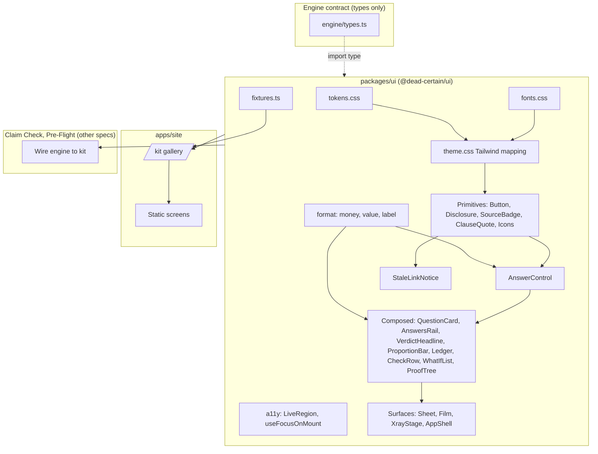
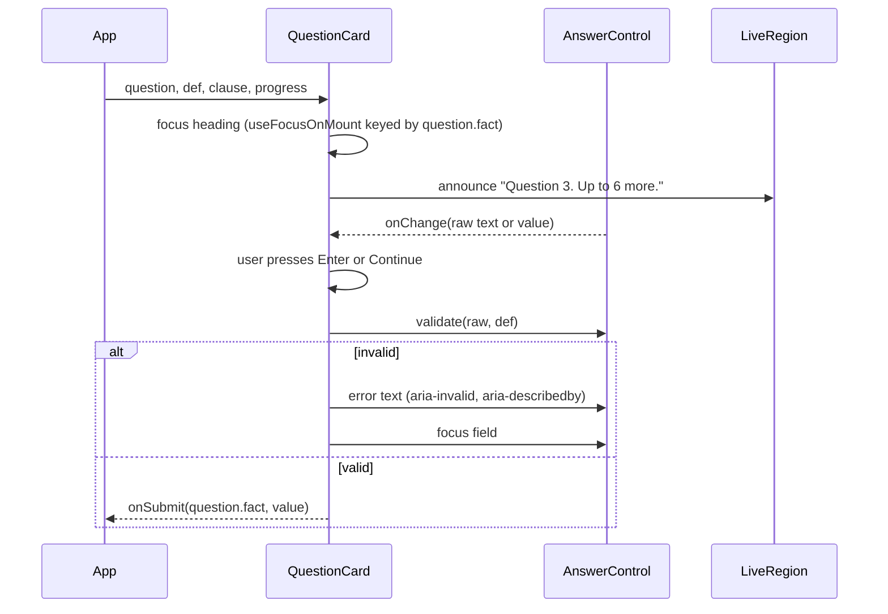
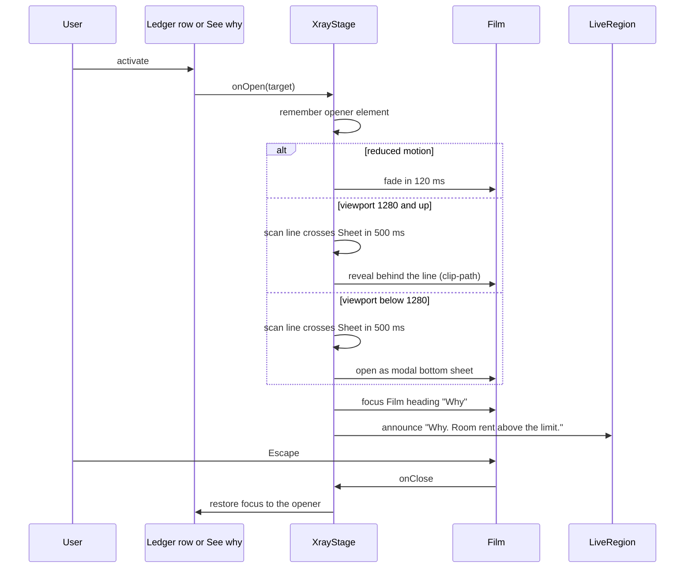

# Design Document: ui-kit

## Overview

The ui-kit is the shared design system for Dead Certain: the package `@dead-certain/ui` (`packages/ui`) plus the `/kit` gallery in `apps/site`. It turns section 8 of `docs/BUILD_PLAN.md` and `.kiro/steering/design-system.md` into design tokens, self-hosted fonts and fourteen React components. Claim Check, Pre-Flight and the site all build on it.

The kit is a presentation layer over the engine contract in `packages/engine/src/types.ts`. Components accept the contract's own types (`Question`, `Verdict`, `LineItem`, `ProofNode`, `Alternative`, `FactDef`, `Clause`) and never compute a decision. The kit imports **types only** from `@dead-certain/engine/types`, so no engine code enters the UI bundle and the apps stay in charge of calling the engine. Anything the contract does not carry (short labels, units, "why was this skipped", rule expressions, the deciding sentence of a clause) enters as an explicit prop or an open question. The kit never edits `types.ts`.

Two materials organise everything. **Paper** (`Sheet`) is for asking and answering. **Film** (`Film`) is for proof. The one choreographed moment is the X-ray develop, owned by a single composed piece, `XrayStage`. Everything else is quiet.

This spec is implemented by the Claude Code lane. Kiro writes the spec only. The design is written for a reader who will execute it one small task at a time: tokens first, then primitives, then composed components, then the gallery and static screens. Each task ends with screenshots at 390, 768 and 1280 px, a read of the browser console, and an axe run.

### Findings from reading the repo

These facts shaped the design.

| Finding | Consequence |
| --- | --- |
| `packages/ui` exists with `package.json`, `src/fixtures.ts` and `src/fixtures.test.ts`. `tokens.css` does not exist. | Fixtures are already owned by Claude Code and are **extended**, not created. `tokens.css` is the first task. |
| `fixtures.ts` imports from `@dead-certain/engine/types`, uses paise (`210_000_00`), and its ledger test asserts claimed minus deductions equals payable. | Every new fixture keeps this arithmetic. Fixtures are annotated with contract types so a contract change breaks compilation. |
| `apps/site` has only a placeholder `index.html`, `src/placeholder.css` and a Vite config with `base: "/dead-certain/"`. No React, no Tailwind. | The site gains React, Tailwind and a second entry for `/kit/`. The placeholder at `/` is untouched. |
| `Question` has no field type and no options. The type lives in `FactDef`. | `QuestionCard` and `AnswerControl` take `def: FactDef` next to `question: Question`. |
| `LineItem.label` always exists and `FactDef.label` is optional. The engine derives a label by replacing underscores and capitalising. | The ledger and check rows print `LineItem.label` verbatim. The answers rail uses `FactDef.label ?? humanize(fact)`, where `humanize` copies the engine rule. |
| `ProofNode.because` arrives with placeholders already filled (the fixture shows "₹6,000"). | The kit renders `because` as text. It does not format placeholders. |
| `ProofNode` carries a rule id, not the rule's expression. | The "Show the rule" text arrives as a prop built by the app (`print(expr)` from the engine). The kit stays free of engine runtime code. |
| `Clause` has `id`, `title`, `text` and no "deciding sentence". | `ClauseQuote` takes an optional `mark` substring. See open question Q5. |
| `EngineError` has ten codes. `KB_MISMATCH` means a replay link was made under different rules. `ErrorCode` is exported as a type from `@dead-certain/engine`. | The stale-link state is designed for `KB_MISMATCH`, with `MALFORMED_TOKEN` and `UNSUPPORTED_VERSION` as its siblings. A compile-time check ties the kit's union to `ErrorCode`. |
| Contrast, computed from the steering tokens: `hairline` on `paper` is **1.48:1**. `focus-paper` on `lightbox` is 4.10:1. `wax` on `paper` is 1.67:1. | `hairline` is decorative only. Control boundaries use `ink-soft` (7.06:1 on paper). `wax` is only ever a fill behind `ink` or `film` text, or a stroke. |
| The wireframe puts "Question 3. Up to 6 more." above the question heading. The steering file refuses "caption above headings". | The kit places the progress line **below** the heading and ties it with `aria-describedby`. See Q3. |

## Architecture



### Principles that drive the structure

1. **Presentational and controlled.** A component renders what it is given and reports intent through callbacks (`onSubmit`, `onOpen`, `onChange`). It owns no engine session and no routing.
2. **Types only from the engine.** `import type` from `@dead-certain/engine/types`. A lint rule (Biome `noRestrictedImports`, or a test that scans imports) fails the build on a runtime import of `@dead-certain/engine`.
3. **Tokens are the only source of color, size and spacing.** Tailwind's default palette and off-scale spacing are removed from the theme, so a hardcoded value cannot compile into a class.
4. **Surfaces set context, components inherit it.** `Sheet` sets `data-surface="paper"` and `Film` sets `data-surface="film"`. CSS custom properties (`--text`, `--text-soft`, `--focus`, `--rule`) change with the surface. A component never asks "am I on film?" in JavaScript.
5. **State is never color alone.** Every verdict, check and source state has a word and a distinct icon shape.
6. **Motion is rationed.** `motion` is imported by `XrayStage` only. Every other transition is CSS and uses the motion tokens.

### Package layout

```text
packages/ui/
├── package.json              # exports: ".", "./fixtures", "./styles.css", "./tokens.css"
├── tokens.css                # custom properties, both surfaces, motion, type
├── theme.css                 # Tailwind @theme mapping; removes default palette and spacing
├── fonts.css                 # @fontsource imports, fallback metric faces
├── print.css                 # one-page verdict (optional task, built last)
├── styles.css                # imports fonts, tokens, theme, print in order
└── src/
    ├── index.ts              # public exports
    ├── fixtures.ts           # EXISTS. Extended by tasks, never replaced
    ├── fixtures.test.ts      # EXISTS
    ├── contract.test.ts      # type-level checks against engine types
    ├── tokens.contrast.test.ts
    ├── format/               # money.ts, value.ts, label.ts (+ tests)
    ├── a11y/                 # LiveRegion.tsx, useFocusOnMount.ts, useReducedMotion.ts
    ├── icons/                # hand-drawn inline SVG (see Q4)
    ├── components/
    │   ├── Button.tsx  Disclosure.tsx  SourceBadge.tsx  ClauseQuote.tsx
    │   ├── Sheet.tsx  Film.tsx  AnswerControl.tsx  QuestionCard.tsx
    │   ├── AnswersRail.tsx  VerdictHeadline.tsx  ProportionBar.tsx
    │   ├── Ledger.tsx  CheckRow.tsx  WhatIfList.tsx
    │   ├── ProofTree.tsx  proofTreeState.ts   # pure reducer, unit tested
    │   ├── XrayStage.tsx  AppShell.tsx  StaleLinkNotice.tsx
    └── verdictState.ts       # goal value -> VerdictState mapping

apps/site/
├── index.html                # EXISTS, placeholder, untouched
├── kit/index.html            # NEW entry: /dead-certain/kit/
└── src/kit/                  # gallery: main.tsx, Specimen.tsx, sections/*, screens/*
```

The gallery uses a second HTML entry (Vite multi-page build) instead of a router. `/kit/` is a real path on GitHub Pages and needs no dependency. The apps keep their hash routing for verdict links.

### Components added beyond the steering list

The steering file lists fourteen components. Four more are needed to deliver the described behaviour. All are rendered in the gallery. Q1 asks the human to approve them.

| Addition | Why it is needed |
| --- | --- |
| `XrayStage` | The develop transition, focus handoff and the desktop/phone split need one owner. |
| `AppShell` | The layout structure in the steering file: header, nav, skip link, rail slot, live region, footer. |
| `WhatIfList` | Renders `Alternative[]` ("What would change this"). The user brief names `Alternative`. |
| `StaleLinkNotice` | The state for a replay link the engine rejects with `KB_MISMATCH`. |

`LiveRegion` and the icon set are internal helpers, exported but not specimens in their own right.

## Sequence Diagrams

### Asking one question



### Developing the X-ray



## Design tokens

`packages/ui/tokens.css` holds every value as a CSS custom property. `theme.css` maps them into Tailwind. Values are copied from the steering file. They are not re-derived.

### Color and surface context

```css
:root {
  color-scheme: light;               /* no global dark mode, ever */

  --lightbox: #EDF2F3;  --paper: #FCFEFE;  --ink: #13222C;  --ink-soft: #4A5A64;
  --hairline: #C9D5D9;  --film: #0B1C26;   --bone: #DCE8EB;  --bone-soft: #8FA6AE;
  --wax: #F2C12E;
  --paid: #1B6E46;      --reduced: #8A5200; --denied: #A8261C;
  --focus-paper: #1F6FEB;  --focus-film: var(--wax);

  /* Surface context. Paper is the default. */
  --surface: var(--paper);  --text: var(--ink);  --text-soft: var(--ink-soft);
  --control-border: var(--ink-soft);   /* 7.06:1, meets the 3:1 floor for controls */
  --divider: var(--hairline);          /* decorative only */
  --focus: var(--focus-paper);
}
[data-surface="film"] {
  --surface: var(--film);  --text: var(--bone);  --text-soft: var(--bone-soft);
  --control-border: var(--bone-soft);  --divider: var(--bone-soft);
  --focus: var(--focus-film);
}
:focus-visible { outline: 2px solid var(--focus); outline-offset: 2px; }
```

The remaining tokens:

| Group | Tokens |
| --- | --- |
| Spacing | `--space-1` 4, `-2` 8, `-3` 12, `-4` 16, `-6` 24, `-8` 32, `-12` 48, `-16` 64, `-24` 96 (px). The numeric suffix matches Tailwind's default key, so `p-4` is 16 px. |
| Radius | `--radius-paper` 4px, `--radius-control` 6px, `--radius-film` 8px |
| Layout | `--column-max` 680px, `--rail-width` 240px, `--touch-min` 44px |
| Motion | `--ease` `cubic-bezier(0.2, 0, 0, 1)`, `--dur-press` 120ms, `--dur-panel` 200ms, `--dur-xray` 500ms, `--dur-reduced` 120ms |
| Type | Families `--font-doc`, `--font-sys`, `--font-mono`. Sizes `--text-doc-body` 17/28, `--text-doc-fine` 14/22, `--text-verdict` 48/56 (36/44 below 768), `--text-sys-body` 17/26, `--text-question` 24/32 (21/28 below 768), `--text-sys-small` 14/20, `--text-mono` 14/22 |
| Breakpoints | 390 (base, holds to 320), 768, 1024, 1280 |

Rules the tokens enforce:

- **Reduced motion.** Under `prefers-reduced-motion: reduce`, `--dur-panel` becomes `0ms` and the scan line is not rendered. Button press stays a 120 ms colour change because it is not movement. The film uses a 120 ms fade.
- **Hairline is decorative.** `--hairline` (1.48:1 on paper) may draw the paper border and dividers. A control's boundary uses `--control-border`.
- **Wax is never text.** It is a fill behind `ink` text on paper (9.62:1) or `film` text (10.30:1), a stroke, or a focus ring on film (10.30:1 on `film`).
- **Money figures.** A utility class `.figures` sets `font-variant-numeric: tabular-nums lining-nums`. Every component that prints an amount uses it.
- **Forced colors.** Focus uses `outline`, so it survives Windows high-contrast mode. Borders and icons use `currentColor` or system colors under `@media (forced-colors: active)`.

### Contrast table (automated)

`tokens.contrast.test.ts` parses `tokens.css` and checks every pair below. Ratios were computed from the steering values.

| Foreground on background | Ratio | Floor | Use |
| --- | --- | --- | --- |
| `ink` on `paper` | 16.05 | 4.5 | Body text |
| `ink` on `lightbox` | 14.38 | 4.5 | Text on the page background |
| `ink-soft` on `paper` | 7.06 | 4.5 | Secondary text, control borders |
| `ink-soft` on `lightbox` | 6.33 | 4.5 | Secondary text on the page background |
| `bone` on `film` | 13.89 | 4.5 | Film text |
| `bone-soft` on `film` | 6.81 | 4.5 | Film secondary text |
| `paid` on `paper` | 6.16 | 4.5 | State word and icon |
| `reduced` on `paper` | 6.31 | 4.5 | State word and icon |
| `denied` on `paper` | 7.01 | 4.5 | State word and icon |
| `paid`, `reduced`, `denied` on `lightbox` | 5.53, 5.66, 6.28 | 4.5 | Same, on the page background |
| `ink` on `wax` | 9.62 | 4.5 | Marked sentence on paper |
| `film` on `wax` | 10.30 | 4.5 | Marked sentence on film |
| `wax` on `film` | 10.30 | 3 | Focus ring and left rule on film |
| `focus-paper` on `paper` | 4.58 | 3 | Focus ring |
| `focus-paper` on `lightbox` | 4.10 | 3 | Focus ring |
| `paper` on `ink` | 16.05 | 4.5 | Primary button label |
| `hairline` on `paper` | 1.48 | none | Decorative only. The test asserts that no control or text uses it |

## Fonts

IBM Plex Serif, Sans and Mono are self-hosted through `@fontsource` packages, as the steering file requires. No request leaves the origin.

| Face | Weights | Subset |
| --- | --- | --- |
| IBM Plex Serif | 400, 600 | latin |
| IBM Plex Sans | 400, 600 | latin |
| IBM Plex Mono | 400 | latin |

- `fonts.css` imports one per-weight CSS file per face. Only `latin` is imported, to protect the bundle budget. A task checks that `₹` (U+20B9) renders from the chosen subset. If it does not, that face also imports `latin-ext`. Q2 asks for approval of the three packages.
- Fontsource uses `font-display: swap`. A swap changes line metrics and can shift layout. To limit that, `fonts.css` may define three **fallback faces** (`Plex Sans Fallback`, `Plex Serif Fallback`, `Plex Mono Fallback`) built on local system fonts with `size-adjust`, `ascent-override`, `descent-override` and `line-gap-override`. The font stacks end in these fallbacks. A task measures the overrides and records them in a code comment. This is an **optional task, built last** (see Delivery order). Without it the stacks end in plain system fonts. The CLS budget (below 0.05) is measured on the apps in Phase 3, not on the gallery.
- Each app and the site preload the two or three files used above the fold (Sans 400 and 600, Serif 600). The kit documents the `<link rel="preload">` tags. The apps place them.
- A test confirms the built CSS contains no `https://` URL.

## Components and Interfaces

### Shared types

```typescript
import type {
  Alternative, Clause, FactDef, FactSource, FactValue,
  KnowledgeBase, LineItem, ProofNode, Question, Verdict,
} from "@dead-certain/engine/types";

/** What the kit needs to print values. The app takes it from kb.currency. */
export interface FormatContext {
  readonly currency?: string;   // ISO 4217, for money
  readonly locale?: string;     // default: "en-IN" for INR, else "en"
}

export type Surface = "paper" | "film";

export type VerdictState =
  | "paid" | "reduced" | "denied"       // Claim Check
  | "ready" | "not_ready"               // Pre-Flight
  | "undecided";                        // goals unknown, questions still needed

/** The three replay failures a verdict link can hit. Mirrors a subset of the engine's ErrorCode. */
export type ReplayFailure = "KB_MISMATCH" | "MALFORMED_TOKEN" | "UNSUPPORTED_VERSION";
// contract.test.ts: `ReplayFailure extends ErrorCode` (type-only import from "@dead-certain/engine")

export interface AnswerEntry {
  readonly fact: string;
  readonly label: string;       // FactDef.label ?? humanize(fact)
  readonly display: string;     // formatValue(...) built by the app or by formatEntries()
  readonly value: FactValue;
}

export interface SkippedNote {
  readonly fact: string;
  readonly label: string;
  readonly reason: string;      // one line, supplied by the app (see Q7)
}
```

### Primitives

**Button**

```typescript
interface ButtonProps extends Omit<React.ButtonHTMLAttributes<HTMLButtonElement>, "className"> {
  variant?: "primary" | "secondary" | "quiet";   // default "secondary"
  surface?: Surface;                              // default: inherited from context
  children: string | React.ReactNode;             // plain words, no arrows or chevrons in text
}
```

- States: default, hover, pressed (120 ms colour change, no movement, no shadow), focus-visible, disabled. Hover, pressed and focus are captured by Playwright acting on the real control, not by forced-state markup. A disabled button uses `aria-disabled` and stays in the tab order. A reason appears in nearby text, not a tooltip.
- Primary is `ink` fill with `paper` text on paper, and `bone` fill with `film` text on film. Secondary has a `--control-border` outline. Quiet is underlined text.
- Minimum size 44 × 44 px. Radius 6 px.
- A test scans every rendered button label in the gallery against `/[→←↑↓➜»«]/u` and fails on a match.

**Disclosure** (Radix Collapsible)

```typescript
interface DisclosureProps {
  title: string;                 // trigger text, e.g. "Why this question?"
  defaultOpen?: boolean;
  open?: boolean; onOpenChange?: (open: boolean) => void;
  children: React.ReactNode;
}
```

- States: closed, open, hover, focus, disabled-by-reduced-motion (height animation 200 ms, or instant under reduced motion).
- The trigger is a real `<button aria-expanded aria-controls>`. The chevron is an `aria-hidden` icon that rotates by swapping glyphs, not by animating a transform under reduced motion.
- Escape while focus is inside the panel closes it and returns focus to the trigger.
- The trigger keeps one name across a flow (steering copy rule).

**SourceBadge**

```typescript
interface SourceBadgeProps { source: FactSource; surface?: Surface }
```

| `FactSource` | Text | Shape marker |
| --- | --- | --- |
| `answered` | You answered | filled square |
| `collected` | Collected | ring |
| `derived` | Worked out | diamond |

Text is always present. The marker is decoration with `aria-hidden`. The badge uses `--text-soft`, never a state colour.

**ClauseQuote**

```typescript
interface ClauseQuoteProps {
  clause: Clause;                       // id, title, text
  variant?: "plain" | "deciding";       // deciding adds the wax rule
  mark?: string;                        // substring of clause.text to highlight
  surface?: Surface;
}
```

- Heading line: "Clause 4.2  Room rent limit" (System voice, semibold). Body: `clause.text` in the Document voice, 17/28.
- `plain`: 2 px `--divider` left rule. `deciding`: 2 px `--wax` left rule.
- `mark`: when found in `clause.text`, the substring renders in a `<mark>` with `--wax` fill and `ink` text (paper) or `film` text (film). When `mark` is absent or not found, nothing is highlighted and the `deciding` left rule alone shows the deciding clause. The component never guesses a sentence.
- Rendered as `<blockquote>` with a `cite`-labelled heading. Text is never injected as HTML.

**Icons** are inline SVG components with `aria-hidden="true"`, `currentColor` stroke, 2 px stroke and a 24 px grid. Set: `CheckCircle`, `MinusCircle`, `CrossCircle`, `QuestionCircle`, `InfoCircle`, `Chevron`, `Close`, `Menu`. No icon package is added (Q4).

### AnswerControl

```typescript
type AnswerControlProps = {
  fact: string;
  def: FactDef;                       // type and options come from here
  value: FactValue | undefined;
  onChange: (next: FactValue | undefined) => void;
  /** Called when Enter is pressed inside a text-like field. */
  onEnter?: () => void;
  error?: string;                     // plain words, shown under the field
  labelledBy: string;                 // id of the question heading
  unit?: string;                      // number facts only (see Q6)
  min?: number;                       // money facts only, integer minor units, supplied by the app
  format: FormatContext;
  autoFocus?: boolean;
};
```

One component, five bodies chosen by `def.type`:

| `def.type` | Body | Value emitted | Keyboard |
| --- | --- | --- | --- |
| `boolean` | Two large radio buttons, "Yes" and "No", in a Radix RadioGroup styled as buttons | `true` or `false` | Arrow keys move. `1` selects Yes, `2` selects No. |
| `enum` | Radio cards, one per `def.options` entry, label via `humanize(option)` (Q8) | the option string | Arrow keys move. `1` to `9` select the first nine. A tenth or later option is selectable by arrows and click only. |
| `money` | Text input with a currency unit prefix. Digits are grouped as you type. Zero is a valid answer unless the app sets `min` above zero. | integer minor units | Enter calls `onEnter`. |
| `number` | Text input, `inputmode="decimal"`, optional `unit` suffix | `number` | Enter calls `onEnter`. |
| `date` | Native `<input type="date">` | ISO `YYYY-MM-DD` string | Native. Enter calls `onEnter`. |

States for every body: empty, filled, focused, invalid (with message), disabled. Money and number add a "typing" state in which the raw text and the parsed value differ. Money also has a "below minimum" invalid state, reachable only when the app passes `min`.

Accessibility:

- The group or input is labelled by the question heading (`aria-labelledby`). A visible text label is that heading. No placeholder-only labels.
- An error sets `aria-invalid="true"` and `aria-describedby` to the error element. The error text is in the DOM under the field.
- Digit shortcuts act only when focus is on a radio group, or on the card with no text field focused. Digits typed in a text field are always text.
- Money input shows the unit as visible text and is exposed as part of the accessible name ("Rupees"). The unit text comes from `Intl.NumberFormat(...).formatToParts` for the currency symbol and name.

Validation messages (plain words, no apology):

| Condition | Message |
| --- | --- |
| money empty | "Enter an amount." |
| money not a number | "Use digits only, with an optional decimal point." |
| money too many decimals | "Use at most 2 decimal places." (the number comes from the currency) |
| money below `min`, and `min` is 1 (the smallest unit) | "Enter an amount above zero." |
| money below `min`, and `min` is above 1 | "Enter an amount of at least ₹500." (`min` formatted with the currency) |
| number empty or not a number | "Enter a number." |

Without `min`, zero passes validation and emits `0`. The kit has no `allowZero` prop. A KB that needs a positive amount sets `min` through the app (Q9).

| Condition (continued) | Message |
| --- | --- |
| date empty | "Pick a date." |
| boolean or enum empty | "Choose one answer." |

### QuestionCard

```typescript
interface QuestionCardProps {
  question: Question;
  def: FactDef;
  clause?: Clause;                          // looked up by the app from question.clause
  value: FactValue | undefined;
  onChange: (next: FactValue | undefined) => void;
  onSubmit: (fact: string, value: FactValue) => void;   // fires only when valid
  onBack?: () => void;                      // hidden when absent
  progress?: { index: number; moreAtMost: number };      // "Question 3. Up to 6 more."
  externalError?: string;                   // e.g. an engine INVALID_ANSWER message
  format: FormatContext;
}
```

Layout (top to bottom): heading (`<h2 tabindex="-1">`, System 24/32 semibold, 21/28 on phones), progress line (small, `--text-soft`, **below** the heading), `AnswerControl`, error, `Disclosure` titled "Why this question?" containing `question.why` and the `ClauseQuote` (plain), then Back and Continue.

States: asking, invalid, with clause, without clause, without why, first question (no Back), last known question (progress says "Last question").

Keyboard and focus:

- On mount and whenever `question.fact` changes, focus moves to the heading (`useFocusOnMount`). The `LiveRegion` announces the progress line.
- Enter submits when focus is in a text-like field or on the heading. Enter on a button activates that button.
- Digit keys select options as described under AnswerControl.
- Escape closes the open Disclosure.
- Continue is never disabled. Validation runs on submit, so keyboard users receive the reason.

### AnswersRail

```typescript
interface AnswersRailProps {
  answers: readonly AnswerEntry[];
  onChange: (fact: string) => void;             // "change this answer"
  skipped?: readonly SkippedNote[];             // questions that no longer matter
  current?: string;                             // fact being asked now, marked aria-current
}
```

- Presentation: from 1024 px a 240 px `<aside aria-label="Your answers">`. Below 1024 px a `Disclosure` titled "Your answers (3)" sits above the sheet. While the film is open side by side (1280 and up) the rail collapses into the same disclosure (see XrayStage).
- Each answer is a `<button>`: visible "Rent  ₹6,000", accessible name "Change room rent per day, currently ₹6,000".
- Skipped notes render below the list as plain lines: "Pre-existing condition no longer matters. The answers so far decide this without it." They are announced once through the live region when they appear.
- States: empty ("No answers yet."), one or many answers, current marked, with skipped notes.
- Activating an answer calls `onChange(fact)`. The app recomputes and re-renders. The kit shows no spinner.

### VerdictHeadline

```typescript
interface VerdictHeadlineProps {
  state: VerdictState;
  statement: React.ReactNode;          // "₹1,42,500 of ₹2,10,000 will be paid"
  size?: "verdict" | "summary";        // 48/56 or 36/44 (Pre-Flight summary uses 36/44)
  headingLevel?: 1 | 2;                // default 1
}
```

| `VerdictState` | Word | Icon | Colour |
| --- | --- | --- | --- |
| `paid` | Paid in full | CheckCircle | `--paid` |
| `reduced` | Paid in part | MinusCircle | `--reduced` |
| `denied` | Not paid | CrossCircle | `--denied` |
| `ready` | Ready | CheckCircle | `--paid` |
| `not_ready` | Not ready | CrossCircle | `--denied` |
| `undecided` | More answers needed | QuestionCircle | `--text-soft` |

The word and statement sit inside one heading. The state line is System semibold with its icon, and the statement follows in the Document voice. The heading's accessible text reads "Paid in part. ₹1,42,500 of ₹2,10,000 will be paid." The state line is part of the verdict, not a caption above it. The icon is `aria-hidden`. Amounts use `.figures`. Focus moves to this heading when a verdict appears, and the live region announces it.

`verdictState.ts` exports `verdictStateFrom(goalValue: FactValue | undefined, needed: number): VerdictState`. A goal value outside the table above, or `undefined` with questions still needed, gives `undecided`. The mapping table is the only place the vocabulary lives (Q10).

### ProportionBar

```typescript
interface ProportionPart {
  kind: "paid" | "cut";
  value: number;               // integer minor units, >= 0
  label: string;               // "Room rent above the limit"
}
interface ProportionBarProps {
  total: number;               // claimed amount, > 0
  parts: readonly ProportionPart[];
  format: FormatContext;
}
```

- Each part is a flex item with `flex-grow` equal to its value. A remainder item fills `total − sum(parts)`. There is no percentage arithmetic and no rounding. Every non-zero part has `min-width: 2px` so it stays visible.
- Paid is solid `--paid`. Cuts are `--reduced` with a diagonal hatch drawn by an SVG `<pattern>`. The hatch separates cuts from paid without colour. Segments are separated by a 2 px `--paper` gap. No CSS gradient is used.
- The bar is `role="img"` with an `aria-label` that reads every part: "₹1,42,500 paid. ₹38,000 cut for room rent above the limit. ₹29,500 cut for co-payment at age 61 or over."
- States: all paid, paid and one cut, paid and many cuts, nothing paid (all cut), zero parts.
- If `sum(parts) > total`, the bar clamps to `total`, renders no remainder and logs nothing. A unit test pins the behaviour. (The engine's money-bounds property makes this unreachable in a correct KB.)

### Ledger

```typescript
interface LedgerProps {
  claimed: { label: string; value: number };
  items: readonly LineItem[];                    // role "deduction", value in minor units
  payable: { label: string; value: number };
  format: FormatContext;
  selectedFact?: string;                         // row whose proof is open
  onOpen: (item: LineItem, opener: HTMLElement) => void;
}
```

- A semantic `<table>` with a visually hidden caption ("Claim ledger"). Row headers are `<th scope="row">`.
- Columns: label (`LineItem.label`), clause (`LineItem.clause`, Machine voice), amount (right aligned, `.figures`). Deductions print with U+2212 ("− ₹38,000").
- Each item row holds a `<button>` in the label cell stretched over the row. Accessible name: "Room rent above the limit, clause 4.2, minus ₹38,000. See why". The selected row has `aria-current="true"`.
- `claimed` and `payable` rows are plain text, not buttons. They have a hairline rule between the deductions and the total.
- Edge states: no deductions (only claimed and payable), a deduction of `0` (omitted), `value: undefined` (row reads "Not known yet" and is still openable), many rows (30), long label that wraps at 320 px while the amount never wraps.
- `onOpen` passes the row element so `XrayStage` can restore focus to it.

### CheckRow

```typescript
interface CheckRowProps {
  item: LineItem;                         // role "check"; value true = pass, false = fail, undefined = unknown
  detail?: string;                        // evidence line, e.g. ".gitignore line 12: .kiro/"
  question?: Question;                    // present while value is unknown and the engine needs an answer
  def?: FactDef;
  answerValue?: FactValue;
  onAnswer?: (fact: string, value: FactValue) => void;
  onOpen: (item: LineItem, opener: HTMLElement) => void;
  format: FormatContext;
}
```

| Value | Word (also in the accessible name) | Icon |
| --- | --- | --- |
| `true` | Passed | CheckCircle, `--paid` |
| `false` | Failed | CrossCircle, `--denied` |
| `undefined` | Needs your answer | QuestionCircle, `--text-soft` |

- Row content: icon, `LineItem.label`, rule id in the Machine voice (opens the proof), then the optional evidence line in the Machine voice.
- Unknown state: shows `question.text` and a boolean `AnswerControl` inline. Answering calls `onAnswer`. The row then re-renders from the new verdict.
- A `value` that is not a boolean is rendered as unknown. This keeps a malformed check visible, not hidden.

### WhatIfList

```typescript
interface WhatIfListProps {
  current: Verdict;
  alternatives: readonly Alternative[];
  labelFor: (fact: string) => string;
  defFor: (fact: string) => FactDef | undefined;
  amountGoal?: string;               // money goal; when set, show a signed delta
  stateGoal?: string;                // verdict goal; when set and no amountGoal, show "Not ready to Ready"
  format: FormatContext;
}
```

Each row reads "If room rent per day were ₹5,000: + ₹38,000". The delta is `alt.verdict.goals[amountGoal] − current.goals[amountGoal]`. When there is no money goal, the row names the new verdict state. The list is plain text, with no actions in this version. Empty list renders nothing and no heading.

### ProofTree

```typescript
interface ProofTreeProps {
  root: ProofNode;
  labelFor: (fact: string) => string;
  formatValue: (fact: string, value: FactValue | undefined) => string;
  ruleExpression?: (ruleId: string) => string | undefined;   // built by the app with the engine's print()
  clauseFor?: (clauseId: string) => Clause | undefined;
  decidingClause?: string;                                    // clause id to mark with wax
  onChangeAnswer?: (fact: string) => void;                    // offered on answered facts
  onEscape: () => void;                                       // XrayStage restores focus
}
```

Visual language: rules are **joints** (a circle on the trunk line, rule id in the Machine voice, then the plain sentence from `because`). Facts are **bone ends** (a short stub with a square end, label and value, then a `SourceBadge`). Strokes use `--text-soft` on film.

Nodes: a `ProofNode` with `source: "derived"` and a rule is a joint with children. A `ProofNode` with `source: "answered"` or `"collected"` and no children is a bone end. A derived node without a rule (should not occur) renders as a bone end with the source badge.

ARIA tree pattern:

- Container `role="tree"` with an accessible name ("Proof"). Every node `role="treeitem"` with `aria-level`, `aria-setsize`, `aria-posinset`. Parents add `aria-expanded`. Children sit in `role="group"`.
- Roving tabindex. Exactly one treeitem has `tabindex="0"`.
- Keys: Down and Up move through visible nodes. Right expands a closed parent, or moves to its first child when open. Left collapses an open parent, or moves to the parent. Home and End go to the first and last visible node. Enter toggles expansion of a parent. Escape calls `onEscape`.
- The "Show the rule" `Disclosure` and the "Change this answer" `Button` live inside the active treeitem. They are in the tab order **only while that treeitem is the active one** (`tabindex` is `0` for the active node's actions and `-1` otherwise), so Tab reaches the actions of the focused node and then leaves the tree.
- Node ids are index paths (`"0.1.0"`). A fact can appear under two rules, so a fact name is not unique.
- Initial expansion: the root and its direct children are open. Deeper nodes start closed. `aria-expanded` always reflects the true state.

Value `undefined` prints "Not known yet". A `collected` fact prints the value and "Collected". A node whose clause equals `decidingClause` shows its `ClauseQuote` (deciding variant) under the rule sentence.

### Sheet and Film

```typescript
interface SheetProps {
  as?: "section" | "div" | "article";
  "aria-labelledby"?: string;
  children: React.ReactNode;
}
interface FilmProps {
  title: string;                       // "Why"
  presentation: "side" | "sheet";
  open: boolean;
  onClose: () => void;
  children: React.ReactNode;
}
```

- `Sheet`: `--paper` fill, 1 px `--hairline` border, 4 px radius, padding 16 (phone) or 24 (768 and up), `max-width: var(--column-max)`, `data-surface="paper"`. No shadow.
- `Film`: `--film` fill, no border, 8 px radius, `data-surface="film"`. Its heading is the `title`, `tabindex="-1"`, and a Close button sits beside it.
- `presentation: "side"` renders a non-modal `<section aria-labelledby>` in the layout. `presentation: "sheet"` renders a Radix Dialog (modal, focus trapped, Escape closes, scrim is a flat `--film` tint at fixed opacity, not a gradient) anchored to the bottom, max height 85 vh, scrollable inside.
- Both presentations keep the same inner content so a window resize across 1280 px does not remount the proof tree. `XrayStage` picks the presentation.

### XrayStage

```typescript
type XrayTarget =
  | { kind: "verdict" }
  | { kind: "line"; fact: string };

interface XrayStageProps {
  sheet: React.ReactNode;                  // the paper side
  film: (target: XrayTarget) => React.ReactNode;   // the proof content
  target: XrayTarget | null;               // null = closed
  title: (target: XrayTarget) => string;   // "Why" or "Why: Room rent above the limit"
  onClose: () => void;
  rail?: React.ReactNode;
}
```

Behaviour:

| Viewport | Layout while open | Film |
| --- | --- | --- |
| 1280 and up | Grid of `Sheet` (up to 680 px) and `Film` (rest). The rail collapses into the "Your answers" disclosure. | `presentation: "side"` |
| below 1280 | Sheet only, full width | `presentation: "sheet"` (modal bottom sheet) |

- **Develop.** On the first open, a 2 px `--film` scan line crosses the sheet once in `--dur-xray` (500 ms) with `--ease`. Left to right at 1280 and up, top to bottom below it. The film is revealed behind the line: `clip-path: inset(...)` animates in the same 500 ms. Motion's `LazyMotion` with `domAnimation` and `m` components drives it. `strict` mode catches accidental full-bundle imports.
- **Reduced motion.** No scan line, no slide. The film fades in over `--dur-reduced` (120 ms).
- **Switching target while open** (a different ledger row) swaps the film content at once. No animation, because the develop is the only choreographed motion. Focus moves to the film heading and the live region announces the new title.
- **Focus.** `XrayStage` stores the opener element passed to `onOpen`. When it opens, focus goes to the film heading. When it closes (Escape in the tree, the Close button, or the Dialog's own Escape), focus returns to the opener. If the opener has left the DOM, focus goes to the sheet heading.
- **Print.** The film is hidden by `print.css`.

### AppShell

```typescript
interface AppShellProps {
  appName: string;                                    // "Claim Check"
  nav: readonly { label: string; href: string; current?: boolean }[];
  rail?: React.ReactNode;                             // AnswersRail
  footer?: React.ReactNode;                           // default: "No guesses were made in the production of this verdict."
  children: React.ReactNode;
}
```

- Landmarks: skip link ("Skip to the content") as the first focusable element, `<header>` with the "Dead Certain" wordmark and nav, `<main id="content" tabindex="-1">`, optional `<aside>` for the rail, `<footer>`.
- Phone: nav sits behind a menu button (Radix Collapsible) labelled "Menu". The menu closes on Escape and on navigation.
- Hosts the single polite `LiveRegion` and the `useAnnounce()` hook.
- The footer joke is the only humor in the kit besides a 404 page (not in this spec). The verdict area never jokes.

### StaleLinkNotice

```typescript
interface StaleLinkNoticeProps {
  failure: ReplayFailure;
  onStart: () => void;
  rulebookHref?: string;               // offered for KB_MISMATCH when present
}
```

Replaces the verdict area when `decode` rejects a link. The component is exhaustive over `ReplayFailure` (a `Record<ReplayFailure, Copy>`), so adding a code to the union without copy fails to compile.

| `failure` | Heading | Body |
| --- | --- | --- |
| `KB_MISMATCH` | This link was made with older rules | The rules have changed since this link was made, so the verdict cannot be replayed. Start the check again to get a verdict under the current rules. |
| `MALFORMED_TOKEN` | This link is incomplete or damaged | Check that the whole link was copied, then open it again. Or start the check again. |
| `UNSUPPORTED_VERSION` | This link comes from a different version | This version of the app cannot read it. Start the check again. |

- Primary button "Start the check". With `rulebookHref`, a quiet link "Read the rules".
- Icon `InfoCircle` in `--text-soft`. The tone is neutral: a stale link is not a denial, so no `--denied` colour.
- The heading takes focus on mount and the live region announces the heading. The component is a state inside `<main>`, not a modal and not `role="alert"`.
- The engine's own message is **not** shown. The kit owns the copy so it stays consistent with the copy rules (no apology, says what to do next).

## Data Models

### Fixtures (`packages/ui/src/fixtures.ts`)

The file exists and is owned by Claude Code. Tasks extend it. Each export is annotated with a contract type so contract drift fails to compile. Amounts are integer paise.

| Fixture | Purpose | Status |
| --- | --- | --- |
| `CLAIMED_AMOUNT`, `questionFixture`, `claimVerdictFixture`, `proofFixture`, `preFlightVerdictFixture` | Existing | Keep as is |
| `factDefFixtures: Record<string, FactDef>` | One `FactDef` per control type: `room_rent_per_day` (money), `stay_days` (number), `age` (number), `admitted_on` (date), `pre_existing` (boolean), `room_category` (enum with 4 options), and the check facts | New |
| `questionFixtures: Record<"money"\|"number"\|"date"\|"boolean"\|"enum", Question>` | One question per control, with and without `why` and `clause` | New |
| `clauseFixtures: Record<string, Clause>` | Clause 4.2, 6.1, 1.2, 2.2 with short fictional text. The sample policy does not exist until Phase 2, so the text is written here and marked "sample" in a comment | New |
| `answersFixture: AnswerEntry[]`, `skippedFixture: SkippedNote[]` | Rail states | New |
| `undecidedVerdictFixture`, `paidInFullVerdictFixture`, `deniedVerdictFixture`, `manyDeductionsFixture` (30 lines), `unknownLineFixture`, `zeroDeductionFixture` | Verdict edge states. Each keeps claimed − deductions = payable. | New |
| `preFlightAllPassFixture`, `preFlightUnknownFixture` | Pre-Flight edge states | New |
| `deepProofFixture` (4 levels, shared fact under two rules), `collectedProofFixture`, `unknownValueProofFixture`, `hugeProofFixture` (200 nodes) | ProofTree states and performance | New |
| `alternativesFixture: Alternative[]`, `alternativesNoMoneyFixture` | WhatIfList | New |
| `claimFormat: FormatContext` = `{ currency: "INR" }` | Formatting | New |

`fixtures.test.ts` gains checks: every fixture ledger adds up, every `LineItem.rule`/`clause` appears in a proof or clause fixture where claimed, and every proof node id path is unique.

### Verdict state mapping

```typescript
const GOAL_TO_STATE: Readonly<Record<string, VerdictState>> = {
  paid: "paid", reduced: "reduced", denied: "denied",
  ready: "ready", not_ready: "not_ready",
};
```

`reduced` and `not_ready` appear in the existing fixtures. `paid`, `denied` and `ready` are assumed and flagged in Q10.

### Validation rules

- `LineItem.value` for `role: "deduction"` is a non-negative integer of minor units. A non-number is shown as "Not known yet".
- `LineItem.value` for `role: "check"` is `true`, `false` or `undefined`. Other values are treated as `undefined`.
- Money text parses to an integer without floating-point arithmetic (string split on the decimal point).
- `ProportionPart.value` is a non-negative integer. Negative or non-integer values are clamped to `0` in the bar, and the unit test pins this.
- `ProofNode` index paths are the identity of a node. Fact names are display only.

## Algorithmic Pseudocode

Pseudocode uses TypeScript because the stack is fixed.

### Money formatting and parsing

```typescript
function minorDigits(currency: string, locale: string): number {
  return new Intl.NumberFormat(locale, { style: "currency", currency })
    .resolvedOptions().maximumFractionDigits;           // INR 2, JPY 0
}

function formatMoney(minor: number, currency: string, locale = defaultLocale(currency)): string {
  const digits = minorDigits(currency, locale);
  const whole = Number.isInteger(minor / 10 ** digits);
  return new Intl.NumberFormat(locale, {
    style: "currency", currency,
    minimumFractionDigits: whole ? 0 : digits,
    maximumFractionDigits: digits,
  }).format(minor / 10 ** digits);                      // "₹1,42,500" for en-IN
}

type ParseMoney = { ok: true; minor: number } | { ok: false; reason: "empty" | "format" | "decimals" };

function parseMoney(text: string, currency: string, locale: string): ParseMoney {
  const t = text.replace(/[\s,]/g, "");                 // spaces and group separators
  if (t === "") return { ok: false, reason: "empty" };
  if (!/^\d+(\.\d*)?$/.test(t)) return { ok: false, reason: "format" };
  const [int, frac = ""] = t.split(".");
  const digits = minorDigits(currency, locale);
  if (frac.length > digits) return { ok: false, reason: "decimals" };
  const minor = Number(int + frac.padEnd(digits, "0"));  // string concat, no float multiply
  return Number.isSafeInteger(minor) ? { ok: true, minor } : { ok: false, reason: "format" };
}
```

**Preconditions:** `currency` is an ISO 4217 code that `Intl` knows. `minor` is a safe integer.
**Postconditions:** `parseMoney(formatMoney(m, c), c)` returns `{ ok: true, minor: m }` for every non-negative safe integer `m`. `parseMoney` never returns a non-integer.
**Loop invariants:** none.

Formatting uses `Number / 10**digits`, which is exact for amounts well below 2^53 minor units. That covers every sample amount (largest ₹5,00,000.00 = 5 × 10^7 paise).

### Date formatting

```typescript
function formatDate(iso: string, locale = "en-IN"): string {
  // iso is "YYYY-MM-DD". Never build a local-time Date from it.
  const d = new Date(`${iso}T00:00:00Z`);
  return new Intl.DateTimeFormat(locale, { dateStyle: "medium", timeZone: "UTC" }).format(d);
}
```

**Preconditions:** `iso` matches `YYYY-MM-DD` and names a real calendar day.
**Postconditions:** the output depends only on `iso` and `locale`, never on the machine's time zone. The function builds its `Date` from a UTC timestamp and formats with `timeZone: "UTC"`. It never calls `new Date(y, m, d)`, `new Date(iso)` without a `Z`, or any local-time getter.

### Grouping money as you type

```typescript
function reformatMoneyInput(raw: string, caret: number, locale: string):
    { text: string; caret: number } {
  const digitsBefore = countDigits(raw.slice(0, caret));   // digits and the first '.' left of the caret
  const [intPart, frac] = splitAtFirstDecimal(stripGroupSeparators(raw));
  const grouped = groupInteger(intPart, locale);            // "142500" -> "1,42,500"
  const text = frac === undefined ? grouped : grouped + "." + frac;
  return { text, caret: indexAfterNDigits(text, digitsBefore) };
}
```

**Postcondition:** the caret stays after the same count of digits it followed before the edit, so typing in the middle of a number does not jump.

### Proof tree keyboard model (pure reducer)

```typescript
type Key = "ArrowDown" | "ArrowUp" | "ArrowRight" | "ArrowLeft" | "Home" | "End" | "Enter";
interface TreeState { active: string; expanded: ReadonlySet<string> }   // ids are index paths

function visibleIds(root: ProofNode, expanded: ReadonlySet<string>): string[] {
  const out: string[] = [];
  function walk(node: ProofNode, id: string): void {
    out.push(id);
    if (expanded.has(id)) node.children.forEach((c, i) => walk(c, `${id}.${i}`));
  }
  walk(root, "0");
  return out;
}

function treeReduce(root: ProofNode, s: TreeState, key: Key): TreeState {
  const vis = visibleIds(root, s.expanded);
  const at = vis.indexOf(s.active);
  const node = nodeAt(root, s.active);
  switch (key) {
    case "ArrowDown":  return { ...s, active: vis[Math.min(at + 1, vis.length - 1)]! };
    case "ArrowUp":    return { ...s, active: vis[Math.max(at - 1, 0)]! };
    case "Home":       return { ...s, active: vis[0]! };
    case "End":        return { ...s, active: vis[vis.length - 1]! };
    case "ArrowRight":
      if (node.children.length === 0) return s;
      return s.expanded.has(s.active)
        ? { ...s, active: `${s.active}.0` }
        : { ...s, expanded: withId(s.expanded, s.active) };
    case "ArrowLeft":
      return s.expanded.has(s.active)
        ? { ...s, expanded: withoutId(s.expanded, s.active) }
        : { ...s, active: parentId(s.active) ?? s.active };
    case "Enter":
      if (node.children.length === 0) return s;
      return { ...s, expanded: toggled(s.expanded, s.active) };
  }
}
```

**Preconditions:** `s.active` is the id of an existing node. Every id in `s.expanded` names a node with children.
**Postconditions:** the result's `active` is in `visibleIds(root, result.expanded)`. A leaf is never added to `expanded`. The function does not mutate `s`.

### Verdict state

```typescript
function verdictStateFrom(goal: FactValue | undefined, needed: number): VerdictState {
  if (typeof goal === "string" && goal in GOAL_TO_STATE) return GOAL_TO_STATE[goal]!;
  return "undecided";
}
```

**Postcondition:** total over every input. Never throws.

### Opening and closing the X-ray

```pascal
PROCEDURE open(target, opener)
  SEQUENCE
    IF stage.target IS NULL THEN
      stage.opener ← opener
      IF reducedMotion THEN
        film.fadeIn(120 ms)
      ELSE
        scanLine.run(500 ms, direction)       // direction depends on viewport
        film.reveal(500 ms)                   // behind the line
      END IF
    ELSE
      film.swapContent(target)                // no animation
    END IF
    stage.target ← target
    focus(film.heading)
    announce(title(target))
  END SEQUENCE
END PROCEDURE

PROCEDURE close()
  SEQUENCE
    stage.target ← NULL
    IF stage.opener IS attached to the document THEN focus(stage.opener)
    ELSE focus(sheet.heading)
    END IF
  END SEQUENCE
END PROCEDURE
```

**Postcondition:** after `close`, focus is inside the sheet, never on `<body>`.

### Contrast check

```typescript
function luminance(hex: string): number {
  const [r, g, b] = hexToRgb(hex).map((v) => {
    const c = v / 255;
    return c <= 0.03928 ? c / 12.92 : ((c + 0.055) / 1.055) ** 2.4;
  });
  return 0.2126 * r! + 0.7152 * g! + 0.0722 * b!;
}
function contrast(a: string, b: string): number {
  const [hi, lo] = [luminance(a), luminance(b)].sort((x, y) => y - x);
  return (hi! + 0.05) / (lo! + 0.05);
}
```

**Postcondition:** symmetric in its arguments, always at least 1.

## Example Usage

```typescript
// 1. A question, wired by an app (Claim Check spec, not this one).
<QuestionCard
  question={questionFixtures.money}
  def={factDefFixtures.room_rent_per_day!}
  clause={clauseFixtures["4.2"]}
  value={draft}
  onChange={setDraft}
  onSubmit={(fact, v) => setSession((s) => answer(s, fact, v))}
  progress={{ index: 3, moreAtMost: 6 }}
  format={claimFormat}
/>

// 2. A verdict with its ledger and proof.
<XrayStage
  target={target}
  onClose={() => setTarget(null)}
  title={(t) => (t.kind === "verdict" ? "Why" : `Why: ${labelFor(t.fact)}`)}
  sheet={
    <Sheet aria-labelledby="verdict-h">
      <VerdictHeadline state={verdictStateFrom(v.goals.verdict, v.needed.length)}
        statement="₹1,42,500 of ₹2,10,000 will be paid" />
      <ProportionBar total={CLAIMED_AMOUNT} parts={parts} format={claimFormat} />
      <Ledger claimed={{ label: "Claimed", value: CLAIMED_AMOUNT }} items={v.lineItems}
        payable={{ label: "Payable", value: 142_500_00 }} format={claimFormat}
        selectedFact={target?.kind === "line" ? target.fact : undefined}
        onOpen={(item, el) => open({ kind: "line", fact: item.fact }, el)} />
    </Sheet>
  }
  film={(t) => <ProofTree root={explain(session, factFor(t))} labelFor={labelFor}
    formatValue={fmt} ruleExpression={exprFor} onEscape={close} />}
/>

// 3. A stale replay link.
try { session = decode(kb, token); }
catch (e) {
  if (e instanceof EngineError && e.code === "KB_MISMATCH")
    return <StaleLinkNotice failure="KB_MISMATCH" onStart={restart} />;
  throw e;
}
```

## Gallery and static screens

### `/kit` gallery (`apps/site/kit/index.html`)

- One page. A table of contents (skip-linked), then one section per component. Each state is a **specimen**: `<figure data-specimen="ledger-many-rows">` with a heading in System voice, the live component, and a one-line note. A specimen id is `<component>-<state>` in kebab-case, and the page supports `#ledger-many-rows` deep links.
- Paper specimens sit on `--lightbox`. Film specimens sit on `--film` inside a `Film`.
- **Interactive states.** Hover, pressed and focus have no specimens and no forced-state markup. Playwright hovers, presses and focuses the real control and checks the result.
- **Specimen matrix** (every cell is a specimen):

| Component | States rendered |
| --- | --- |
| Tokens | Colour swatches with ratios, type specimens for all seven styles, spacing scale, radii, motion durations |
| Button | primary, secondary, quiet × default, disabled × paper, film |
| Disclosure | closed, open, nested in film |
| SourceBadge | answered, collected, derived × paper, film |
| ClauseQuote | plain, deciding without mark, deciding with mark, mark not found, long text, paper, film |
| AnswerControl | boolean, enum (2 and 6 options, 10 options), money (empty, typing, filled, zero, invalid, below `min`), number (with and without unit), date, disabled |
| QuestionCard | each control type, with and without why and clause, invalid, first question, last question |
| AnswersRail | empty, 3 answers, current, with skipped notes, collapsed (phone), rail (desktop) |
| VerdictHeadline | six states × size verdict and summary |
| ProportionBar | all paid, one cut, many cuts, all cut, zero parts |
| Ledger | normal, no deductions, zero deduction, unknown value, 30 rows, selected row, 320 px wrap |
| CheckRow | pass, fail, unknown with inline question, with evidence, non-boolean value |
| WhatIfList | money, no money, empty |
| ProofTree | collapsed, expanded, deep, shared fact, collected, unknown value, deciding clause, 200 nodes, keyboard focus on each node kind |
| Sheet, Film | paper, film side, film sheet |
| XrayStage | closed, open side (1280), open sheet (below 1280), reduced motion |
| AppShell | desktop with rail, phone with menu closed and open |
| StaleLinkNotice | `KB_MISMATCH`, `MALFORMED_TOKEN`, `UNSUPPORTED_VERSION`, with and without rulebook link |

### Static screens (built on fixtures, no engine)

Rendered inside the gallery under "Screens" and also as their own deep links, so each is screenshot-able at three widths:

1. Claim Check start
2. Claim Check question (money)
3. Claim Check verdict (reduced, with ledger and what-if)
4. Claim Check verdict with X-ray open (side at 1280, sheet at 390 and 768)
5. Pre-Flight report (not ready, with an inline question)
6. Stale link (`KB_MISMATCH`)

Screens use only kit components and fixtures. They do not import the engine at run time. They are the visual baseline the two app specs match.

## Correctness Properties

For all values below, "renders" means the gallery or a pure function produces the result.

### Property 1: Money round trip

For every safe non-negative integer `m` and currency `c` in {INR, USD, JPY}: `parseMoney(formatMoney(m, c), c)` equals `{ ok: true, minor: m }`.

**Validates: Requirements 4.1, 4.2, 4.3, 4.8**

### Property 2: Parse never invents precision

For every string `t`, if `parseMoney(t, c)` is `ok`, then `minor` is a safe integer and `formatMoney(minor, c)` has no more fraction digits than the currency allows.

**Validates: Requirements 4.3, 4.6, 4.7, 4.9**

### Property 3: Reformat keeps the digits

For every raw string and caret, `reformatMoneyInput` returns text whose digits and decimal point equal those of the input, and a caret that follows the same number of digits.

**Validates: Requirements 4.10**

### Property 4: Date formatting never uses local time

Date formatting builds its `Date` from a UTC timestamp and formats with `timeZone: "UTC"`. It never constructs a local-time `Date`. A unit test asserts that for a set of ISO dates, including month and year boundaries, `formatDate` prints the same calendar day that the ISO string names, and a source scan asserts that the format code contains no local-time `Date` constructor or getter (`getDate`, `getMonth`, `getFullYear`, `getHours`, `new Date(y, m, d)`).

**Validates: Requirements 4.11, 4.12, 4.13**

### Property 5: Tree reducer stays on screen

For every proof tree, state and key, `treeReduce(...).active` is in `visibleIds`, and no leaf is ever in `expanded`.

**Validates: Requirements 18.7, 18.8, 18.9, 18.10, 18.11, 18.15**

### Property 6: Tree reducer is pure

For every input, the input state is unchanged after the call.

**Validates: Requirements 18.16**

### Property 7: Tree ids are unique

For every proof tree, `visibleIds` with everything expanded has no duplicates, even when one fact appears under two rules.

**Validates: Requirements 18.13**

### Property 8: Verdict state is total

For every `FactValue | undefined` and every `needed ≥ 0`, `verdictStateFrom` returns a member of `VerdictState` and never throws.

**Validates: Requirements 13.11, 13.12**

### Property 9: Bar parts never exceed the bar

For every `total > 0` and parts, the sum of rendered flex-grow values including the remainder equals `total`, and no value is negative.

**Validates: Requirements 14.1, 14.6, 14.7, 14.9**

### Property 10: Colour is never the only signal

For every `VerdictState`, check state and `FactSource`, the rendered output contains a word and an icon or marker element.

**Validates: Requirements 13.1, 13.2, 13.3, 13.4, 13.5, 13.6, 8.1, 8.2, 8.3, 16.1, 16.2, 16.3, 26.6, 26.9**

### Property 11: Contrast floor

For every pair in the contrast table, the computed ratio meets its floor. `hairline` is used by no text and no control border.

**Validates: Requirements 2.1, 2.2, 2.3, 2.4**

### Property 12: No refused patterns

The built CSS contains no `box-shadow` other than `none`, no `linear-gradient`, `radial-gradient` or `conic-gradient`, no `text-transform: uppercase`, no `prefers-color-scheme: dark`, and no `https://` URL. No rendered button label contains an arrow glyph.

**Validates: Requirements 2.5, 2.6, 2.7, 2.8, 2.9, 2.10, 2.11**

### Property 13: No runtime engine import

No file under `packages/ui/src` (tests excepted) imports a value from `@dead-certain/engine`.

**Validates: Requirements 5.1, 5.2**

### Property 14: Ledger arithmetic is displayed, not computed

For every fixture verdict, `claimed − sum(deductions) = payable` (the existing fixture test), and the ledger renders each value exactly as `formatMoney` returns it.

**Validates: Requirements 15.2, 15.3, 15.4, 15.13, 23.5**

### Property 15: Focus returns

For every opener, after `XrayStage` opens and closes, `document.activeElement` is the opener, or the sheet heading if the opener is gone.

**Validates: Requirements 20.8, 20.9**

### Property 16: Reduced motion removes movement

Under `prefers-reduced-motion: reduce`, no scan line element exists and the film's only transition is opacity over 120 ms.

**Validates: Requirements 20.5, 27.3, 27.4**

### Property 17: Stale link exhaustive

`StaleLinkNotice` has copy for every member of `ReplayFailure`, and every member is assignable to the engine's `ErrorCode` (compile-time).

**Validates: Requirements 22.1, 22.2, 22.3, 22.4, 5.6**


## Error Handling

### Invalid answer

**Condition:** The user submits an empty or malformed value, or the engine rejects it with `INVALID_ANSWER` or `NON_INTEGER_MONEY`.
**Response:** The message appears under the field in plain words. The field gets `aria-invalid`. Focus returns to the field. Engine messages arrive through `externalError`.
**Recovery:** Editing the field clears the error. Continue is never disabled.

### Stale or damaged replay link

**Condition:** `decode` throws `KB_MISMATCH`, `MALFORMED_TOKEN` or `UNSUPPORTED_VERSION`.
**Response:** The app renders `StaleLinkNotice`. The heading takes focus and is announced. No answers are shown, because none were recovered.
**Recovery:** "Start the check" restarts. For `KB_MISMATCH` the notice offers "Read the rules" when the app passes a link.

### Unknown or unexpected data

**Condition:** a goal value outside the mapping, a check value that is not boolean, a `LineItem.value` of `undefined`, a clause id with no `Clause`.
**Response:** `undecided` state, "Needs your answer", "Not known yet", or the clause id printed as plain text without a quote. Nothing throws and nothing logs. The gallery console must stay clean.
**Recovery:** the next verdict from the engine replaces the data.

### Font failure

**Condition:** a font file fails to load.
**Response:** the metric-matched fallback faces keep the layout in place. CLS stays within budget.
**Recovery:** none needed.

### Narrow and zoomed viewports

**Condition:** 320 px width or 200% zoom.
**Response:** the single column reflows, long labels wrap, amounts never wrap, and the film is a bottom sheet. A Playwright test checks for horizontal scroll at 320 px.

## Testing Strategy

### Unit testing (Vitest, no DOM)

Pure logic only: `format/*`, `verdictStateFrom`, `treeReduce` and `visibleIds`, `reformatMoneyInput`, `partitionBar`, `humanize`, the contrast function and the token parser. `contract.test.ts` uses `expectTypeOf` to prove component props accept `Question`, `Verdict`, `LineItem`, `ProofNode`, `Alternative` unchanged and that `ReplayFailure` extends `ErrorCode`. A source scan test enforces property 13. A CSS scan test enforces property 12.

### Property-based testing

**Library:** fast-check (already pinned for the engine at 4.10.2; the kit reuses that version). Files are named `*.props.test.ts` so `pnpm test:props` picks them up. Properties 1 to 3 and 5 to 9 are property tests. Property 4 is a plain unit test plus a source scan, not a property test, and needs no child process.

### Browser testing (Playwright against the gallery, lane: Claude Code)

- `e2e/kit.spec.ts` visits `/dead-certain/kit/` and, for each `[data-specimen]`, runs the behaviour, console and axe checks at **390, 768 and 1280** px. The three widths are three Playwright projects added to `playwright.config.ts`. The same run can save screenshots at those widths as per-task evidence. It makes no pixel comparison.
- Every test listens for `console` messages of type `error` or `warning` and fails on any. This is the "read the browser console" step as an automated gate.
- axe-core runs on the full gallery page and on each static screen at all three widths, and must report **zero violations** (Q11 covers the adapter).
- Behaviour tests: hover, pressed and focus-visible states on the real controls (hover, press and focus them, then assert the computed style or the focus ring), radio group keys, digit shortcuts, Enter and Escape, tree keyboard model, focus handoff to the heading, focus return from the film, the 44 px target check (`boundingBox` of every interactive element), horizontal scroll at 320 px, and the reduced-motion project (`reducedMotion: "reduce"`).
- **No visual-regression gate.** The kit commits no pixel baselines and CI makes no image comparison. Playwright snapshots are per operating system, so macOS baselines would fail on the Linux CI runner. The CI gates are the behaviour tests, the console check and axe.

### Per-task evidence

Every task ends with: the three screenshots for what it built, the console read (clean), the axe result (zero violations), and `pnpm check` output. The screenshots are attached to the pull request as evidence and are not committed.

### Budgets

- The kit's own JavaScript is **50 kB gzipped or less**, excluding React and React DOM, so each app keeps room. Measured by a script that gzips the built chunks. This is the only size gate in this spec.
- The section 10 performance budgets (load, CLS and the rest) are measured on the apps in Phase 3, not on the gallery, which is not a user-facing page.
- **Optional, built last:** a timing measurement of `ProofTree` with 200 nodes (arrow key to paint under 50 ms in a Playwright trace). The 200-node specimen itself stays in the gallery and is not optional.

## Performance Considerations

- No runtime CSS-in-JS. Styling is Tailwind utilities over CSS variables, so there is no style injection at run time.
- `motion` loads through `LazyMotion` with `domAnimation` and `m` components, and only inside `XrayStage`.
- Radix imports are per package (`react-radio-group`, `react-collapsible`, `react-dialog`) to stay inside the bundle budget.
- Only Latin font subsets and six font files load. Critical files are preloaded by the host page.
- `ProofTree` memoises per-node rows by index-path id so a key press re-renders the two nodes whose state changed.

## Security Considerations

- No network calls from the kit. The only external-looking string allowed is a link `href` passed in by an app.
- No `dangerouslySetInnerHTML`. Clause text, `because` text and engine messages render as text. A test fails on that token in `packages/ui/src`.
- The kit stores nothing: no `localStorage`, no cookies, no analytics. The URL fragment belongs to the apps.
- Dependencies are pinned to exact versions, chosen with `context7` in the first task.

## Dependencies

Stack items are fixed by `tech.md` and the build plan. The human has approved every additional dependency listed below (Q1, Q2, Q11). **Every dependency is pinned to an exact version.** The Claude Code lane picks the versions with `context7` in the first task and records them in `package.json`. No range specifiers (`^`, `~`) are allowed.

| Package | Where | Status |
| --- | --- | --- |
| `react`, `react-dom`, `@types/react`, `@types/react-dom` | ui, site | In the stack (React). Exact versions to be pinned with `context7` |
| `tailwindcss` (v4 assumed, CSS-first `@theme`) | ui, site | In the stack. Version to pin |
| `@tailwindcss/vite` | site (and later apps) | Approved (Q1). Version picked in task 1 |
| `@vitejs/plugin-react` | site | Approved (Q1). Version picked in task 1 |
| `@radix-ui/react-radio-group`, `@radix-ui/react-collapsible`, `@radix-ui/react-dialog` | ui | In the stack ("Radix primitives"). The three package names are approved (Q1). Versions picked in task 1 |
| `motion` | ui | In the stack. Version to pin |
| `@fontsource/ibm-plex-serif`, `@fontsource/ibm-plex-sans`, `@fontsource/ibm-plex-mono` | ui | Approved (Q2). Versions picked in task 1 |
| `fast-check` 4.10.2 | ui (dev) | In the stack and already used by the engine |
| `axe-core`, `@axe-core/playwright` | e2e | `axe-core` is in the stack. The Playwright adapter is approved (Q11). Versions picked in task 1 |
| Icon set | none | **Not added.** Hand-drawn SVG (Q4) |
| DOM test library (`jsdom`, Testing Library) | none | **Not added.** Component behaviour is covered in Playwright (Q12) |
| Lighthouse | none | **Not used.** Not in the stack. The gallery is not a user-facing page |

## Open Questions

All questions are resolved. None of the decisions changes `packages/engine/src/types.ts`. Where a decision leaves a gap in the contract (Q5, Q6), the app supplies the missing value as a prop and the contract stays as it is.

| # | Question | Resolution |
| --- | --- | --- |
| Q1 | Approve the extra components (`XrayStage`, `AppShell`, `WhatIfList`, `StaleLinkNotice`), and the build dependencies `@tailwindcss/vite`, `@vitejs/plugin-react`, and the three Radix package names? | **Resolved: approved.** Versions are pinned exactly, picked by the Claude Code lane with `context7` in the first task |
| Q2 | Approve `@fontsource/ibm-plex-serif`, `-sans` and `-mono` as static files (weights 400 and 600 for Serif and Sans, 400 for Mono, Latin subset), with `latin-ext` added only if `₹` is missing? | **Resolved: approved** |
| Q3 | The wireframe puts "Question 3. Up to 6 more." above the question. The refusal list bans a caption above a heading. Place it below? | **Resolved: below the heading**, tied by `aria-describedby` |
| Q4 | Hand-draw the eight icons as inline SVG rather than adding an icon package? | **Resolved: hand-drawn** |
| Q5 | Who supplies the deciding sentence of a clause? `Clause` has no field for it. | **Resolved:** the app passes `mark`. Absent means a wax left rule only |
| Q6 | `FactDef` has no unit (for example "days"). | **Resolved:** `unit` prop on `AnswerControl`, supplied by the app |
| Q7 | The engine gives no reason a question was skipped. | **Resolved:** the app writes one line per skipped fact and passes it as `SkippedNote.reason` |
| Q8 | `FactDef.options` are bare strings with no display labels. | **Resolved:** show `humanize(option)` |
| Q9 | Is zero a valid money answer? | **Resolved, default changed: zero is valid.** `AnswerControl` takes an optional `min` (integer minor units) supplied by the app. "Enter an amount above zero." appears only when `min` requires it. There is no `allowZero` prop |
| Q10 | The verdict vocabulary. Fixtures use `reduced` and `not_ready`. `paid`, `denied` and `ready` are assumed. | **Resolved:** the mapping table in `verdictState.ts`. Phase 2 knowledge bases use these strings or the table changes |
| Q11 | Approve `@axe-core/playwright` as the axe adapter? | **Resolved: approved** |
| Q12 | Skip jsdom and Testing Library, and cover component behaviour through Playwright on the gallery? | **Resolved: skip** |
| Q13 | Film is a side panel from 1280 px and a modal bottom sheet below that. Is 1024 to 1279 px better served by a side panel? | **Resolved:** bottom sheet below 1280 |
| Q14 | Pre-Flight checks are grouped but the contract has no group. | **Resolved:** the report screen groups by the clause id's first number and takes titles from an app-supplied map |

## Delivery order (input to the tasks phase)

The tasks document should follow this order. Each slice is one or more tasks small enough to build, screenshot and close alone.

1. **Dependencies.** All approvals are given. The Claude Code lane picks exact versions with `context7`, pins them, and adds the dependencies.
2. **Tokens.** `tokens.css`, `theme.css`, contrast test, refused-pattern test, then the `/kit` page shell with a token specimen section. Site gains React and Tailwind.
3. **Fonts.** `fonts.css` with the `@fontsource` imports, preload notes, `₹` glyph check. The fallback metric faces are deferred to the optional tasks.
4. **Format and pure logic.** `format/*`, `verdictState.ts`, `proofTreeState.ts`, with unit and property tests. No UI yet.
5. **Primitives.** `Button`, `Disclosure`, `SourceBadge`, icons, `ClauseQuote`, `Sheet`, `Film`.
6. **Input.** `AnswerControl` one control type per task (boolean, enum, money, number, date).
7. **Composed.** `QuestionCard`, `AnswersRail`, `VerdictHeadline`, `ProportionBar`, `Ledger`, `CheckRow`, `WhatIfList`.
8. **Proof.** `ProofTree` (reducer first, then rendering, then actions), `XrayStage`, `AppShell`, `StaleLinkNotice`.
9. **Gallery completion and static screens.** Fill the specimen matrix, build the six screens, add the three-width Playwright projects, behaviour tests, and the axe and console gates. No pixel baselines.
10. **Optional tasks, built last, in any order, and dropped first if time runs short:**
    - the fallback font metric faces in `fonts.css`
    - the print styles in `print.css` (cut list item 4)
    - the 200-node `ProofTree` timing measurement (the 200-node specimen is not optional)

Fixtures grow alongside each slice. A fixture is added in the task that first needs it.
